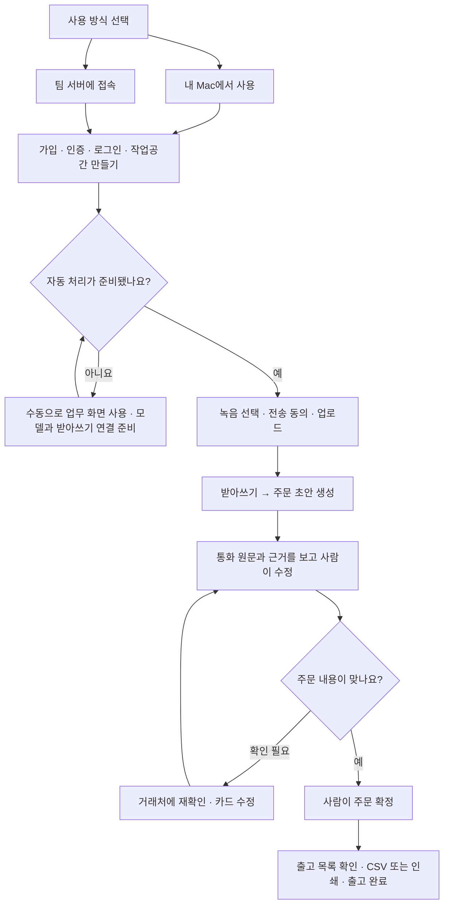

# 인인협 T07 팀 프로젝트

> 인간-인공지능협업제품서비스설계 · T07 생성형 AI 팀 프로젝트

## 설치 에이전트에게 이대로 보내세요

> 이 저장소의 아차를 내 컴퓨터에서 먼저 체험할 수 있게 설치해 줘. Node.js 24가 있는지 확인하고, 아래 **로컬 첫 실행** 순서로 테스트해 줘. 기존 설정과 데이터는 그대로 두고 새 임시 데이터 폴더를 써. Docker, 유료 API, 고객 녹음, 인터넷 공개는 필요 없어. 켜지면 접속 주소와 `/healthz` 결과, 종료 방법을 알려 줘. 실제 모델이 필요하면 이어서 내 Mac 또는 팀 서버 설치 안내를 보고 필요한 것만 준비해 줘. 이 설치 요청만으로 원격 브랜치나 운영 환경을 변경하지 마.

### 로컬 첫 실행: 키 없이 샘플 열기

저장소 루트에서 시작한다. `npm ci`는 최초 의존성 다운로드에 인터넷이 필요하다. Node.js 24가 준비되지 않았으면 먼저 [Node.js 공식 설치 안내](https://nodejs.org/en/download)를 따른다.

```sh
node --version                      # v24.x 확인
cd src/app
npm ci --omit=dev --ignore-scripts --no-audit --no-fund
demo_data="$(mktemp -d)" || exit 1
printf '체험 데이터: %s\n' "$demo_data"
env -i PATH="$PATH" HOME="$HOME" \
  HOST=127.0.0.1 PORT=5600 PUBLIC_BASE_URL=http://127.0.0.1:5600 \
  DEMO_MODE=1 DATA_DIR="$demo_data" AUTH_MAIL_MODE=outbox \
  AI_PROVIDER=fixture ALLOW_PAID_AI=0 node server.mjs
```

- **접속:** [내 컴퓨터에서 아차 열기](http://127.0.0.1:5600/). 별도 터미널에서 `curl -fsS http://127.0.0.1:5600/healthz`로 기동을 확인한다. 포트가 이미 사용 중이면 기존 프로세스를 끄지 말고, 빈 포트로 `PORT`·`PUBLIC_BASE_URL`·접속 주소를 함께 바꾼다.
- **범위:** 샘플 통화와 주문 화면을 체험한다. 실제 받아쓰기·메일 발송·AI 모델 연결은 이 방식에 포함되지 않는다. 외부에 포트를 열지 않는다.
- **종료:** 실행 터미널에서 `Ctrl+C`. 출력한 임시 경로만 정리하면 된다. 기존 `.env`와 작업공간은 읽거나 변경하지 않는다.
- **실사용:** [Mac 소스 설치](docs/mac-app.md) 또는 [팀 서버 자가 호스팅](docs/self-hosting.md). 서명·공증된 일반 설치 파일은 아직 제공하지 않는다.

### 팀 dev 배포는 별도

- 팀 서버의 [배포 구성](ops/server/README.md)은 `origin/dev`를 감시한다. **이 서버에서는 dev 머지가 곧 배포 경로**다. GitHub의 [배포 게이트](.github/workflows/dev-release-gate.yml)는 모의 자료로 검사할 뿐 실제 배포나 운영 백업 복원을 수행하지 않는다.
- dev 반영 전: 정확한 후보 커밋의 CI와 깨끗한 환경에서 첫 실행을 확인한다. 운영 설정은 그대로 두고 최신 데이터 백업을 격리 복원하여 관리자·기존 주문/통화·권한이 보존되는지 확인한다.
- dev 반영 후: [배포 상태](https://t07.3-39-67-126.sslip.io/status.json), [헬스 체크](https://t07.3-39-67-126.sslip.io/healthz), GitHub dev의 커밋을 대조한다. 이어서 작업공간과 주문 화면의 읽기 동작을 확인한다. 헬스 체크 실패의 자동 롤백은 앱 버전 기준이며, 실제 데이터 복원을 대신하지 않는다.

## 한 줄 소개
**아차** — 자동차 부품 대리점이 전화로 받은 주문을 받아 적다가 빠뜨리거나 다시 묻는 일을 줄이는 AI. 통화를 글로 받아 적고 거래처 · 차종 · 부품 · 수량을 주문 카드로 정리해요. 헷갈리는 칸은 그 말을 한 녹음 부분을 바로 들려줘요.

**아차**는 전화 주문을 받아쓰고, 통화 근거가 붙은 주문 초안으로 정리해 **사람의 확인과 출고**를 돕는다. 현재 기본 업종은 자동차 부품 대리점이다.

> 개발 중인 제품이다. 아래 안내는 현재 저장소의 구현 기준이며, 모든 기능이 검증된 정식 배포판을 뜻하지 않는다. 내부 파일명·설정키의 `Ahmatda`/`AHMATDA`는 기존 자료 호환성을 위해 유지한다.

## 처음 쓰는 흐름



AI 초안은 확정 주문이 아니다. 받아쓰기 프로그램이 꺼져 있으면 녹음은 대기하며, 모델이 없으면 자동 정리를 할 수 없다. 처음에는 **실제 고객 자료 대신 가짜 녹음**으로 확인한다.

## 설치 방식 고르기

| | 내 Mac에서 사용 | 팀 서버에서 함께 사용 |
|---|---|---|
| 시작 | 개발용 Mac 앱을 소스에서 빌드 | 설치 담당자가 Node.js 24 서버 준비 |
| 자료 위치 | 내 Mac의 앱 전용 폴더 | 설치 담당자가 운영하는 서버 |
| AI | 준비된 앱 전용 Ollama·Whisper | 서버에 연결한 Ollama·별도 Whisper 일꾼 |
| Docker | 필요 없음 | 선택 사항, Node 직접 실행이 기본 |
| 현재 한계 | 서명·공증된 일반 배포판과 새 Mac 설치 검증 미완 | HTTPS·인증 링크 전달·백업 등 운영 설정 필요 |

Mac 앱의 **팀 서버 열기**는 원격 웹 화면을 여는 기능이다. 내 Mac 자료나 계정을 서버로 자동 옮기거나 동기화하지 않는다. 서버에 연결하면 그 서버의 데이터 처리 정책이 적용된다.

### A. 내 Mac에서 시작하기

현재는 개발용 소스 빌드 경로다. Node.js 24 공식 실행파일과 LICENSE, Xcode Command Line Tools가 필요하다. 검증 기기는 Apple Silicon/macOS 26.6.1이며, 앱 셸의 macOS 14 선언만으로 모든 포함 런타임의 구버전 호환성을 보장하지 않는다.

아래는 **저장소 루트, 기존 빌드가 없는 새 개발 환경**에서 실행한다. `npm ci`는 패키지를 다운로드한다. 기존 앱이 있으면 명령이 멈추므로 먼저 보관 방법을 확인한다.

```sh
# 기존 앱/링크가 있으면 덮어쓰지 않는다.
if [ ! -e out/Ahmatda.app ] && [ ! -L out/Ahmatda.app ]; then
  (cd src/app && npm ci) && bash src/mac-app/build.sh
else
  printf '%s\n' '기존 앱을 보존했습니다. Mac 설치 안내를 먼저 확인하세요.'
fi
```

1. 빌드가 성공한 경우 Finder에서 `out/Ahmatda.app`을 연다. 보안 경고를 우회하지 않는다.
2. **이 Mac** 모드를 확인하고 준비가 안 됐다면 **수동 업무 계속**으로 시작한다.
3. 직접 가입·약관 동의를 진행한다. **이동 → 로컬 가입 인증 링크 열기**에서 가입 이메일로 인증 화면을 열고 인증·로그인을 마친다. 이는 실제 이메일 발송이 아닌 개발용 로컬 인증이다.
4. 작업공간을 만든다. 기본 자료 위치는 `~/Library/Application Support/Ahmatda/data`다.
5. 자동 처리가 필요하면 실행기 준비 후 **이동 → 주문 정리 모델 준비 / 받아쓰기 모델 준비**를 진행한다. **기본 빌드에 모델·실행기가 모두 포함되는 것은 아니다.** 모델 메뉴의 출처·용량을 확인하고 직접 시작한다.
6. 관리자가 **이동 → 받아쓰기 연결 설정**에서 대상 공간을 확인해 연결한다. 연결은 30일이며 다른 공간으로 화면을 이동해도 연결 대상은 자동 변경되지 않는다.
7. 가짜 녹음을 올려 받아쓰기·카드 생성을 확인한 뒤, 위 사용자 여정대로 검토한다.

[Mac 준비·실행기·모델 상세 안내](docs/mac-app.md) · [배포 제한과 라이선스 점검](docs/mac-distribution-audit.md)

### B. 팀 서버에서 시작하기

팀원은 설치 담당자가 제공한 **HTTPS 주소**로 접속한다. 아래 명령은 설치 담당자의 **새 로컬 설치 체험용**이며 서버를 인터넷에 공개하지 않는다. Docker는 필요 없다.

Node.js 24를 준비한 뒤 저장소 루트에서 실행한다. 기존 `.env`는 보존하며, 이 실행에서는 AI와 유료 호출을 명시적으로 끈다.

```sh
cd src/app
npm ci
# 기존 설정을 덮어쓰지 않는다. 새 파일은 소유자만 읽고 쓴다.
if [ ! -e .env ]; then
  (umask 077; set -C; cat .env.example > .env)
fi
HOST=127.0.0.1 PORT=5600 PUBLIC_BASE_URL=http://127.0.0.1:5600 \
DEMO_MODE=0 AUTH_MAIL_MODE=outbox AI_PROVIDER=off ALLOW_PAID_AI=0 \
node --env-file=.env server.mjs
```

1. `http://127.0.0.1:5600`에 접속해 가입한다. 위 예제는 수동 업무 모드이며 자동 AI 결과를 만들지 않는다.
2. 기본 `outbox`는 메일을 보내지 않는다. 설치 담당자가 데이터 폴더의 인증 링크를 해당 가입자에게 안전하게 전달한다. 링크·토큰을 공개 저장소나 공유 문서에 올리지 않는다.
3. 인증·로그인 후 작업공간을 만들고 구성원을 초대한다. 기본 데이터 위치는 `src/app/.data`이며 운영자는 별도 `DATA_DIR`을 지정할 수 있다.
4. 자동 처리는 Ollama와 모델, Whisper 일꾼을 **별도로** 준비한다. `fixture`는 가짜 고정 응답이지 로컬 AI가 아니다.
5. 팀 공개 전에 HTTPS·접속 주소·인증 전달·백업을 설치 담당자가 설정한다. 현재 정적 서버 일꾼 토큰은 지정한 한 작업공간의 대기열을 처리하므로 여러 공간 연결은 별도 계획이 필요하다.

[Node 설치·선택 Docker·팀 운영·백업](docs/self-hosting.md) · [받아쓰기 프로그램](src/pc-agent/README.md)

## 어디까지 확인했나요?

| 확인한 범위 | 아직 완료가 아닌 것 |
|---|---|
| 가짜 자료로 가입·공간 격리·카드 검토·확정·출고 및 계정 전환 보호 | 실제 메일 배달, 운영 약관·개인정보 정책 |
| 특정 Mac에서 앱 기동·모델 준비 상태, 합성음성의 실제 Whisper/Qwen 처리 | 신규 Mac 전체 설치, 현장 통화 정확도, 장시간 운영 |
| 모의 다운로드로 재개·중단·해시·잠금 복구 회귀 | 모든 실제 CDN 장애·전원 손실 복구 |
| 중지한 가짜 자료의 전체 백업·복원과 권한 보존 | 운영 Docker 복원, 자동 백업·암호화/외부 보관 |
| 웹·네이티브 소스 표시명 아차 반영 | 기존 설치 앱에 자동 업데이트, 정식 서명·공증 배포 |

현재 로컬 변경은 원격 PR과 다를 수 있다. 설치 전 확인할 커밋과 테스트 결과를 구분한다. 전체 기획서 1.6 완료로 표시하지 않는다.

- [요구사항별 구현·미완 상태](work/03-개발-태림/산출물/v1.6-요구사항-추적표.md)
- [실제 음성 검증 범위](work/03-개발-태림/산출물/v1.6-실제음성-주문카드-검증.md) · [백업·복원 범위](work/03-개발-태림/산출물/2026-11-18-중지상태-백업복원-검증.md)
- [개발·무과금 테스트](src/app/README.md) · [시스템 구조](docs/architecture.md) · [개발 일지](work/03-개발-태림/LOG.md)

## 🚨 Up Next 🚨
**[ 11/25(수) 22:00 ]** Weekly Meeting

## 팀원
| 이름 | GitHub | 역할 |
|---|---|---|
| 금*현 | iiankeum | 마케팅 |
| 김*희 | kamnamhee | 기획 |
| 배*결 | dmms0830-lang | 총괄 · 서버 · 음성 인식 |
| 신*림 | taejs | 개발 |

## 전체 일정
Weekly Meeting: 매주 수요일 22:00

| 주차 | 단계 | 산출물 |
|---|---|---|
| W45 | 아이디어 공모 (~11/07) · 투표 (11/08) | 아이디어 파일, 투표 결과 |
| W46 | 7·4번 프로토타입 · 킥오프 (11/11) 최종 결정 · 문제 정의 · 리서치 | 프로토타입, 킥오프 회의록, 리서치 메모, 사용자 정의 |
| W47 | 기능 범위 확정 · 설계 · 개발 착수 · 프리마케팅 시작 | 기능 목록, 화면·구조 설계, 예고 게시글 |
| W48 | 프로토타입 개발 · 프리마케팅 (개발 과정 공유) | 동작하는 첫 버전, 개발기 게시글 |
| W49 | 개발 마무리 · 정식 홍보 시작 | 데모, 출시 홍보 게시글 |
| W50 | 홍보 · 피드백 반영 | 홍보 기록, 개선 버전 |
| W51 | 최종 정리 · 제출 | 완성된 README, 최종 레포 |

## 폴더 구성
```
docs/
  ideas/       # 아이디어 제안서 (아이디어당 1파일)
  meetings/    # 회의록 (YYYY-MM-DD.md)
  research/    # 리서치 메모, 참고자료
  promotion/   # 홍보 기록 (게시글 링크, 반응, 수치)
  시스템구성도/ # 7번 데모가 어떻게 도는지 한 장(PDF)
work/          # 역할별 작업 과정 · 산출물 (00-총괄 · 01-기획 · 02-마케팅 · 03-개발)
src/           # 소스 코드 (7번 제품은 src/app/)
```

## 라이선스
[MIT 라이선스](LICENSE) · [제3자 구성요소 고지](THIRD_PARTY_NOTICES.md)
