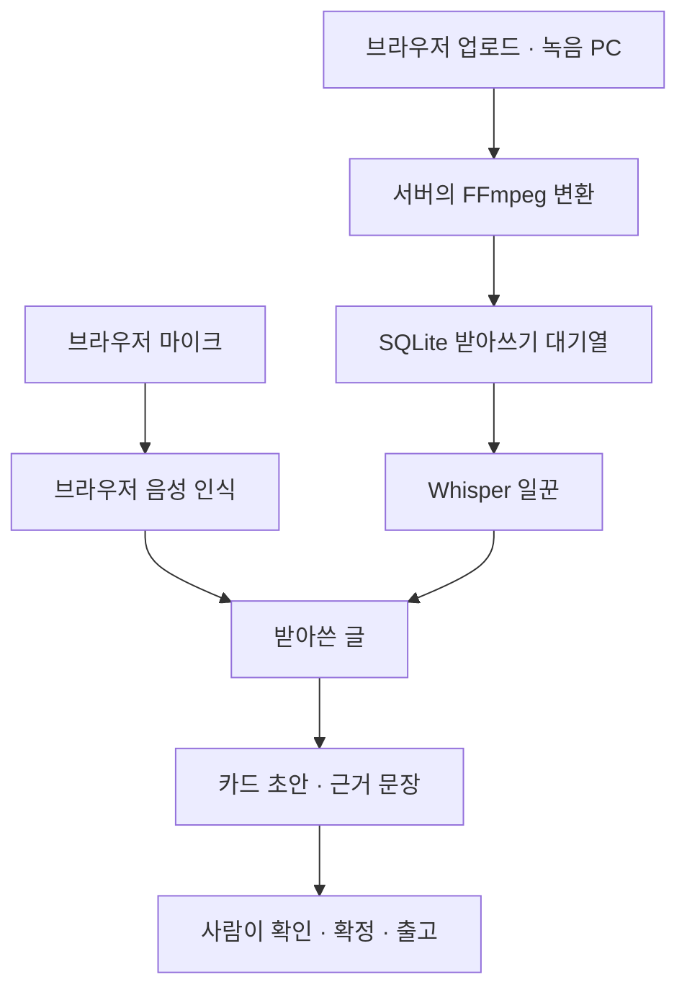

# 아맞다 시스템 구조

> AI 초안 · 돌린 사람: 신*림 · Codex · 2026-11-18

## 통화 입력에서 카드까지

- **브라우저 마이크**는 브라우저의 `SpeechRecognition`으로 받아쓴 글을 만든다. 브라우저와 서비스 제공자에 따라 네트워크를 사용할 수 있다. 앱 서버에는 전사문과 문장 시각을 보내며 마이크 원본 파일은 저장하지 않는다. 마이크를 지원하지 않는 브라우저에서는 샘플 대화로 체험할 수 있다.
- **녹음 업로드·폴더 전송**은 서버에서 FFmpeg로 16 kHz mono PCM WAV를 만든다. Whisper 일꾼이 임대한 일감의 WAV를 내려받아 전사문과 문장 구간을 돌려준다. 작업공간 사전이 받아쓰기 힌트로 쓰인다.
- **카드**는 받아쓴 글과 사전을 사용해 채우고, 근거 문장을 함께 표시한다. 사용자는 확인이 필요한 항목을 고치고 주문을 확정한다. 출고 목록은 확정한 주문을 바탕으로 만든다.

## 배치와 설정

| 위치 | 실행되는 것 | 데이터 |
|---|---|---|
| 브라우저 | 웹 화면, 마이크·샘플 입력, 카드 검토 | 세션 쿠키, 처리 중인 화면 데이터 |
| 자가 호스팅 서버 | Node.js HTTP 서버, FFmpeg, SQLite, 카드 검증, AI 연결 | 계정 DB, 작업공간별 DB와 WAV, 사전, 일감 |
| 녹음·받아쓰기 PC (선택) | 폴더 자동 전송과 Whisper 일꾼 | 녹음 폴더, Whisper 모델, 처리 중 받은 WAV |
| Anthropic (선택) | Claude Opus 카드 추출·브리핑·묻기 | 연동을 허용한 요청에 포함된 텍스트 문맥 |

로그인 세션이 브라우저 요청의 작업공간을 결정한다. 녹음 PC 토큰은 한 작업공간으로만 전송한다. 일꾼 토큰은 서버에서 지정한 작업공간에서만 일감을 처리한다. 자가 호스팅 설치는 하나의 앱 인스턴스가 로컬 볼륨을 사용한다. [자가 호스팅 안내](self-hosting.md)

AI가 꺼진 상태에서도 통화 저장과 사람의 검토를 할 수 있다. fixture는 가짜 입력에서 준비한 카드와 답변을 재현한다. 실제 Claude 호출은 서버에서 제공자를 켜고 키와 유료 호출을 허용한 뒤 작업공간의 원문 전송 정책(`configured`)을 선택해야 한다. `masked`의 실제 서버 가림 처리는 아직 연결되지 않았으므로 `off`와 함께 외부 호출을 차단한다. `configured`는 원문 문맥을 전송할 수 있다. 한 인스턴스의 일꾼 연결은 `WORKER_WORKSPACE_ID` 하나로 제한된다.

## 업종별 사전과 카드

작업공간의 지식베이스는 현장말, 오인식, 거래처, 차종, 부품, 업무 절차와 그 관계를 관리한다. 업종 프로필은 그 용어가 전사와 카드에 어떻게 쓰이는지 정의한다. 서버는 `AHMATDA_DOMAIN`에 지정된 프로필로 새 카드를 만들고 각 카드에 버전을 남긴다. [업종 프로필 확장 안내](../src/app/docs/업종-프로필.md)

| 바꾸는 범위 | 구현 위치 |
|---|---|
| 어휘·표준 표기·별칭·거래처 | 작업공간의 지식베이스, `lib/knowledge.mjs` |
| 업종 용어·필수 필드·검증 규칙 | `public/js/domain.js` |
| 전사 힌트와 AI에 전달하는 사전 정보 | `lib/repo.mjs` |
| 카드 추출 프롬프트와 응답 스키마 | `lib/ai.mjs` |
| 카드 필드 교정, 상태 변경, 화면 | `lib/cards.mjs`, `routes/cards.mjs`, `public/js/pages/` |

## 측정 범위

2026-11-12 설계 초안의 가짜 통화 61건은 화면 시연용 시드다. 정확도, 실제 환경의 전사 속도, 운영 가용성을 평가하는 자료로 사용할 때는 실제 측정 데이터를 별도로 수집한다. 앱의 오프라인 검증은 합성 WAV, 일꾼 대역, AI fixture에서 상태 전환과 카드 저장을 확인한다.

[기존 데모 설계](../src/app/docs/설계.md) · [받아쓰기 일꾼 API](../src/app/docs/worker-api.md)
