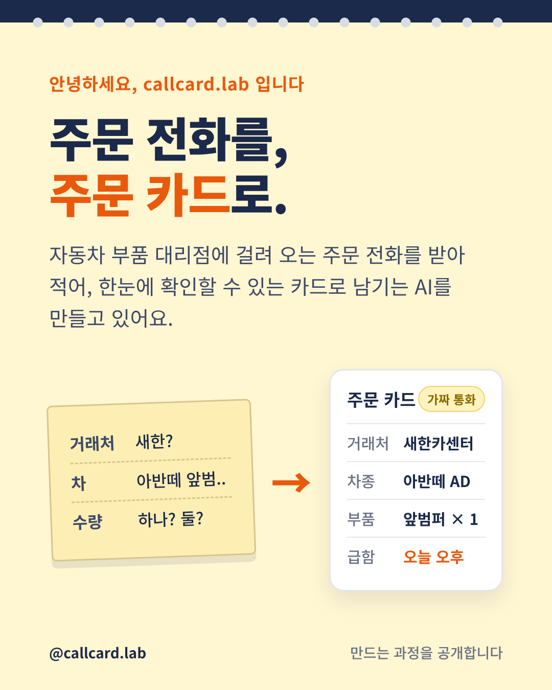

# 홍보 기록 — 2026-11-16 · 인스타

- 날짜 · 시각: 2026-11-16 22:12 (KST)
- 채널: 인스타그램 @callcard.lab (피드 게시물 1장)
- 링크: https://www.instagram.com/callcard.lab/p/Dfzb3SzsNBv/ — **2026-11-19 00:54 삭제함**(이름을 「아차 랩」으로 바꾸고 다시 올림 → [2026-11-19 기록](2026-11-19-인스타.md). 금*현 지시). 반응 수치는 재지 못했다.
- 올린 사람: 금*현 (금*현 지시로 Claude가 데스크톱 앱 브라우저에서 게시)
- 누가 · 어떻게 썼나: AI 초안([asset/W47/01-시작포스트/글.md](../../work/02-마케팅-강현/asset/W47/01-시작포스트/글.md))을 금*현이 검토해 해시태그를 고친 뒤 그대로 올림. 그림은 AI가 만든 디자인 이미지(가짜 데이터, 「가짜 통화」 표시)
- 운영자 허락: 해당 없음(팀 계정)
- 추적 링크: 없음(프로필 링크를 넣지 않기로 함 — 금*현 결정 2026-11-16)

## 올린 내용



```
안녕하세요, callcard.lab 입니다 👋

자동차 부품 대리점에는 하루 종일 정비소 주문 전화가 옵니다.
「그 아반떼 앞범퍼 하나, 급해요」
짧고 빠르게 지나가는 말을 메모지에 받아 적고, 끊고 나서 다시 전산에 옮기죠.

바쁠 땐 메모가 빠지고,
「아까 몇 개라고 했더라?」 하며 다시 전화를 겁니다.
녹음은 남아 있어도, 어느 통화였는지 찾기가 어렵고요.

그래서 저희는
📞 걸려 온 주문 전화를 받아 적고
📋 거래처 · 차종 · 부품 · 수량을 주문 카드 한 장으로 정리하고
🔁 헷갈리는 칸을 누르면 그 말을 한 녹음을 바로 들려주는
AI를 만들고 있어요.

만드는 과정을 이 계정에 하나씩 공개합니다.
부품 · 정비 현장에 계신 분들의 이야기를 들려주시면 큰 힘이 돼요 🙏

#자동차부품 #부품대리점 #정비소 #카센터 #공업사 #전화주문 #업무자동화 #생성형AI #자동차정비 #부품상
```

- 비율 4:5(1080×1350), 필터 없음, AI 레이블 없음(사실적인 사진 · 영상이 아닌 디자인 그림이라서).

## 반응 수치
잰 시각을 꼭 적는다. 재지 못한 칸은 `-` 로 둔다. 숫자를 짐작해 채우지 않는다.

| 잰 시각 | 조회 · 도달 | 좋아요 · 공감 | 댓글 | 공유 · 저장 | 링크 클릭(src) | 데모 방문(src) | 체험 신청(src) |
|---|---|---|---|---|---|---|---|
| +1일 2026-11-17 | | | | | - | - | - |
| +3일 2026-11-19 | | | | | - | - | - |
| +7일 2026-11-23 | - (11/19 삭제한 게시물) | - | - | - | - | - | - |

- 재는 법: 조회 · 좋아요 · 댓글 · 저장은 인스타 화면(인사이트)에서 읽는다. 프로필 링크가 없어 링크 클릭 · 데모 방문 · 체험 신청은 이 게시물로 셀 수 없다.

## 받은 말
아직 없음.

## 배운 점
- 잘 된 것: -
- 안 된 것: -
- 다음에 바꿀 것: -

## 증거
- 게시 그림: `docs/promotion/img/2026-11-16-인스타-1.png`
