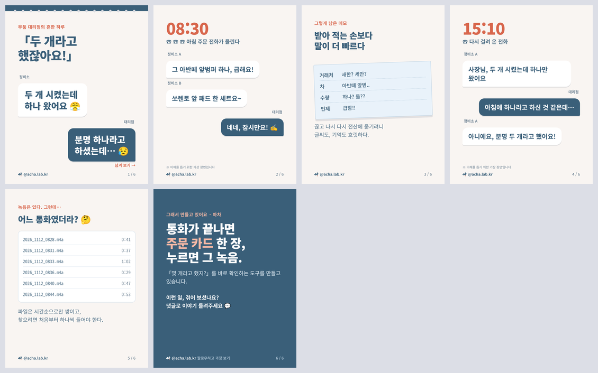

# 홍보 기록 — 2026-11-20 · 인스타

- 날짜 · 시각: 2026-11-20 22:40 (KST)
- 채널: 인스타그램 @acha.lab.kr (캐러셀 6장)
- 링크: https://www.instagram.com/acha.lab.kr/p/Df9xoEZk-0K/
- 올린 사람: 금*현 (금*현 지시로 Claude가 데스크톱 앱 브라우저에서 게시)
- 누가 · 어떻게 썼나: AI 초안([asset/W47/02-공감카드뉴스/글.md](../../work/02-마케팅-강현/asset/W47/02-공감카드뉴스/글.md))을 금*현이 검토. 6장째 「3초 만에」 → 「바로」, 게시 글에 이름 「아차」를 넣고 올림(2026-11-20). 그림은 AI가 만든 디자인 이미지(가상 장면 표시)
- 운영자 허락: 해당 없음(팀 계정)
- 추적 링크: 없음(프로필 링크 넣지 않음)
- 메모: 실행 계획에는 11/18(수)였으나 이름 변경 · 계정 전환으로 11/20(금)에 올림.

## 올린 내용



```
「두 개라고 했잖아요!」
「분명 하나라고 하셨는데…」

부품 대리점에서 한 번쯤 겪어 보셨을 장면이에요.

☎ 아침 8시 반, 주문 전화가 한꺼번에 몰리고
✍️ 받아 적는 손보다 말이 더 빨라서 메모는 「하나? 둘??」
☎ 오후에 다시 걸려 온 전화, 기억은 서로 다르고
🎧 녹음은 있는데 파일이 시간순으로만 쌓여 찾을 수가 없죠

저희는 이 장면을 바꾸려고
통화가 끝나면 주문 카드 한 장, 헷갈리는 칸을 누르면 그때 그 녹음이 바로 나오는 도구, 「아차」를 만들고 있어요.

비슷한 일 겪어 보셨다면 댓글로 이야기 들려주세요 💬
현장 이야기가 저희에겐 가장 좋은 설계도예요.

※ 카드 속 장면은 이해를 돕기 위한 가상 장면입니다.

#자동차부품 #부품대리점 #정비소 #카센터 #공업사 #전화주문 #주문실수 #업무자동화 #생성형AI
```

- 비율 4:5(1080×1350), 필터 없음, AI 레이블 없음(디자인 그림). 그림 6장은 저장소의 `card-01.png` ~ `card-06.png` 와 같은 파일(SHA-256 확인). 캡션도 `글.md` 와 해시로 대조함.

## 반응 수치
잰 시각을 꼭 적는다. 재지 못한 칸은 `-` 로 둔다. 숫자를 짐작해 채우지 않는다.

| 잰 시각 | 조회 · 도달 | 좋아요 · 공감 | 댓글 | 공유 · 저장 | 링크 클릭(src) | 데모 방문(src) | 체험 신청(src) |
|---|---|---|---|---|---|---|---|
| +1일 2026-11-21 | | | | | - | - | - |
| +3일 2026-11-23 | | | | | - | - | - |
| +7일 2026-11-27 | | | | | - | - | - |

## 받은 말
아직 없음.

## 배운 점
- 잘 된 것: -
- 안 된 것: -
- 다음에 바꿀 것: -

## 증거
- 게시 그림(6장 한눈에): `docs/promotion/img/2026-11-20-인스타-1.png`
