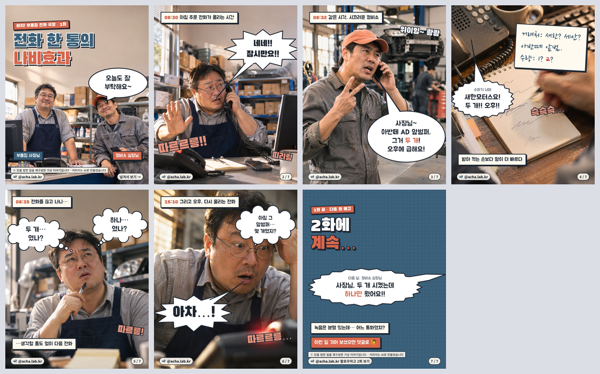

# 홍보 기록 — 2026-11-22 · 인스타

- 날짜 · 시각: 2026-11-22 16:33쯤 (KST)
- 채널: 인스타그램 @acha.lab.kr (캐러셀 7장)
- 링크: https://www.instagram.com/acha.lab.kr/p/DgCR4X5E39h/
- 올린 사람: 금*현 (금*현 지시로 Claude가 데스크톱 앱 브라우저에서 게시)
- 누가 · 어떻게 썼나: 배경 사진은 금*현이 GPT(이미지 생성)로 만듦, 말풍선 · 글자 · 게시 글은 Claude 초안([asset/toon/ep01-real/](../../work/02-마케팅-강현/asset/toon/ep01-real/README.md)). 스타일은 금*현 피드백으로 두 번 고침
- 운영자 허락: 해당 없음(팀 계정)
- 추적 링크: 없음(프로필 링크 넣지 않음)
- 메모: 원래 이날은 현장 은어 퀴즈였으나 빼기로 함(금*현 결정 2026-11-22). 「현장 말」은 11/30 데모 쇼츠 #2에서 낱말 사전 기능으로 보여 준다.

## 올린 내용



```
「두 개라고 했잖아요!」 사건의 시작 🦋
[아차! 부품집 전화 극장] 1화

아침 8시 반, 쏟아지는 주문 전화.
정비소 실장님은 분명 「두 개」라고 했는데…
메모지엔 「1? 2?」

그리고 오후 3시 10분, 다시 울리는 전화.
「아차…!」

👉 2화에 계속
비슷한 일 겪어 보셨다면 댓글로 알려 주세요 🙋

※ 있을 법한 일을 재구성한 가상 이야기입니다. 이미지는 AI로 만들었습니다.

#부품대리점 #자동차부품 #정비소 #카센터 #공업사 #전화주문 #인스타툰 #썰툰 #생성형AI
```

- 비율 4:5(1080×1350), 필터 없음, **AI 레이블 켬**(게시물에 「AI 콘텐츠」 표시 확인). 그림 7장은 저장소 `ep01-01.jpg` ~ `ep01-07.jpg` 와 같은 파일(SHA-256 확인). 캡션도 `글.md` 와 해시로 대조함.

## 반응 수치
잰 시각을 꼭 적는다. 재지 못한 칸은 `-` 로 둔다. 숫자를 짐작해 채우지 않는다.

| 잰 시각 | 조회 · 도달 | 좋아요 · 공감 | 댓글 | 공유 · 저장 | 링크 클릭(src) | 데모 방문(src) | 체험 신청(src) |
|---|---|---|---|---|---|---|---|
| +1일 2026-11-23 | | | | | - | - | - |
| +3일 2026-11-25 | | | | | - | - | - |
| +7일 2026-11-29 | | | | | - | - | - |

## 받은 말
아직 없음.

## 배운 점
- 잘 된 것: -
- 안 된 것: -
- 다음에 바꿀 것: -

## 증거
- 게시 그림(7장 한눈에): `docs/promotion/img/2026-11-22-인스타-1.png`
