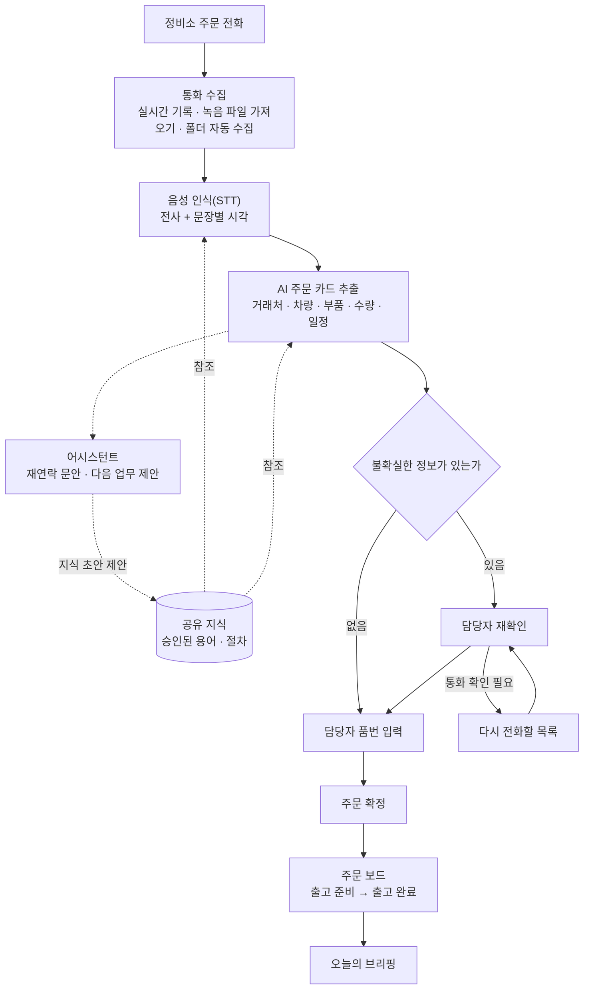
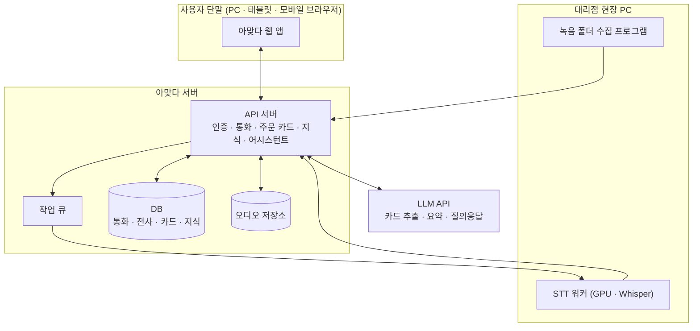

# 아맞다(Ah-matda) SW 개발 기획서

> Ah-matda — 자동차 부품 대리점 전화 주문 AI 접수 서비스
>
> “아 맞다, 언제까지 보내달라 했지?” — 통화를 끊고 떠오르는 그 순간에 여는 서비스

| 항목 | 내용 |
|---|---|
| 문서 | SW 개발 기획서 (통합 기획서 v0.3 Part 1) |
| 작성 | T07 팀 |
| 범위 | 추진 배경 · 시장 및 경쟁사 분석 · 타깃 사용자 · 핵심 가치 · 전체 서비스 개요 |

**서비스명**

| 항목          | 내용                                                                                                                                                                           |
|---------------|--------------------------------------------------------------------------------------------------------------------------------------------------------------------------------|
| 국문 / 영문   | 아맞다 / Ah-matda                                                                                                                                                              |
| 뜻            | 통화 종료 버튼을 누른 직후 가장 많이 나오는 탄식 “아 맞다”. “아 맞다, 언제까지 보내달라 했지?”, “아 맞다, 몇 개라고 했더라?” 하는 순간 무의식적으로 열어 보는 서비스라는 뜻 |
| 기능          | 통화 직후 놓친 정보의 확인(주문 카드), 지난 통화 사실 확인(근거 재생 · 지난 통화에 묻기), 하루 마감의 빠짐 점검(오늘의 브리핑)                                              |
| 브랜드 메시지 | “통화 끊고 ‘아 맞다’ 할 때, 아맞다가 기억하고 있어요.”                                                                                                                         |

## 1. 추진 배경 및 목적

### 1.1 추진 배경

| 구분      | 내용                                                                                                                                                  |
|-----------|-------------------------------------------------------------------------------------------------------------------------------------------------------|
| 현장      | 자동차 부품 대리점은 정비소(카센터·공업사)의 주문을 주로 전화로 접수함. 발화는 “그 아반떼 앞범퍼 하나, 급해요”처럼 짧고 비정형적임                    |
| 업무      | 담당자는 통화 중 메모하고 통화 후 전산에 다시 입력하는 이중 작업을 수행함. 주문이 몰리면 메모가 누락되고 재통화로 보완함                              |
| 기록      | 통화는 이미 녹음되고 있으나 파일이 시간순으로만 쌓여 파일명으로 내용을 알 수 없음. 원하는 통화를 찾으려면 처음부터 다시 들어야 함                     |
| 분쟁      | 수량·좌우·연식을 두고 “두 개라고 했다 / 안 했다”식 다툼이 발생하나, 확인 수단이 기억과 메모에 의존함                                                  |
| 기술      | 받아쓰기·요약은 단말과 통신사 앱이 무료에 가깝게 제공하는 범용 기능이 됨. 통화를 ’업무 단위(주문)’로 구조화하고 근거를 확인하게 하는 영역은 비어 있음 |
| 실행 여건 | 팀 내에 부품 대리점용 업무 프로그램 운영 경험이 있어 실제 대리점 시범 적용과 피드백 경로를 확보함                                                     |

### 1.2 문제 정의

| No  | 문제                  | 현상                                           | 영향                               | 해결 방향                                                |
|-----|-----------------------|------------------------------------------------|------------------------------------|----------------------------------------------------------|
| P1  | 메모와 이중 입력      | 통화 중 수기 메모 → 통화 후 전산 재입력        | 누락·오기, 재통화, 처리 지연       | 통화 내용을 자동으로 주문 카드 초안으로 정리함           |
| P2  | 녹음은 있으나 못 찾음 | 녹음 파일이 시간순으로만 누적됨                | 사실 확인에 과도한 시간 소요       | 전사·검색·요약으로 통화를 ’찾을 수 있는 기록’으로 전환함 |
| P3  | 수량·사양 분쟁        | “하나만 시켰는데 두 개가 왔다”                 | 반품·재배송 비용, 거래처 신뢰 저하 | 주문 정보마다 원문 발화 근거를 연결함                    |
| P4  | 사람에게 묶인 지식    | 현장 용어·거래처 습관이 담당자 개인에게 축적됨 | 교대·휴무 시 품질 저하             | 팀이 승인한 지식을 AI 맥락으로 재사용함                  |

### 1.3 추진 목적

- 전화 주문의 **접수 → 확인 → 확정 → 출고** 흐름을 한 화면 체계로 연결하여 누락과 재작업을 줄이는 것을 목적으로 함
- AI는 초안까지만 작성하고 **담당자가 확인·확정**하는 구조를 유지하여, 품번·재고·납기처럼 오류 비용이 큰 판단은 사람이 책임지도록 함
- 통화 기록과 현장 지식을 팀 자산으로 축적하여 담당자 교대·휴무에도 업무 연속성을 확보함

## 2. 시장 및 경쟁사 분석

### 2.1 시장 정의

| 영역                          | 내용                                               |
|-------------------------------|----------------------------------------------------|
| ① 음성 인식(STT)              | 음성을 텍스트로 변환하는 기반 기술                 |
| ② AI 기록·요약(AI Note-taker) | 회의·통화를 받아쓰고 요약하는 서비스               |
| ③ 대화 인텔리전스·AICC        | 통화에서 업무 필드를 추출해 CRM·상담 시스템에 반영 |
| ④ 주문 접수 자동화            | 전화·음성사서함·메신저 주문을 주문 데이터로 구조화 |

→ 아맞다의 자리는 **“한국어 전화 주문을 업종 특화 주문 카드로 구조화하는 Vertical Voice-to-Order”** 로 정의

### 2.2 경쟁 환경

| 경쟁군                      | 대표 서비스                                 | 제공 가치                                           | 아맞다 관점의 한계                                                              |
|-----------------------------|---------------------------------------------|-----------------------------------------------------|---------------------------------------------------------------------------------|
| A. 범용 AI 기록 앱          | 클로바노트, 티로(Tiro), 다글로, 에이닷 노트 | 녹음 → 받아쓰기 → 요약, 검색, AI 질의               | 요약 중심이며 주문 필드 구조화와 확정 워크플로가 없음                           |
| B. 통신사 AI 통화 앱        | 에이닷 전화(SKT), 익시오(LG U+)             | 통화 녹음·요약, 지난 통화 검색                      | 개인 휴대폰 통화 중심. 대리점 대표 유선전화와 팀 단위 주문 관리에 대응하지 않음 |
| C. 단말 기본 기능           | 갤럭시 AI, 아이폰 통화 녹음                 | 녹음·받아쓰기·요약 무료 제공                        | 개인 단위 기록에 그침                                                           |
| D. 기업 유선전화 부가서비스 | KT 통화매니저, LG U+ AI비즈콜               | 유선전화 녹취·요약·이력 관리                        | 회선·녹취 영역. 주문 구조화는 제공하지 않음(보완 관계)                          |
| E. 소상공인 AI 전화 응대    | KT AI 통화비서, LG U+ AI전화                | AI가 매장 전화를 대신 응대                          | ‘AI가 대신 받는’ 모델. 아맞다는 ’사람의 통화를 기록·구조화’하는 모델임          |
| F. STT API · AICC           | 리턴제로, CLOVA Speech, 통신 3사 AICC       | 음성 인식 엔진, 대형 콜센터 솔루션                  | 구성 요소이거나 대형 조직 대상임                                                |
| G. 해외 회의·영업 통화 AI   | Otter, Fireflies, Gong, Dialpad, Aircall    | 통화 → CRM 필드 자동 입력(사람 승인 후 반영)        | 한국어·국내 유선전화·부품 도메인에 대응하지 않음                                |
| H. 주문 접수 자동화 AI      | Choco(OrderAgent · VoiceAgent)              | 음성사서함·메신저·이메일 주문을 ERP 주문으로 구조화 | 식자재 유통 특화. 국내 자동차 부품 대리점 대상 사례는 확인되지 않음             |
| I. 부품 주문 플랫폼         | PartsTech, 모비스 부품몰 등                 | 정비소가 화면에서 검색·주문                         | 전화 주문을 온라인으로 대체하려는 접근임                                        |

**주요 서비스 동향**

- 클로바노트: 개인은 월 300분(데이터 활용 동의 시 600분) 무료, AI 요약 월 15회. 기업용은 네이버웍스 라인(Lite 1인 월 2만 원)으로 제공됨 \[11\]
- 티로: 실시간 기록이 강점이며 Lite 요금제는 월 7달러(300분)로 안내됨 \[12\]. 아맞다 프로토타입은 티로의 실시간 기록·요약 흐름을 디자인 참고로 삼음 【확인】 프로토타입 README
- 익시오: ’AI 대화 검색’과 통화 내용을 6가지 양식으로 구조화하는 ’AI 스마트 요약’을 제공하며, 부동산 중개·영업 활동 등 업무용 양식도 지원함 \[6\]. 말레이시아 통신사와 SaaS 형태의 해외 출시를 추진함 \[7\]
- 에이닷: 통화 요약·녹음 파일을 ’에이닷 노트’로 옮겨 관리하는 기능을 제공함 \[5\]
- KT 통화매니저: 영업·상담 등 유선전화 업무를 PC와 앱으로 관리하는 서비스임 \[13\]
- LG U+ AI전화: 매장 인터넷전화에 AI 콜봇을 탑재해 단순·반복 문의를 24시간 응대함 \[14\]
- KT AI 통화비서: 매장 전화가 통화 중이거나 부재중일 때 AI가 고객 용건을 글로 받아 적어 앱으로 전달함 \[15\]
- Choco: 이메일·메신저·음성사서함 주문을 ERP 주문으로 변환하는 OrderAgent를 운영하며, 2.1만 개 이상의 유통사와 10만 구매자를 대상으로 연 880만 건 이상의 주문을 처리함 \[10\]. 2025년 12월에는 전화 주문을 실시간으로 받는 VoiceAgent를 출시함 \[10\]

### 2.3 기능 비교

○ 제공 · △ 일부·조건부 · × 미제공 · ?

| 비교 항목                      | 클로바노트 | 티로 | 익시오·에이닷 | Gong·Fireflies | Choco      | 아맞다                  |
|--------------------------------|------------|------|---------------|----------------|------------|-------------------------|
| 한국어 전화 통화 대응          | △          | △    | ○             | ?              | ?          | ○ (예시 데이터)         |
| 대리점 유선전화 녹음 파일 수집 | ×          | △    | ×             | ×              | ×          | ○ (미구현)              |
| 받아쓰기·요약                  | ○          | ○    | ○             | ○              | △          | ○ (예시 데이터)         |
| 업종 특화 주문 필드 추출       | ×          | △    | △             | ○ (영업용)     | ○ (식자재) | ○ (시뮬레이션)          |
| 필드별 원문 근거 연결          | ×          | △    | ?             | △              | △          | ○ (표시만)              |
| 불확실 정보 표시·재확인 게이트 | ×          | ×    | ?             | △              | △          | ○ (동작)                |
| 사람 확정 후 다음 단계 연결    | ×          | ×    | ×             | ○              | ○          | ○ (동작)                |
| 팀 지식 제안 → 승인 → AI 참조  | △          | △    | ×             | ?              | △          | ○ (동작, 브라우저 저장) |

## 3. 타깃 사용자

### 3.1 Primary

| 항목           | 내용                                                                                     |
|----------------|------------------------------------------------------------------------------------------|
| 업무 환경      | 유선전화와 PC를 사용함. 통화 중에는 품번 조회와 전산 입력이 겹쳐 별도 메모 여력이 부족함 |
| 핵심 고충      | 메모 누락, 통화 재청취, 수량·사양 분쟁, 품번 확인을 위한 재통화                          |
| 기대 가치      | 통화가 끝나면 주문이 정리되어 있고, “아까 몇 개라고 했는지”를 즉시 확인함                |
| 주요 사용 화면 | 통화 기록, AI 주문 카드, 오늘의 브리핑                                                   |

### 3.2 Secondary

| 구분 | 대상                         | 기대 가치                                                                 | 주요 사용 화면           |
|------|------------------------------|---------------------------------------------------------------------------|--------------------------|
| S1   | 출고·배송 담당               | 확정된 주문만, 무엇을 어디에 언제까지 보내는지 한눈에 확인함              | 주문 보드                |
| S2   | 대리점 대표·관리자           | 하루 주문 흐름을 파악하고 팀 지식을 승인·관리함                           | 오늘의 브리핑, 공유 지식 |
| S3   | 정비소(주문 발신자)          | 한 번 말하면 정확히, 제때 받음. 서비스의 직접 사용자가 아닌 간접 수혜자임 | —                        |
| S4   | 전화로 주문을 받는 타 도매업 | 동일한 문제 구조의 해소(확장 대상)                                        | 동일                     |

### 3.3 As-Is → To-Be

| 단계        | As-Is                             | To-Be(아맞다)                                |
|-------------|-----------------------------------|----------------------------------------------|
| 주문 접수   | 통화하며 메모지에 기록함          | 통화에 집중함. 대화가 자동으로 기록됨        |
| 주문 정리   | 통화 후 메모를 보며 전산에 입력함 | AI 주문 카드 초안을 확인함                   |
| 불명확 정보 | 기억에 의존하거나 재통화함        | ‘재확인 필요’ 표시와 재연락 목록으로 관리함  |
| 품번 확정   | 담당자가 조회·입력함              | 동일(담당자 입력). AI는 품번을 생성하지 않음 |
| 출고 전달   | 구두·메모로 전달함                | 주문 보드의 ‘출고 준비’ 항목으로 전달함      |
| 사실 확인   | 녹음 파일을 처음부터 재청취함     | 검색 후 해당 발화 구간을 바로 확인함         |
| 일 마감     | 미처리 건을 기억에 의존해 점검함  | 브리핑에서 확인 필요·재연락 대상을 점검함    |

## 4. 서비스 핵심 가치(Core Value)

| No  | 핵심 가치           | 정의                                                                                      | 사용자 효익                       |
|-----|---------------------|-------------------------------------------------------------------------------------------|-----------------------------------|
| CV1 | 놓치지 않는 주문    | 통화가 곧 기록이 됨                                                                       | 메모 누락과 재통화가 줄어듦       |
| CV2 | 확인 가능한 AI      | 모든 정보에 근거를 연결하고 불확실성을 드러냄                                             | AI 결과를 신뢰하고 검증할 수 있음 |
| CV3 | 사람이 확정         | AI는 초안, 확정은 담당자가 수행함                                                         | 오주문 위험을 통제함              |
| CV7 | 쉬운 사용           | 큰 글씨, 홈 화면 설치, 현장 말                                                            | 고령 담당자도 부담 없이 사용함    |
| CV4 | 통화에서 출고까지   | 접수·확정·출고·마감을 한 흐름으로 연결함                                                  | 전달 누락이 줄고 진행 상황이 보임 |
| CV5 | 쌓이는 팀 지식      | 현장 용어와 절차를 승인 기반으로 축적함                                                   | 담당자가 바뀌어도 품질이 유지됨   |
| CV6 | 안심할 수 있는 처리 | 외부 발송·자동 확정을 하지 않고 데이터 전송을 최소화하며, 어디서 무엇이 처리되는지 고지함 | 개인정보와 거래 정보를 보호함     |

**제품 원칙**

1.  AI는 초안까지만 작성하고 사람이 확정함
2.  품번·재고·납기·단가는 확인 자료 없이 AI가 확정하거나 지어내지 않음
3.  틀릴 수 있는 값은 숨기지 않고 표시함
4.  예시·시뮬레이션과 실제 AI 응답을 구분하여 표시함
5.  승인된 지식만 AI가 참조함. 모델 자체를 재학습시키는 방식이 아님

## 5. 전체 서비스 개요

### 5.1 서비스 정의

**아맞다(Ah-matda)** — 걸려 온 주문 전화를 받아쓰고, 주문에 필요한 정보만 뽑아 ’확인만 하면 되는 주문 카드’로 정리하며, 확정된 주문을 출고와 일일 브리핑까지 이어 주는 부품 대리점용 웹 워크스페이스

### 5.2 시스템 흐름도

**(1) 업무 흐름**

| 단계        | 처리 주체     | 내용                                           |
|-------------|---------------|------------------------------------------------|
| ① 통화 수집 | 사용자·시스템 | 실시간 기록 또는 녹음 파일 입력                |
| ② 음성 인식 | STT           | 화자·시각이 포함된 대화 기록 생성              |
| ③ 카드 추출 | LLM           | 주문 필드 추출, 근거 발화 연결, 불확실 값 표시 |
| ④ 확인·수정 | 담당자        | 불확실 정보 확인, 품번 입력, 수량 조정         |
| ⑤ 확정      | 담당자        | 검증 통과 시 주문 확정                         |
| ⑥ 출고 관리 | 담당자        | 확인 필요 → 출고 준비 → 출고 완료              |
| ⑦ 브리핑    | 시스템·LLM    | 일일 요약, 재연락 대상 정리                    |
| ⑧ 지원      | LLM           | 재연락 문안 초안, 업무 제안, 지식 초안         |

**(2) 시스템 구성(목표)**

### 5.3 주요 기능 요약

| 구분      | 기능                | 설명                                                       | 우선순위 |
|-----------|---------------------|------------------------------------------------------------|----------|
| 통화 수집 | 실시간 기록         | 통화 내용을 실시간으로 받아써 화면에 표시함                | P0       |
| 통화 수집 | 녹음 파일 가져오기  | 녹음 파일을 올려 전사·분석함                               | P0       |
| 통화 수집 | 녹음 폴더 자동 수집 | 현장 PC 녹음 폴더의 새 파일을 자동 전송함                  | P1       |
| 대화 기록 | 전사 열람           | 화자·시각별 대화, 핵심어 하이라이트                        | P0       |
| 대화 기록 | AI 요약             | 통화 한눈에 보기, 다음 할 일, 담당자 판단 필요 정보        | P0       |
| 주문 카드 | 자동 추출           | 거래처·담당자·요청 일정·차종·연식·차량 번호·부품·수량·메모 | P0       |
| 주문 카드 | 근거 연결           | 정보별 원문 인용과 시각 표시                               | P0       |
| 주문 카드 | 재확인 게이트       | 불확실 정보 확인 전 확정 차단                              | P0       |
| 주문 카드 | 수정·확정           | 품번 입력, 수량 조정, 확정                                 | P0       |
| 후속 관리 | 다시 전화할 목록    | 재연락 대상 표시와 관리                                    | P0       |
| 통화 탐색 | 검색·필터           | 거래처·차량·부품 검색, 상태 필터                           | P0       |
| 출고 관리 | 주문 보드           | 확인 필요 / 출고 준비 / 출고 완료                          | P0       |
| 브리핑    | 오늘의 브리핑       | 일일 요약, 재연락 대상, 요약 복사                          | P0       |
| AI 지원   | 어시스턴트          | 업무 제안, 대화, 재연락 문안 초안                          | P1       |
| 지식      | 공유 지식           | 용어·절차 제안 → 승인 → AI 참조, 이력·복원                 | P1       |
| 기반      | 계정·권한·설정      | 로그인, 워크스페이스, 역할, 환경 설정                      | P0(상용) |
| 기반      | 이력 저장           | 통화·카드·대화의 서버 저장                                 | P0(상용) |

### 5.4 추진 일정

| 주차      | 단계                                             | 산출물                     |
|-----------|--------------------------------------------------|----------------------------|
| W45       | 아이디어 공모·투표                               | 아이디어 제안서            |
| W46       | 프로토타입, 킥오프(11/11) 아이템 확정            | 프로토타입, 회의록, 리서치 |
| W47(현재) | 기능 범위 확정, 설계, 개발 착수, 프리마케팅 시작 | 기능 목록, 화면·구조 설계  |
| W48       | 프로토타입 개발, 개발 과정 공유                  | 동작하는 첫 버전           |
| W49       | 개발 마무리, 정식 홍보                           | 데모                       |
| W50       | 홍보, 피드백 반영                                | 개선 버전                  |
| W51       | 최종 정리·제출                                   | 최종 리포지토리            |

### 5.5 주요 리스크와 대응

| No  | 리스크                                          | 영향                   | 대응                                                                                         |
|-----|-------------------------------------------------|------------------------|----------------------------------------------------------------------------------------------|
| R1  | 음성 인식 오류(품번·차량 번호·현장 용어·저음질) | 오주문                 | 도메인 사전, 불확실 표시, 사람 확정, 원문 재생                                               |
| R2  | LLM이 근거 없는 값을 생성함                     | 신뢰 저하              | 통화에서 말한 것만 추출, 서버 측 재검증, 품번 수기 입력 원칙                                 |
| R3  | 개인정보·통화 녹음의 외부 전송                  | 법적 이슈              | 현장 처리 우선, 마스킹, 동의·고지 체계, 법률 검토                                            |
| R4  | 고령 사용자의 사용성                            | 도입 실패              | 큰 글씨, 단순 흐름, 입력 최소화. 프로토타입 기본 글자 크기(13px, 일부 7~8px)는 상향이 필요함 |
| R5  | 프로토타입과 제품 데모의 이원화                 | 중복 개발, 사양 불일치 | 기능 ID 기준으로 사양을 통합하고 단일 코드 기반으로 수렴함                                   |
| R6  | 공개 데모의 AI 비용·오남용                      | 비용 증가              | 빈도 제한, 일일 상한, 예시 흐름 제공                                                         |

### 5. 미결 사항

- 제품명 ’아맞다’의 상표·도메인·앱 마켓 이름 검토, 화면 문구·URL·저장 키의 이름 교체 일정
- 실시간 기록의 실제 구현 방식(전화기·교환기 연동 또는 마이크 입력)과 시작 기준
- 현장 녹음 파일의 형식(발신 번호 포함 여부, 채널 수)
- 받아쓴 텍스트의 외부 LLM 전송 허용 범위(동의 · 마스킹 · 국내 또는 현장 처리)
- 낱말 사전 반영 방식(즉시 반영 / 승인 후 반영)
