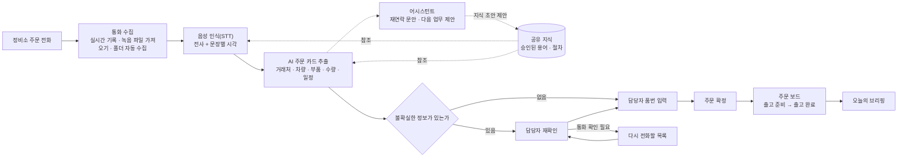
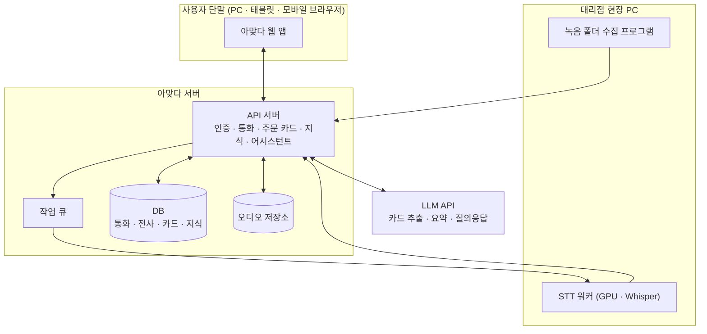

# [산출물 1] SW 개발 기획서 — 아맞다(Ah-matda)

> 전화 주문 통화를 '확인만 하면 되는 주문 카드'로 바꾸는 부품 대리점용 AI 주문 접수 워크스페이스
>
> **"아 맞다, 언제까지 보내달라 했지?"** — 통화를 끊고 떠오르는 그 순간에 여는 서비스

| 항목 | 내용 |
|---|---|
| 문서명 | 아맞다 SW 개발 기획서 |
| 버전 / 작성일 | v0.3(초안) / 2026-11-16 — v0.2: 제품 데모 도움말(`#/help`) 대조 반영 · v0.3: 제품명 '아맞다' 확정 반영 |
| 분석 대상 | GitHub `iiankeum/T07-genai-project`(main `604e4cd` · 2026-11-15, dev `01ead54`) / 컨셉 프로토타입 `https://t07-product-prototypes.butterybeam16.chatgpt.site/callnote/` / 제품 데모 `https://t07.3-39-67-126.sslip.io/#/help`(모두 2026-11-16 확인) |
| 관련 문서 | [산출물 2] 개발 요청서 · [산출물 3] 정보구조도(IA) |
| 제품명 | **아맞다(Ah-matda)** 로 확정함(2026-11-16). 리포지토리·데모에 쓰인 가칭 「콜노트(Callnote)」를 대체함 |

**표기 규칙**

| 표기 | 의미 |
|---|---|
| 【확인】 | 데모 페이지 또는 리포지토리(코드·문서)에서 직접 확인한 사실 |
| 【인용】 | 외부 공개 자료 또는 팀 선행 조사(`work/01-기획-남희/자료/`)를 인용한 내용. 출처는 문서 끝에 정리함 |
| 【가설】 | 검증 전 가정·목표값. 현장 확인이 필요함 |
| 【제안】 | 본 문서에서 새로 제안하는 내용 |

**서비스명**

| 항목 | 내용 |
|---|---|
| 국문 / 영문 | 아맞다 / Ah-matda |
| 이름의 뜻 | 통화 종료 버튼을 누른 직후 가장 많이 나오는 탄식 "아 맞다". "아 맞다, 언제까지 보내달라 했지?", "아 맞다, 몇 개라고 했더라?" 하는 순간 무의식적으로 열어 보는 서비스라는 뜻임 |
| 이름에 담긴 유즈케이스 | 통화 직후 놓친 정보의 확인(주문 카드), 지난 통화 사실 확인(근거 재생 · 지난 통화에 묻기), 하루 마감의 빠짐 점검(오늘의 브리핑) |
| 브랜드 메시지(제안) | "통화 끊고 '아 맞다' 할 때, 아맞다가 기억하고 있어요." |
| 가칭과의 관계 | 리포지토리 경로(`src/prototypes/taejs/callnote/`)와 데모 URL(`/callnote/`), 데모 화면 문구의 '콜노트'는 가칭 시점의 표기임. 본 문서에서 작은따옴표로 옮긴 데모 문구와 경로는 원문 그대로 둠 |

**분석 대상의 성격(전제)**

- 데모 페이지는 실제 음성 인식·전화 연결·주문 전송 없이 예시 데이터로 동작하는 **컨셉 프로토타입**임 【확인】
- 배포본과 리포지토리 main 브랜치 소스(`src/prototypes/taejs/callnote/`)를 대조한 결과 스크립트·스타일 4개 파일의 해시가 동일하고, `index.html`은 뒤로가기 링크 1곳(`../` → `/`)만 상이함 【확인】
- 리포지토리 dev 브랜치에는 동일 아이템의 제품 데모(`src/app/`, 기능 ID F01~F15)가 별도로 구현되어 있음. 본 기획서는 프로토타입의 화면 흐름을 기준으로 작성하되, 기술 배경과 기능 ID는 제품 설계와 정합을 맞춤 【확인】

---

## 1. 추진 배경 및 목적

### 1.1 추진 배경

| 구분 | 내용 | 근거 |
|---|---|---|
| 현장 | 자동차 부품 대리점은 정비소(카센터·공업사)의 주문을 주로 전화로 접수함. 발화는 "그 아반떼 앞범퍼 하나, 급해요"처럼 짧고 비정형적임 | 【확인】 아이디어 제안서 |
| 업무 | 담당자는 통화 중 메모하고 통화 후 전산에 다시 입력하는 이중 작업을 수행함. 주문이 몰리면 메모가 누락되고 재통화로 보완함 | 【확인】 아이디어 제안서 |
| 기록 | 통화는 이미 녹음되고 있으나 파일이 시간순으로만 쌓여 파일명으로 내용을 알 수 없음. 원하는 통화를 찾으려면 처음부터 다시 들어야 함 | 【확인】 킥오프 회의록(2026-11-11) |
| 분쟁 | 수량·좌우·연식을 두고 "두 개라고 했다 / 안 했다"식 다툼이 발생하나, 확인 수단이 기억과 메모에 의존함 | 【확인】 아이디어 제안서·회의록 |
| 기술 | 받아쓰기·요약은 단말과 통신사 앱이 무료에 가깝게 제공하는 범용 기능이 됨. 통화를 '업무 단위(주문)'로 구조화하고 근거를 확인하게 하는 영역은 비어 있음 | 【인용】 팀 선행 조사, 2장 |
| 실행 여건 | 팀 내에 부품 대리점용 업무 프로그램 운영 경험이 있어 실제 대리점 시범 적용과 피드백 경로를 확보함 | 【확인】 아이디어 제안서 |

### 1.2 문제 정의

| No | 문제 | 현상 | 영향 | 해결 방향 |
|---|---|---|---|---|
| P1 | 메모와 이중 입력 | 통화 중 수기 메모 → 통화 후 전산 재입력 | 누락·오기, 재통화, 처리 지연 | 통화 내용을 자동으로 주문 카드 초안으로 정리함 |
| P2 | 녹음은 있으나 못 찾음 | 녹음 파일이 시간순으로만 누적됨 | 사실 확인에 과도한 시간 소요 | 전사·검색·요약으로 통화를 '찾을 수 있는 기록'으로 전환함 |
| P3 | 수량·사양 분쟁 | "하나만 시켰는데 두 개가 왔다" | 반품·재배송 비용, 거래처 신뢰 저하 | 주문 정보마다 원문 발화 근거를 연결함 |
| P4 | 사람에게 묶인 지식 | 현장 용어·거래처 습관이 담당자 개인에게 축적됨 | 교대·휴무 시 품질 저하 | 팀이 승인한 지식을 AI 맥락으로 재사용함 |

### 1.3 추진 목적

- 전화 주문의 **접수 → 확인 → 확정 → 출고** 흐름을 한 화면 체계로 연결하여 누락과 재작업을 줄이는 것을 목적으로 함
- AI는 초안까지만 작성하고 **담당자가 확인·확정**하는 구조를 유지하여, 품번·재고·납기처럼 오류 비용이 큰 판단은 사람이 책임지도록 함
- 통화 기록과 현장 지식을 팀 자산으로 축적하여 담당자 교대·휴무에도 업무 연속성을 확보함

### 1.4 추진 목표(KPI) 【가설】

| 구분 | 지표 | 목표값 | 측정 방법 | 참고 |
|---|---|---|---|---|
| 처리 속도 | 녹음 수신 → 주문 카드 초안 생성 | 30초 이내 | 서버 처리 로그 | 제품 데모 실측: 48.9초 녹음 기준 약 19초 【인용】 |
| 추출 품질 | 주문 카드 필드 일치율 | 90% 이상 | 정답 카드 대비 필드 단위 비교 | 난이도 높은 가짜 통화 4건에서 34칸 중 32칸 일치(94.1%). 표본이 작아 재검증이 필요함 【인용】 |
| 업무 효율 | 주문 1건당 정리 시간 | 현행 대비 50% 단축 | 파일럿 전후 관찰 | 현행 값 미측정 |
| 누락 방지 | '확인 필요' 주문 당일 처리율 | 95% 이상 | 상태 변경 이력 | — |
| 분쟁 대응 | 근거 통화 구간 탐색 시간 | 1분 이내 | 사용성 테스트 | — |
| 활용도 | 주문 카드 확정률(확정 / 생성) | 80% 이상 | 서비스 로그 | — |

### 1.5 추진 범위와 단계

| 단계 | 범위 | 상태 |
|---|---|---|
| Phase 0 컨셉 프로토타입 | 예시 데이터 기반 화면 흐름 검증(통화 기록 · 주문 카드 · 주문 보드 · 브리핑 · 어시스턴트 · 공유 지식) | 완료 — 본 분석 대상 【확인】 |
| Phase 1 제품 데모(MVP) | 녹음 업로드 · 받아쓰기 · 카드 추출 · 근거 재생 · 확정 · 검색 · 질의 · 브리핑(F01~F15) | 진행 중 — dev 브랜치 `src/app/`. 도움말 화면에 F01~F15가 모두 '해 보기' 링크와 함께 안내됨 【확인】 |
| Phase 2 현장 파일럿 | 실제 대리점 녹음 연동, 계정·권한, 개인정보 처리 체계 | 계획 【제안】 |
| Phase 3 상용화 | 다중 대리점 운영, 전산 연동, 과금 | 계획 【제안】 |

---

## 2. 시장 및 경쟁사 분석

### 2.1 시장 정의

아맞다는 단일 시장이 아니라 네 영역이 겹치는 지점에 위치함.

| 영역 | 내용 | 아맞다와의 관계 |
|---|---|---|
| ① 음성 인식(STT) | 음성을 텍스트로 변환하는 기반 기술 | 구성 요소(직접 경쟁 아님) |
| ② AI 기록·요약(AI Note-taker) | 회의·통화를 받아쓰고 요약하는 서비스 | 기능이 겹치는 인접 경쟁 |
| ③ 대화 인텔리전스·AICC | 통화에서 업무 필드를 추출해 CRM·상담 시스템에 반영 | 구조(AI 초안 → 사람 승인)의 참조 대상 |
| ④ 주문 접수 자동화 | 전화·음성사서함·메신저 주문을 주문 데이터로 구조화 | 가장 가까운 해외 유사 사례 |

→ 아맞다의 자리는 **"한국어 전화 주문을 업종 특화 주문 카드로 구조화하는 Vertical Voice-to-Order"** 로 정의함 【제안】

### 2.2 시장 규모와 성장성 【인용】

| 시장 | 규모·전망 | 출처 |
|---|---|---|
| 글로벌 음성·화자 인식 | 2025년 96.6억 달러 → 2030년 231.1억 달러, 연평균 19.1% 성장. 아시아·태평양이 가장 빠르게 성장하는 지역으로 제시됨 | MarketsandMarkets(2025-08) [1] |
| 글로벌 AI 회의 어시스턴트 | 2025년 34.7억 달러 → 2033년 214.8억 달러, 연평균 25.8% 성장 | Grand View Research [2] |
| 〃(타 기관) | 2030년 93.3억 달러, 연평균 24.3% 성장 | Research and Markets [3] |
| 국내 AICC(AI 컨택센터) | 2020년 4,214만 달러 → 2030년 3억 5,088만 달러, 연평균 23.7% 성장 | Allied Market Research(한국경제 인용) [4] |

- 조사 기관마다 시장 범위 정의가 달라 절대값의 편차가 큼. 규모 자체보다 **연 19~26% 수준의 성장세**를 참고 지표로 활용함
- 국내에서는 통화 AI가 이미 대중화 단계에 진입함. SK텔레콤 '에이닷'은 1천만 사용자를 확보했고 [5], LG유플러스 '익시오'는 가입자 100만 명을 넘어섬 [6]

### 2.3 수요 기반(자동차 부품 유통) 【인용】

| 지표 | 수치 | 기준 | 출처 |
|---|---|---|---|
| 현대모비스 A/S 부품 대리점 | 국내 1,200여 개 | 2025-06 | 현대자동차그룹 뉴스룸 [8] |
| 전국 자동차 정비업체(주문 발신 측) | 36,184곳 | 2024년 4분기 | 팀 선행 조사 [R1] |
| 자동차 부품 판매 사업체(신품+중고) | 19,374곳 | 2018년 통계청 서비스업조사 | 팀 선행 조사 [R2] |
| 대리점 온라인 매출 비중 | 1% 내외 | 2019년 공정위 서면실태조사 | 팀 선행 조사 [R1] |

- 온라인 주문 비중이 낮아 전화 채널 의존이 지속되는 것으로 판단함
- 현대모비스는 2025년 대리점 컨퍼런스에서 현장 피드백을 'AI를 활용한 오더 시스템' 등에 활용한다는 방침을 밝힘 [9]. 본사 차원의 디지털 전환은 위협이자 연동 기회로 판단함

### 2.4 목표 시장 추정 【가설】

가격 가설은 팀 선행 조사의 "대리점 1곳당 월 1만~3만 원대"를 따르며, 중간값인 월 2만 원으로 산정함.

| 구분 | 대상 | 산식 | 연 매출 상한 |
|---|---|---|---|
| SOM(초기 진입) | 현대모비스 부품 대리점 1,200여 곳 | 1,200곳 × 2만 원 × 12개월 | 약 2.9억 원 |
| SAM(유효 시장) | 자동차 부품 판매 사업체 19,374곳 | 19,374곳 × 2만 원 × 12개월 | 약 46.5억 원 |
| TAM(전체 시장) | 전화로 주문을 받는 도매업 전반(식자재·철물·건자재 등) | 사업체 수 미확인 | 추가 조사 필요 |

- 전 대상이 도입한다는 가정의 상한값이며 실제 침투율은 반영하지 않음
- 단일 브랜드 대리점만으로는 시장 규모가 작음. **인접 도매업 확장**과 **전산 연동 등 부가 기능을 통한 객단가 상향**이 사업성의 관건으로 판단함

### 2.5 경쟁 환경

| 경쟁군 | 대표 서비스 | 제공 가치 | 아맞다 관점의 한계(빈자리) |
|---|---|---|---|
| A. 범용 AI 기록 앱 | 클로바노트, 티로(Tiro), 다글로, 에이닷 노트 | 녹음 → 받아쓰기 → 요약, 검색, AI 질의 | 요약 중심이며 주문 필드 구조화와 확정 워크플로가 없음 |
| B. 통신사 AI 통화 앱 | 에이닷 전화(SKT), 익시오(LG U+) | 통화 녹음·요약, 지난 통화 검색 | 개인 휴대폰 통화 중심. 대리점 대표 유선전화와 팀 단위 주문 관리에 대응하지 않음 |
| C. 단말 기본 기능 | 갤럭시 AI, 아이폰 통화 녹음 | 녹음·받아쓰기·요약 무료 제공 | 개인 단위 기록에 그침 |
| D. 기업 유선전화 부가서비스 | KT 통화매니저, LG U+ AI비즈콜 | 유선전화 녹취·요약·이력 관리 | 회선·녹취 영역. 주문 구조화는 제공하지 않음(보완 관계) |
| E. 소상공인 AI 전화 응대 | KT AI 통화비서, LG U+ AI전화 | AI가 매장 전화를 대신 응대 | 'AI가 대신 받는' 모델. 아맞다는 '사람의 통화를 기록·구조화'하는 모델임 |
| F. STT API · AICC | 리턴제로, CLOVA Speech, 통신 3사 AICC | 음성 인식 엔진, 대형 콜센터 솔루션 | 구성 요소이거나 대형 조직 대상임 |
| G. 해외 회의·영업 통화 AI | Otter, Fireflies, Gong, Dialpad, Aircall | 통화 → CRM 필드 자동 입력(사람 승인 후 반영) | 한국어·국내 유선전화·부품 도메인에 대응하지 않음 |
| H. 주문 접수 자동화 AI | Choco(OrderAgent · VoiceAgent) | 음성사서함·메신저·이메일 주문을 ERP 주문으로 구조화 | 식자재 유통 특화. 국내 자동차 부품 대리점 대상 사례는 확인되지 않음 |
| I. 부품 주문 플랫폼 | PartsTech, 모비스 부품몰 등 | 정비소가 화면에서 검색·주문 | 전화 주문을 온라인으로 대체하려는 접근임 |

**주요 서비스 동향 【인용】**

- 클로바노트: 개인은 월 300분(데이터 활용 동의 시 600분) 무료, AI 요약 월 15회. 기업용은 네이버웍스 라인(Lite 1인 월 2만 원)으로 제공됨 [11]
- 티로: 실시간 기록이 강점이며 Lite 요금제는 월 7달러(300분)로 안내됨 [12]. 아맞다 프로토타입은 티로의 실시간 기록·요약 흐름을 디자인 참고로 삼음 【확인】 프로토타입 README
- 익시오: 'AI 대화 검색'과 통화 내용을 6가지 양식으로 구조화하는 'AI 스마트 요약'을 제공하며, 부동산 중개·영업 활동 등 업무용 양식도 지원함 [6]. 말레이시아 통신사와 SaaS 형태의 해외 출시를 추진함 [7]
- 에이닷: 통화 요약·녹음 파일을 '에이닷 노트'로 옮겨 관리하는 기능을 제공함 [5]
- KT 통화매니저: 영업·상담 등 유선전화 업무를 PC와 앱으로 관리하는 서비스임 [13]
- LG U+ AI전화: 매장 인터넷전화에 AI 콜봇을 탑재해 단순·반복 문의를 24시간 응대함 [14]
- KT AI 통화비서: 매장 전화가 통화 중이거나 부재중일 때 AI가 고객 용건을 글로 받아 적어 앱으로 전달함 [15]
- Choco: 이메일·메신저·음성사서함 주문을 ERP 주문으로 변환하는 OrderAgent를 운영하며, 2.1만 개 이상의 유통사와 10만 구매자를 대상으로 연 880만 건 이상의 주문을 처리함 [10]. 2025년 12월에는 전화 주문을 실시간으로 받는 VoiceAgent를 출시함 [10]

### 2.6 기능 비교

○ 제공 · △ 일부·조건부 · × 미제공 · ? 공식 자료로 확인하지 못함. 조사일 기준이며 변동 가능함. 아맞다 열은 **목표 사양**(괄호는 프로토타입 현재 수준)임.

| 비교 항목 | 클로바노트 | 티로 | 익시오·에이닷 | Gong·Fireflies | Choco | 아맞다 |
|---|---|---|---|---|---|---|
| 한국어 전화 통화 대응 | △ | △ | ○ | ? | ? | ○ (예시 데이터) |
| 대리점 유선전화 녹음 파일 수집 | × | △ | × | × | × | ○ (미구현) |
| 받아쓰기·요약 | ○ | ○ | ○ | ○ | △ | ○ (예시 데이터) |
| 업종 특화 주문 필드 추출 | × | △ | △ | ○ (영업용) | ○ (식자재) | ○ (시뮬레이션) |
| 필드별 원문 근거 연결 | × | △ | ? | △ | △ | ○ (표시만) |
| 불확실 정보 표시·재확인 게이트 | × | × | ? | △ | △ | ○ (동작) |
| 사람 확정 후 다음 단계 연결 | × | × | × | ○ | ○ | ○ (동작) |
| 팀 지식 제안 → 승인 → AI 참조 | △ | △ | × | ? | △ | ○ (동작, 브라우저 저장) |

※ 타사 열은 팀 선행 조사 [R3]와 본 문서의 추가 조사를 종합한 정성 평가임. 계약·설계 판단에 사용하기 전에 각 사 공식 자료로 재확인이 필요함

### 2.7 차별화 포지셔닝 【제안】

받아쓰기와 요약은 차별점이 될 수 없다고 판단함. 아맞다의 차별점은 아래 여섯 가지로 정리함.

| No | 차별점 | 내용 | 프로토타입 근거 |
|---|---|---|---|
| D1 | 전화 주문 전용 카드 | 거래처·담당자·요청 일정·차종·연식·차량 번호·부품·수량·메모를 고정 필드로 추출함 | AI 주문 카드 |
| D2 | 확인 가능한 AI | 정보마다 원문 발화와 시각을 연결하고, 불확실한 값은 숨기지 않고 표시함 | "앞범퍼 하나 · 00:42", '재확인 필요' 표시 |
| D3 | 사람이 확정 | 품번은 AI가 채우지 않고 담당자가 입력함. 불확실 정보 확인과 품번 입력 전에는 확정이 차단됨 | 확정 버튼 검증 로직 |
| D4 | 통화에서 출고까지 한 흐름 | 통화 → 카드 → 주문 보드 → 브리핑으로 이어짐 | 주문 보드, 오늘의 브리핑 |
| D5 | 쌓이는 팀 지식 | 현장 용어와 업무 절차를 제안 → 승인 → AI 참조로 운영하고 이력을 관리함 | 공유 지식 |
| D6 | 기존 녹음 자산 활용 | 이미 PC에 쌓이는 녹음 파일을 그대로 사용하여 신규 전화 장비가 필요 없음 | 제품 설계(F01 · F12) |

### 2.8 시사점과 리스크

| 구분 | 내용 | 대응 방향 |
|---|---|---|
| 위협 | 통신사·단말 제조사가 통화 요약을 무료로 번들 제공함. 익시오처럼 업무용 요약 양식으로 확장하는 움직임이 있음 | 요약이 아닌 '주문 카드 + 근거 + 확정 워크플로'에 집중함 |
| 위협 | 본사의 'AI 활용 오더 시스템' 방침 | 본사 전산을 대체하지 않는 보조 도구로 포지셔닝하고 연동 가능성을 열어 둠 |
| 기회 | 해외에서 주문 접수 자동화(Choco 등)가 검증됨 | 'AI 초안 → 사람 확인 → 시스템 반영' 패턴을 국내 부품 유통에 적용함 |
| 리스크 | 품번·차량 번호·현장 용어의 음성 인식 오류 | 도메인 사전, 불확실 표시, 사람 확정 원칙으로 보완함 |
| 리스크 | 통화 녹음의 외부 처리에 따른 개인정보 처리 위탁·국외 이전 이슈 | 음성은 현장 PC에서 처리하고 텍스트 전송을 최소화함. 도입 전 법률 검토가 필요함 |
| 리스크 | 가칭 'Callnote'는 같은 이름의 해외 통화 녹음 소프트웨어가 있었음 [16]. 확정명 '아맞다'는 일상 감탄사라 상표 식별력 판단이 필요함 | 상표 출원 가능성(지정 상품 · 유사 상표)과 도메인·앱 이름 선점 여부를 검토함 |

---

## 3. 타깃 사용자

### 3.1 Primary — 부품 대리점 주문 접수 담당자

| 항목 | 내용 |
|---|---|
| 정의 | 대리점에서 정비소의 주문 전화를 받아 품번을 확인하고 출고를 지시하는 담당자(현장 호칭 '프론트 부장'). 영업·출고를 겸하는 경우가 있음 |
| 프로토타입상 역할 | '영업 담당자' — 「대한오토 부품 · 영업 · 출고 워크스페이스」 소속 【확인】 |
| 업무 환경 | 유선전화와 PC를 사용함. 통화 중에는 품번 조회와 전산 입력이 겹쳐 별도 메모 여력이 부족함 【인용】 |
| 특성 | 40~60대 비중이 높을 것으로 추정함. 작은 글씨와 복잡한 화면에 부담을 느낌 【가설】 |
| 핵심 고충 | 메모 누락, 통화 재청취, 수량·사양 분쟁, 품번 확인을 위한 재통화 |
| 기대 가치 | 통화가 끝나면 주문이 정리되어 있고, "아까 몇 개라고 했는지"를 즉시 확인함 |
| 주요 사용 화면 | 통화 기록, AI 주문 카드, 오늘의 브리핑 |

### 3.2 Secondary

| 구분 | 대상 | 기대 가치 | 주요 사용 화면 |
|---|---|---|---|
| S1 | 출고·배송 담당 | 확정된 주문만, 무엇을 어디에 언제까지 보내는지 한눈에 확인함 | 주문 보드 |
| S2 | 대리점 대표·관리자 | 하루 주문 흐름을 파악하고 팀 지식을 승인·관리함 | 오늘의 브리핑, 공유 지식 |
| S3 | 정비소(주문 발신자) | 한 번 말하면 정확히, 제때 받음. 서비스의 직접 사용자가 아닌 간접 수혜자임 | — |
| S4 | 전화로 주문을 받는 타 도매업 | 동일한 문제 구조의 해소(확장 대상) | 동일 |

### 3.3 사용자 여정(As-Is → To-Be)

| 단계 | As-Is | To-Be(아맞다) |
|---|---|---|
| 주문 접수 | 통화하며 메모지에 기록함 | 통화에 집중함. 대화가 자동으로 기록됨 |
| 주문 정리 | 통화 후 메모를 보며 전산에 입력함 | AI 주문 카드 초안을 확인함 |
| 불명확 정보 | 기억에 의존하거나 재통화함 | '재확인 필요' 표시와 재연락 목록으로 관리함 |
| 품번 확정 | 담당자가 조회·입력함 | 동일(담당자 입력). AI는 품번을 생성하지 않음 |
| 출고 전달 | 구두·메모로 전달함 | 주문 보드의 '출고 준비' 항목으로 전달함 |
| 사실 확인 | 녹음 파일을 처음부터 재청취함 | 검색 후 해당 발화 구간을 바로 확인함 |
| 일 마감 | 미처리 건을 기억에 의존해 점검함 | 브리핑에서 확인 필요·재연락 대상을 점검함 |

---

## 4. 서비스 핵심 가치(Core Value)

| No | 핵심 가치 | 정의 | 사용자 효익 | 프로토타입 구현 근거 【확인】 |
|---|---|---|---|---|
| CV1 | 놓치지 않는 주문 | 통화가 곧 기록이 됨 | 메모 누락과 재통화가 줄어듦 | 실시간 기록 데모에서 대화가 한 줄씩 기록되고 카드가 함께 채워짐 |
| CV2 | 확인 가능한 AI | 모든 정보에 근거를 연결하고 불확실성을 드러냄 | AI 결과를 신뢰하고 검증할 수 있음 | 핵심어 하이라이트, 원문 인용과 시각, 불확실 값 경고 |
| CV3 | 사람이 확정 | AI는 초안, 확정은 담당자가 수행함 | 오주문 위험을 통제함 | 차량 번호 확인과 품번 입력 전에는 확정 불가. 제품 데모는 '되물을 것'이 남으면 확정 막힘 |
| CV7 | 쉬운 사용 | 큰 글씨, 홈 화면 설치, 현장 말 | 고령 담당자도 부담 없이 사용함 | 제품 데모의 '글씨 크게' 토글(다시 열어도 유지), 홈 화면 추가 안내 |
| CV4 | 통화에서 출고까지 | 접수·확정·출고·마감을 한 흐름으로 연결함 | 전달 누락이 줄고 진행 상황이 보임 | 통화 기록 → 주문 보드 → 오늘의 브리핑 |
| CV5 | 쌓이는 팀 지식 | 현장 용어와 절차를 승인 기반으로 축적함 | 담당자가 바뀌어도 품질이 유지됨 | 공유 지식의 제안 → 승인 → 참조, 변경 이력·복원 |
| CV6 | 안심할 수 있는 처리 | 외부 발송·자동 확정을 하지 않고 데이터 전송을 최소화하며, 어디서 무엇이 처리되는지 고지함 | 개인정보와 거래 정보를 보호함 | "자동 발송되지 않습니다" 안내, 어시스턴트 요청의 `store: false`. 제품 데모는 도움말에 처리 경로(GPU PC 받아쓰기 · 해외 AI · 브라우저 음성 인식 · 원본 삭제)를 고지함 |

**제품 원칙**

1. AI는 초안까지만 작성하고 사람이 확정함
2. 품번·재고·납기·단가는 확인 자료 없이 AI가 확정하거나 지어내지 않음
3. 틀릴 수 있는 값은 숨기지 않고 표시함
4. 예시·시뮬레이션과 실제 AI 응답을 구분하여 표시함
5. 승인된 지식만 AI가 참조함. 모델 자체를 재학습시키는 방식이 아님

---

## 5. 전체 서비스 개요

### 5.1 서비스 정의

> **아맞다(Ah-matda)** — 걸려 온 주문 전화를 받아쓰고, 주문에 필요한 정보만 뽑아 '확인만 하면 되는 주문 카드'로 정리하며, 확정된 주문을 출고와 일일 브리핑까지 이어 주는 부품 대리점용 웹 워크스페이스

### 5.2 시스템 흐름도

**(1) 업무 흐름**

| 단계 | 처리 주체 | 내용 | 프로토타입 수준 【확인】 |
|---|---|---|---|
| ① 통화 수집 | 사용자·시스템 | 실시간 기록 또는 녹음 파일 입력 | 샘플 대화 재생(시뮬레이션). 파일은 업로드되지 않음 |
| ② 음성 인식 | STT | 화자·시각이 포함된 대화 기록 생성 | 예시 대본 |
| ③ 카드 추출 | LLM | 주문 필드 추출, 근거 발화 연결, 불확실 값 표시 | 대본 진행에 맞춘 필드 채움(시뮬레이션) |
| ④ 확인·수정 | 담당자 | 불확실 정보 확인, 품번 입력, 수량 조정 | 동작 |
| ⑤ 확정 | 담당자 | 검증 통과 시 주문 확정 | 동작(메모리 내, 새로고침 시 초기화) |
| ⑥ 출고 관리 | 담당자 | 확인 필요 → 출고 준비 → 출고 완료 | 동작 |
| ⑦ 브리핑 | 시스템·LLM | 일일 요약, 재연락 대상 정리 | 일부 고정 문구 |
| ⑧ 지원 | LLM | 재연락 문안 초안, 업무 제안, 지식 초안 | 예시 동작. 실제 AI 응답은 모델 미연결 상태(2026-11-16 기준 503 응답) |

**(2) 시스템 구성(목표)**

※ Mermaid를 지원하지 않는 뷰어에서는 위 단계 표와 5.4의 구성 표를 참조함

### 5.3 주요 기능 요약

구현 수준: **동작**(클라이언트 로직으로 실제 동작) · **시뮬레이션**(예시 데이터 재생) · **미구현**. 팀 기능 ID는 리포지토리 `기능목록-v0.md` 기준임. '제품 데모' 열은 dev 브랜치 데모의 도움말 화면과 메뉴에서 확인한 대응 기능임 【확인】

| 기능군 | 기능 | 설명 | 프로토타입 수준 | 제품 데모(dev) | 팀 기능 ID | 우선순위 |
|---|---|---|---|---|---|---|
| 통화 수집 | 실시간 기록 | 통화 내용을 실시간으로 받아써 화면에 표시함 | 시뮬레이션 | `#/live` 브라우저 음성 인식 | F03 | P0 |
| 통화 수집 | 녹음 파일 가져오기 | 녹음 파일을 올려 전사·분석함 | 시뮬레이션(파일 선택만) | `#/upload` | F01 | P0 |
| 통화 수집 | 녹음 폴더 자동 수집 | 현장 PC 녹음 폴더의 새 파일을 자동 전송함 | 미구현 | PC 프로그램 + 업로드 화면 안내 | F12 | P1 |
| 대화 기록 | 전사 열람 | 화자·시각별 대화, 핵심어 하이라이트 | 동작(예시 데이터) | `#/calls` 문장별 시각 · 재생 | F02 | P0 |
| 대화 기록 | AI 요약 | 통화 한눈에 보기, 다음 할 일, 담당자 판단 필요 정보 | 동작(템플릿 문구) | 통화 요약(Claude) | F04 연계 | P0 |
| 주문 카드 | 자동 추출 | 거래처·담당자·요청 일정·차종·연식·차량 번호·부품·수량·메모 | 시뮬레이션 | Claude 카드 추출 | F04 | P0 |
| 주문 카드 | 근거 연결 | 정보별 원문 인용과 시각 표시 | 표시만(상호작용 없음) | 칸 클릭 → 문장 강조 · 재생 | F05 | P0 |
| 주문 카드 | 재확인 게이트 | 불확실 정보 확인 전 확정 차단 | 동작 | '들어 보기' · 되물을 것 확정 막힘 | F05 · F06 | P0 |
| 주문 카드 | 수정·확정 | 품번 입력, 수량 조정, 확정 | 동작(메모리 내) | 서버 저장 | F06 | P0 |
| 후속 관리 | 다시 전화할 목록 | 재연락 대상 표시와 관리 | 동작 | 브리핑의 다시 전화할 곳 | F10 | P0 |
| 통화 탐색 | 검색·필터 | 거래처·차량·부품 검색, 상태 필터 | 동작(샘플 5건) | 받아쓴 글 · 날짜 · 거래처 · 상태 | F08 | P0 |
| 출고 관리 | 주문 보드 | 확인 필요 / 출고 준비 / 출고 완료 | 동작 | `#/board` · `#/shipping` | F06 · F14 | P0 |
| 브리핑 | 오늘의 브리핑 | 일일 요약, 재연락 대상, 요약 복사 | 동작(일부 고정 문구) | `#/` 첫 화면, AI 요약 · 마감 요약 복사 | F10 | P0 |
| AI 지원 | 어시스턴트 | 업무 제안, 대화, 재연락 문안 초안 | 예시 동작 / 실제 AI 미연결 | `#/ask` 지난 통화에 묻기(근거 인용) | F09(부분) | P1 |
| 지식 | 공유 지식 | 용어·절차 제안 → 승인 → AI 참조, 이력·복원 | 동작(브라우저 저장) | `#/glossary` 낱말 사전(승인 단계 없음) | F07(부분) | P1 |
| 기반 | 계정·권한·설정 | 로그인, 워크스페이스, 역할, 환경 설정 | 미구현 | 없음(관리자 암호만) | 신규 | P0(상용) |
| 기반 | 이력 저장 | 통화·카드·대화의 서버 저장 | 미구현 | SQLite 저장 | 신규 | P0(상용) |

### 5.4 시스템 구성과 기술 스택 【확인】

| 구분 | 컨셉 프로토타입(분석 대상) | 제품 데모(dev 브랜치) |
|---|---|---|
| 위치 | `src/prototypes/taejs/callnote/` | `src/app/` · `src/pc-agent/` |
| 프런트엔드 | 정적 HTML · CSS · Vanilla JS(빌드 없음, 단일 페이지) | 빌드 없는 ES 모듈, 해시 라우팅, PWA |
| 서버 | Node.js 20 이상 개발 서버. 배포는 Worker 단일 파일 패키징 | Node.js 24 이상, 서버 프로세스 1개 |
| 데이터 저장 | 통화·주문은 메모리(새로고침 시 초기화). 지식만 브라우저 localStorage | `node:sqlite`(통화 · 카드 · 작업 · 사전 등) |
| 음성 인식 | 없음(예시 대본) | faster-whisper large-v3(GPU PC 워커 `gpu-pc-1`, RTX 5060 Ti 16GB), 브라우저 Web Speech API(실시간 체험). 워커가 꺼지면 '대기 중'으로 줄을 섬 |
| LLM | OpenAI Responses API(기본 `gpt-4o-mini`), 구조화 출력, `store: false` — 어시스턴트 전용. 2026-11-16 기준 미연결(503) | Claude API(`claude-opus-5-5`) — 카드 추출 · 브리핑 · 질의응답. 2026-11-16 기준 켜짐 |
| 보호 장치 | 동일 출처 검사, 분당 12회 제한, 요청 9만 자 제한, 45초 타임아웃 | CSP, 출처 검사, IP별 빈도 제한, 일일 상한, 업로드 10MB · 300초 상한 |
| 데이터 처리 | 브라우저 메모리 · localStorage | 원본은 변환 후 삭제하고 16kHz WAV만 보관, 업로더 IP는 해시값만 저장, 받아쓴 글은 해외 서버의 Claude로 전송, 실시간 음성은 브라우저 회사 서버에서 인식(도움말에 고지) |
| 내비게이션 | 단일 화면 전환(URL 불변), 첫 화면 통화 기록 | 해시 라우팅(`#/…`), 첫 화면 오늘 브리핑, 모바일 하단 탭(오늘 · 통화 · 실시간 · 묻기 · 더보기), 큰 글씨 토글, 홈 화면 설치(PWA) |
| 배포 | ChatGPT Sites(`*.chatgpt.site`) | AWS Lightsail(서울), dev 브랜치 푸시 시 자동 배포 |

- 두 구현은 LLM 공급자, 저장 구조, 첫 화면, 화면 구성이 다름(개발 요청서 6.5). 상용 설계 시 **제품 데모(dev) 구조를 기준**으로 하고, 프로토타입에서만 검증된 '어시스턴트'와 '공유 지식 승인 흐름'을 제품에 이식하는 방향을 제안함 【제안】

### 5.5 추진 일정 【확인】 리포지토리 README 기준

| 주차 | 단계 | 산출물 |
|---|---|---|
| W45 | 아이디어 공모·투표 | 아이디어 제안서 |
| W46 | 프로토타입, 킥오프(11/11) 아이템 확정 | 프로토타입, 회의록, 리서치 |
| W47(현재) | 기능 범위 확정, 설계, 개발 착수, 프리마케팅 시작 | 기능 목록, 화면·구조 설계 — **본 문서 3종** |
| W48 | 프로토타입 개발, 개발 과정 공유 | 동작하는 첫 버전 |
| W49 | 개발 마무리, 정식 홍보 | 데모 |
| W50 | 홍보, 피드백 반영 | 개선 버전 |
| W51 | 최종 정리·제출 | 최종 리포지토리 |

### 5.6 주요 리스크와 대응

| No | 리스크 | 영향 | 대응 |
|---|---|---|---|
| R1 | 음성 인식 오류(품번·차량 번호·현장 용어·저음질) | 오주문 | 도메인 사전, 불확실 표시, 사람 확정, 원문 재생 |
| R2 | LLM이 근거 없는 값을 생성함 | 신뢰 저하 | 통화에서 말한 것만 추출, 서버 측 재검증, 품번 수기 입력 원칙 |
| R3 | 개인정보·통화 녹음의 외부 전송 | 법적 이슈 | 현장 처리 우선, 마스킹, 동의·고지 체계, 법률 검토 |
| R4 | 고령 사용자의 사용성 | 도입 실패 | 큰 글씨, 단순 흐름, 입력 최소화. 프로토타입 기본 글자 크기(13px, 일부 7~8px)는 상향이 필요함 |
| R5 | 프로토타입과 제품 데모의 이원화 | 중복 개발, 사양 불일치 | 기능 ID 기준으로 사양을 통합하고 단일 코드 기반으로 수렴함 |
| R6 | 공개 데모의 AI 비용·오남용 | 비용 증가 | 빈도 제한, 일일 상한, 예시 흐름 제공 |

### 5.7 미결 사항

- 제품명 '아맞다'의 상표·도메인·앱 마켓 이름 검토, 화면 문구·URL·저장 키의 이름 교체 일정
- 실시간 기록의 실제 구현 방식(전화기·교환기 연동 또는 마이크 입력)과 시작 기준
- 현장 녹음 파일의 형식(발신 번호 포함 여부, 채널 수)
- 받아쓴 텍스트의 외부 LLM 전송 허용 범위(동의 · 마스킹 · 국내 또는 현장 처리)
- 가격 가설과 과금 단위(대리점 · 회선 · 사용자)
- 프로토타입의 어시스턴트·공유 지식을 제품 데모에 통합하는 범위와 시점
- 첫 화면(통화 기록 / 오늘 브리핑)과 LLM 공급사 단일화(OpenAI / Claude)
- 낱말 사전 반영 방식(즉시 반영 / 승인 후 반영)

---

## 출처

**외부 자료(2026-11-16 조회)**

1. MarketsandMarkets, Speech and Voice Recognition Market(2025-08) — https://www.marketsandmarkets.com/PressReleases/speech-voice-recognition.asp
2. Grand View Research, AI Meeting Assistant Market — https://www.marketresearch.com/Grand-View-Research-v4060/AI-Meeting-Assistant-44621361/
3. Research and Markets, AI-Powered Meeting Assistants Market Report — https://www.researchandmarkets.com/reports/6226248/ai-powered-meeting-assistants-market-report
4. 한국경제(2024-07-15), AICC 시장 선점 경쟁 — https://www.hankyung.com/amp/2024071536251
5. SK텔레콤 뉴스룸(2026-01-06), 에이닷 서비스 소개 — https://news.sktelecom.com/218051
6. 메트로신문(2025-12-02), 익시오 가입자 100만·AI 스마트 요약 — https://www.metroseoul.co.kr/article/20251202500274
7. 딜사이트(2026-05-12), 익시오 SaaS형 수출 — https://dealsite.co.kr/articles/161660
8. 현대자동차그룹 뉴스룸(2025-06), 2025 대리점 컨퍼런스 — https://www.hyundaimotorgroup.com/ko/news/CONT0000000000179659
9. 스마트투데이(2025-06-30), 현대모비스 대리점 컨퍼런스 — https://www.smarttoday.co.kr/ko-kr/articles/84449
10. Choco OrderAgent — https://choco.com/us/orderagent / OpenAI 고객 사례(2026-04-27) — https://openai.com/index/choco / Food Digital — https://fooddigital.com/news/choco-openai-tech-for-global-food-distribution-systems / VoiceAgent 출시(2025-12) — https://choco.com/us/stories/suppliers/introducing-the-choco-voice-agent-built-by-choco-in-collaboration-with-openai · https://www.folio3.ai/ai-pulse/choco-launches-first-ai-voice-agent-food-service-openai-partnership
11. 클로바노트 요금 정리(2026-03 기준) — https://smarttechnote.com/clovanote-guide/
12. 티로 요금 정리(2026-07-29 확인 기준) — https://subanana.com/ko/blog/%ED%8B%B0%EB%A1%9C-%EB%8C%80%EC%95%88
13. 비즈워치(2025-07-25), KT 통화매니저 — https://news.bizwatch.co.kr/article/mobile/2025/07/25/0004
14. LG 보도자료, 소상공인 전용 AI전화 — https://lg.co.kr/media/release/29212 / 재경일보 — https://news.jkn.co.kr/post/854091
15. App Store, KT AI 통화비서 Lite — https://apps.apple.com/kr/app/ai-%ED%86%B5%ED%99%94%EB%B9%84%EC%84%9C-lite/id1640406058
16. iClarified(2012-03-23), Callnote(Skype 통화 녹음 앱) — https://www.iclarified.com/entry/index.php?enid=20893

※ 11·12번은 공식 요금 페이지가 아닌 2차 정리 자료임. 요금은 수시로 변동되므로 인용 전 공식 페이지 확인이 필요함

**제품 데모**

- 제품 데모 도움말 — https://t07.3-39-67-126.sslip.io/#/help (2026-11-16 확인, 커밋 `01ead54`)

**리포지토리 자료(T07-genai-project)**

- [R1] `work/01-기획-남희/자료/조사-대리점-생태계.md` — 대리점 구조, 정비업체 수, 온라인 매출 비중
- [R2] `work/02-마케팅-강현/산출물/프리마케팅-계획서.md` — 대상 규모(부품 판매 사업체 수 등)
- [R3] `work/01-기획-남희/자료/조사-서비스지도-국내.md` · `조사-서비스지도-해외.md` · `조사-주문접수-부품플랫폼.md` — 서비스 비교, 가격 기준점
- `docs/ideas/한결-AI-전화-주문-받아쓰기.md` — 아이디어 제안서
- `docs/meetings/2026-11-11.md` — 킥오프 회의록
- `work/01-기획-남희/산출물/기능목록-v0.md` — 기능 ID(F01~F15)
- `work/03-개발-태림/산출물/구현-대조표.md` — 제품 데모 구현 상태·실측값
- `src/prototypes/taejs/README.md` · `callnote/*` · `server/*` — 프로토타입 소스
- dev 브랜치 `src/app/README.md` · `src/app/docs/설계.md` — 제품 데모 설계
