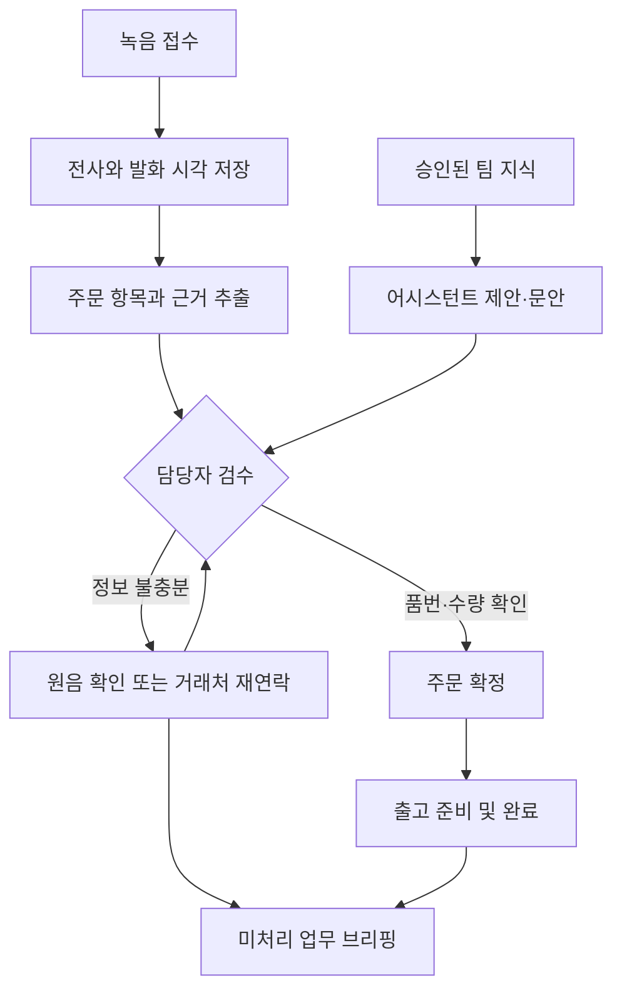

# [산출물 1] 아맞다 (Ah-matda) SW 개발 기획서

**자동차 부품 대리점의 전화 주문 접수·검수·출고 인계 서비스**  
기획 기준일 2026-11-16 · 대상 독자 사업 책임자, 영업·출고 실무자, 제품·개발·디자인 팀

**두 데모의 적용 범위.** [화면 프로토타입](https://t07-product-prototypes.butterybeam16.chatgpt.site/callnote/)은 샘플 대화, 주문 카드 UX, 어시스턴트·공유 지식을 설명한다. [현장 업무 데모](https://t07.3-39-67-126.sslip.io/#/help)는 녹음 수집, 받아쓰기, 근거 청취, 확정과 출고를 설명한다. 두 호스트는 서로 다른 배포본이다.

## 1. 추진 배경 및 목적

### 서비스 이름과 대표 사용 장면

> “아 맞다, 언제까지 보내달라 했지?”

**아맞다 (Ah-matda)**는 통화 종료 버튼을 누른 뒤 무심코 내뱉는 “아, 맞다”에서 따온 이름이다. 방금 들은 주문에서 한 가지가 기억나지 않을 때, 담당자가 자연스럽게 다시 열어보는 서비스를 뜻한다.

정비소와 통화를 마친 직원이 배송 시각을 놓쳤다면, **최근 통화 → 주문 카드의 희망 배송 시각 → 해당 발화** 순서로 확인한다. 고객이 “오늘 다섯 시 전까지 받을 수 있을까요?”라고 했다면 카드에는 ‘오늘 17시 이전 배송 희망’으로 남는다. 직원은 그 요청을 확인한 뒤 재고와 배송 가능 여부를 안내한다.

### 현장의 문제와 추진 목적

정비소에서 “21년식 CN7 앞범퍼 하나, 도색 전 제품으로 오늘 다섯 시 전에요”라고 주문한다. 같은 통화에서 고객이 차량 번호를 말한 뒤 “아마 맞을 거예요”라고 덧붙인다. 접수자는 한 번의 통화에서 차량 사양, 부품, 수량, 마감 상태, 희망 납기와 미확인 정보를 구별해야 한다. 배송 요청을 배송 약속으로 잘못 옮기거나 불명확한 차량 번호로 품번을 선택하면 출고 단계에서 다시 확인해야 한다.

| 현재 업무 | 정보가 끊기는 지점 | 아맞다에서 바꿀 업무 |
| --- | --- | --- |
| 통화 중 종이·메신저에 메모하고 종료 후 전산 입력 | 최종 수량과 고객이 번복한 말이 뒤섞임 | 통화 한 건에 발화 시각과 주문 초안을 연결한다. 담당자가 최종값을 채택한다. |
| 품번·재고 확인 후 다시 전화 | 누가 무엇을 확인할 것인지 개인 메모에 남음 | 차량 번호·품번·납기 질문을 남기고, 재연락 대상과 담당자를 인계한다. |
| 창고가 영업 담당자에게 구두로 재확인 | 초안과 출고 가능한 주문을 구별하기 어려움 | 사람이 확인한 주문만 출고 준비 목록에 노출하고 처리 결과를 같은 주문에 기록한다. |

**사업 목적**은 통화가 끝난 시점부터 출고팀이 사용할 수 있는 주문을 확정하기까지의 시간과 재입력을 줄이는 것이다. 초기 도입 단위는 전화 접수가 빈번하고 영업·출고 역할이 나뉘는 자동차 부품 대리점 한 곳이다. 매장별 도입 효과는 기존 수기 업무를 먼저 측정해 검증한다.

[현장 문제 및 최초 아이디어](https://github.com/iiankeum/T07-genai-project/blob/604e4cd2fc58afb05513bcc26b108609af791921/docs/ideas/%ED%95%9C%EA%B2%B0-AI-%EC%A0%84%ED%99%94-%EC%A3%BC%EB%AC%B8-%EB%B0%9B%EC%95%84%EC%93%B0%EA%B8%B0.md) · [지정 데모](https://t07-product-prototypes.butterybeam16.chatgpt.site/callnote/)

**현장 업무 사례.** 새한카센터의 전날 주문에는 앞범퍼 2개가 기록됐고, 다음 날 통화에서는 고객이 1개를 주문했다고 기억해 1개 반품·회수를 협의한다. 두 통화를 각각 주문과 반품 건으로 보존하면 담당자는 원주문 수량의 근거를 들려주고 회수할 수량을 따로 인계할 수 있다. 같은 방식으로 배송 독촉이나 재고·단가 문의도 통화 이력에 남기고 출고 수량에는 포함하지 않는다. [현장 데모 통화 기록](https://t07.3-39-67-126.sslip.io/#/calls)

## 2. 시장 및 경쟁사 분석

구매자가 비교할 대상은 음성을 기록하는 서비스, 영업 통화를 분석하는 서비스, 주문을 받아 출고하는 업무 시스템이다. 아래 ‘공개 기능’은 제품사 자료를, ‘아맞다의 대응’은 이를 바탕으로 한 기획 판단을 나타낸다.

| 비교 대상 | 공개 기능 또는 현장 대안 | 아맞다의 대응 및 검증할 차이 |
| --- | --- | --- |
| 네이버 클로바노트 · 한국어 음성 기록 | 화자 분리, 회의 요약, 하이라이트와 다음 할 일을 제공한다. [네이버 공식 발표](https://navercorp.com/media/pressReleasesDetail?seq=2268) | 고객이 중간에 고친 수량과 불확실한 차번호가 출고 카드에 어떻게 반영되는지 비교한다. |
| 티로 · 현장 대화 기록 | 대화를 실시간 기록·번역하고 템플릿 문서로 정리한다. 저장소가 실시간 기록 UX의 참고 대상으로 명시한다. [티로 제품 소개](https://tiro.ooo/ko/) · [프로토타입 안내](https://github.com/iiankeum/T07-genai-project/blob/604e4cd2fc58afb05513bcc26b108609af791921/src/prototypes/taejs/README.md) | 통화 직후 검수자가 부품별 품번·수량·배송 요청을 개별 수정하고 넘기는 데 걸리는 시간을 비교한다. |
| Microsoft Dynamics 365 Sales · 영업 통화 분석 | 통화 원문, 재생 타임라인, 노트·후속 조치를 제공한다. [Microsoft Learn](https://learn.microsoft.com/en-us/dynamics365/sales/view-and-understand-call-summary-sales-app) | 소규모 대리점이 한 화면에서 원문 확인부터 출고 인계까지 완료하는 흐름을 우선한다. |
| 이카운트 ERP · 출고 업무의 인접 시스템 | 판매입력, 출하지시서와 창고 출하 처리를 연결한다. [이카운트 출하 안내](https://www.ecount.com/kr/ecount/service/faq-view?category=erp&page=2&record_sid=87VCB1FDL4Q85BJ) | 전화 접수를 앞단에 붙이고 사람이 확정한 품목만 인계한다. 재고 수량과 판매전표의 기준 시스템은 기존 ERP로 둔다. |
| 수기 메모 + 기존 판매 프로그램 · 현상 유지 | 프로젝트 제안자가 기술한 현장 방식이다. [현장 문제 및 최초 아이디어](https://github.com/iiankeum/T07-genai-project/blob/604e4cd2fc58afb05513bcc26b108609af791921/docs/ideas/%ED%95%9C%EA%B2%B0-AI-%EC%A0%84%ED%99%94-%EC%A3%BC%EB%AC%B8-%EB%B0%9B%EC%95%84%EC%93%B0%EA%B8%B0.md) | 교육비와 이중 입력이 도입을 좌우한다. 같은 난이도의 주문을 기존 방식과 아맞다로 각각 처리해 비교한다. |

**사업 가설.** 전화 주문량이 많고 품번을 담당자가 대조해야 하는 대리점일수록 통화당 절감 시간의 가치가 크다. 구매자는 점주 또는 영업 책임자, 매일 쓰는 사람은 접수·출고 담당자로 본다. 매장 단위 월 구독과 처리 음성량에 따른 비용 구조를 파일럿에서 검토한다. 유료 전환 의향, 월 처리 분량, 전사·추출 비용, 주간 이용 담당자 수를 함께 확인한 뒤 가격을 정한다.

## 3. 타깃 사용자

| 구분 | 사용자·사용 시점 | 필요한 업무 결과 | 성공 판단 |
| --- | --- | --- | --- |
| Primary | 영업·전화 접수 담당자 / 통화 중·직후 | 대화와 초안을 대조하고 미확인 차량 정보와 품번을 해결 | 같은 내용을 다시 입력하지 않고 승인자·원문이 남은 주문을 인계 |
| Primary | 출고 담당자 / 피킹·출고 시 | 확정 품번, 수량, 요청 일정, 메모를 한 건으로 확인 | 초안 피킹을 방지하고 정확한 주문을 한 번만 출고 처리 |
| Secondary | 점주·영업 책임자 / 마감·인수인계 시 | 긴급 미출고, 미확정, 재연락 대상을 확인 | 마감 때 남은 업무마다 담당자와 다음 조치가 있음 |
| Secondary | 신규 직원·지식 검토자 / 생소한 현장 표현을 접할 때 | “앞범퍼·전범퍼”의 표준 표현과 공급사 조회 절차를 확인 | 승인한 지식의 출처를 확인하고 다음 상담에 재사용 |

정비소 주문자는 수혜자다. 초기 업무 흐름은 대리점 직원의 브라우저에서 시작하며 정비소 고객의 회원가입을 전제하지 않는다.

현장 데모에는 영업 담당자가 카드를 고치는 화면 외에 출고 담당자가 거래처별 목록을 인쇄하는 화면, 정비소별 과거 주문·문의를 찾는 화면이 있다. 점주는 마감 때 총 통화 수, 주문 카드 수, 재연락 거래처 수를 서로 다른 업무 지표로 확인한다. [출고 목록](https://t07.3-39-67-126.sslip.io/#/shipping) · [오늘 브리핑](https://t07.3-39-67-126.sslip.io/#/)

## 4. 서비스 핵심 가치 (Core Value)

| 가치 | 설계 원칙 | 파일럿 측정 방법 |
| --- | --- | --- |
| 접수 시간을 줄인다 | 통화 글과 편집 카드를 나란히 제공하고 한 번 확정한 값을 출고에 재사용 | 통화 종료→첫 확정 시간의 중앙값·90백분위. 외부 회신 대기는 별도 분류 |
| 틀린 부품이 출고될 가능성을 줄인다 | 불확실한 차번호를 표시하고 품번을 사람이 대조한 뒤 확정 | 출고 후 품번·수량 정정 건수 ÷ 출고 완료 건수. 취소·고객 변경은 구분 |
| 원문으로 확인할 수 있다 | 핵심 필드마다 발화 위치, 수정자와 최종값을 연결 | 표본 주문에서 수량·차량 정보의 근거 발화를 찾는 데 걸린 시간과 정답 일치율 |
| 사람 간 인계를 보장한다 | 재연락과 출고 상태를 따로 기록하고 팀 승인 지식만 AI에 제공 | 마감 시 기한 경과·미완료 재연락 수와 다음 근무자의 처리율 |

**검증 설계 제안.** 같은 매장에서 기존 방식과 파일럿을 각각 2주 관찰한다. 긴급 여부와 단일·복수 품목을 나누고 건수 및 중앙값을 함께 보고한다. ‘종료→확정 중앙값 30% 단축’은 검증용 목표안이다. 안전 지표로 근거 없이 생성된 품번이 확정되는 사례는 인수 시험에서 0건이어야 한다. 화면의 ‘오늘 통화 12건’은 샘플 수치이므로 성과 측정에서 제외한다.

## 5. 전체 서비스 개요

### 5.1 업무·시스템 흐름도

아래는 상용화 목표 흐름이다. 지정 데모에서는 샘플 발화가 시간차로 표시되며 파일 선택도 같은 샘플을 재생한다. 아래의 현장 업무 데모에는 별도의 업로드·처리 대기열과 미리 전사한 예시 통화가 있다. 실시간 마이크 입력은 브라우저 인식을 이용한다.

### 5.2 주요 기능과 책임

| 업무 | 지정 데모 | 상용화 시 개발 범위 |
| --- | --- | --- |
| 통화 수집·전사 | 파일 선택·재생 → 샘플 대화와 단계별 카드 채움 | 음원 검증, 처리 대기열, STT, 화자·시각·재생 연결, 실패 재처리 |
| 주문 검수·확정 | 거래처·차량·품번·수량 편집, 차량 번호 확인, 콜백 등록 | 서버 저장, 복수 품목·문의 처리, 근거 기반 품번 검증, 변경 이력 |
| 출고·마감 | 주문 보드 3열, 브리핑·재연락 목록과 복사 | 실데이터 집계, 출고 권한, 중복 방지, 재연락 담당자·기한, 출고 목록 인계 |
| 어시스턴트 | 제안 예시, 예시 채팅, 재연락 문안, 조건부 모델 호출 | 권한 있는 통화·승인 지식으로 문안 작성, 근거 표시, 장애·사용량 관리 |
| 공유 지식 | 대표어·별칭·관계·출처 등록, 승인·복원, 브라우저 저장 | 팀 단위 저장, 승인자 권한, 승인 버전과 검토 중인 개정본 분리 |

### 5.3 기술 범위와 출시 순서

- **지정 데모**는 HTML/CSS/JavaScript 단일 페이지다. 통화·주문은 메모리, 공유 지식은 브라우저 저장소를 사용한다. 어시스턴트는 서버의 `POST /api/assistant`로 질의하는 구조다. 2026-11-16 배포 화면에서 ‘현재 업무로 제안 받기’ 실행 시 모델 미연결 안내와 재시도 버튼을 확인했다.
- **저장소의 별도 앱** 문서는 대리점 PC의 Whisper 작업자, 서버 작업 대기열·SQLite, Claude 기반 카드·질의·브리핑을 설명한다. 이 구조는 실제 음원 처리와 근거 재생의 재사용 후보다. 지정 데모의 어시스턴트 서버는 OpenAI Responses API 연결을 구현한다. 두 경로의 제공자·저장 방식·테스트 결과는 각각 검증해야 한다.
- **P0 · 파일럿 진입**은 계정·매장 권한, 실제 파일 한 건의 접수부터 확정·출고까지의 저장, 불확실성 검수, 장애 복구, 일치하는 마감 집계다. 모델이 끊겨도 사람이 원문과 카드를 검수할 수 있어야 한다.
- **P1 · 운영 확장**은 매장 PC 폴더 수집, 거래처 이력, 인쇄·CSV 및 ERP 인계, 지식 승인 이력 활용이다. 파일럿에서 확인한 재입력 비용과 출고 오류 빈도로 우선순위를 재검토한다.

[지정 데모](https://t07-product-prototypes.butterybeam16.chatgpt.site/callnote/) · [프로토타입 안내](https://github.com/iiankeum/T07-genai-project/blob/604e4cd2fc58afb05513bcc26b108609af791921/src/prototypes/taejs/README.md) · [모델 호출 구현](https://github.com/iiankeum/T07-genai-project/blob/604e4cd2fc58afb05513bcc26b108609af791921/src/prototypes/taejs/server/assistant.mjs) · [팀 기획서 v1.3 완료 기준](https://github.com/iiankeum/T07-genai-project/blob/604e4cd2fc58afb05513bcc26b108609af791921/work/03-%EA%B0%9C%EB%B0%9C-%ED%83%9C%EB%A6%BC/%EB%B0%9B%EC%9D%80%EC%9E%90%EB%A3%8C/%EA%B8%B0%ED%9A%8D%EC%84%9C-v1.3-%EC%99%84%EB%A3%8C%EA%B8%B0%EC%A4%80.md) · [별도 앱 시스템 구성도](https://github.com/iiankeum/T07-genai-project/blob/604e4cd2fc58afb05513bcc26b108609af791921/docs/%EC%8B%9C%EC%8A%A4%ED%85%9C%EA%B5%AC%EC%84%B1%EB%8F%84/README.md) · [별도 앱 구현 대조표](https://github.com/iiankeum/T07-genai-project/blob/604e4cd2fc58afb05513bcc26b108609af791921/work/03-%EA%B0%9C%EB%B0%9C-%ED%83%9C%EB%A6%BC/%EC%82%B0%EC%B6%9C%EB%AC%BC/%EA%B5%AC%ED%98%84-%EB%8C%80%EC%A1%B0%ED%91%9C.md)

분석한 저장소 기준은 `main@604e4cd`이다. 화면·동작의 인수 기준은 산출물 2, 화면 ID와 경로는 산출물 3을 따른다.

### 5.4 현장 데모에서 검증할 업무 흐름

| 단계 | 현장 직원의 행동 | 시스템 처리 및 업무 결과 |
| --- | --- | --- |
| ① 접수 | 예시 음원을 올리거나, PC 녹음 폴더를 지정하거나, 실시간 모드에서 주문을 말한다. | 파일은 서버가 16kHz WAV로 변환하고 GPU PC의 Whisper 작업자가 가져간다. 실시간 음성은 브라우저 제공자의 인식 경로를 이용한다. |
| ② 받아쓰기·카드 생성 | 직원은 발화 시각이 있는 통화 글과 주문 카드를 받는다. | 도움말 기준 Claude가 전사 텍스트로 거래처·차량·품목·수량·긴급도·되물을 내용을 정리한다. 고객이 수량을 정정하면 마지막 값을 취하고, 말하지 않은 품번은 비워 둔다. |
| ③ 근거 검수·확정 | 차번호 가운데 글자나 품번이 의심되면 노란 ‘들어 보기’로 해당 발화를 확인한다. 미해결 질문은 거래처에 확인하고 ‘해결함’을 누른다. | 카드에는 AI 초안·사람이 고침·사람이 확인을 구별한다. 미해결 질문이 남으면 확정을 막고, 배송 문의는 부품이 없어도 처리할 수 있다. |
| ④ 출고·마감 | 확정 물량을 거래처별로 인쇄·CSV 인계한다. 마감 때는 급한 미출고 주문과 다시 연락할 거래처를 확인한다. | 주문과 문의의 완료 처리를 구분한다. AI가 응답하지 않아도 숫자와 할 일에서 마감 요약을 복사할 수 있다. |

**환경과 데이터 처리.** 2026-11-16 확인 시 현장 도움말의 상태는 ‘AI 켜짐 · 받아쓰기 일꾼 대기 중’이었다. 신규 파일의 전사 완료 시간은 이번 점검에서 측정하지 않았다. 도움말은 변환 뒤 업로드 원본은 삭제하고 16kHz WAV는 보관하며, 업로더 IP는 변환한 값으로 기록한다고 안내한다. 카드·요약·과거 통화 질의에는 서버가 전사 글을 해외 Claude로 보낸다. 이 공개 데모는 가상 통화용이다. 실제 매장 파일럿의 처리 위치, 접근권한, 보관·파기 기간은 별도 운영 요건으로 둔다. [현장 데모 도움말](https://t07.3-39-67-126.sslip.io/#/help)

**파일럿 판정 제안.** 서로 다른 세 유형을 한 묶음으로 검수한다. 정정 주문은 최종 수량과 근거 발화가 일치하는지, 배송 문의는 출고 대상에서 빠지는지, 반품은 원주문을 보존하고 회수 품목이 인계되는지 확인한다. 전사 지연은 파일 접수→작업 시작 대기 시간과 작업 시작→카드 생성 시간을 따로 측정한다.
