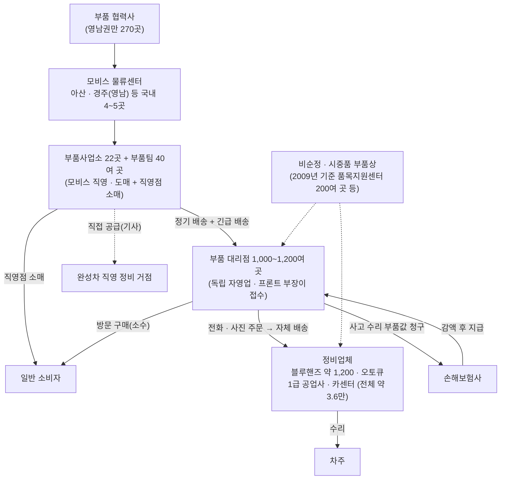

> AI 초안 · 돌린 사람: 배*결 · Claude Code(Opus 5.5) 조사 에이전트 · 2026-11-11 · 검토 전

# 현대모비스 부품 대리점 생태계와 하루 업무 (웹 조사 D)

조사 시점: 2026-11-11. 수치와 제도는 출처마다 기준 연도가 다르다. 각 줄에 연도를 붙였다.

## 0. 한눈에

- 순정 A/S 부품은 **협력사 → 모비스 물류센터 → 부품사업소·부품팀 → 부품 대리점 → 정비업체·소비자** 순으로 흐른다. 국내 대리점은 「1천 개 이상」(2025)이다. [확인: S1][S1]
- 대리점은 모비스 직영이 아닌 **독립 자영업자**다. 손님은 개인보다 **정비업체(공업사·카센터)가 주력**인 도매 성격이다. [기사: S15][S15] [후기: S31][S31]
- 한 기사에 따르면 대리점 매출의 **약 80%가 보험 수리(사고차) 관련**이다. 부품값은 대리점이 보험사에 청구한다. [기사: S9][S9]
- 모비스 보고서에 **「대리점 프론트 부장」**이라는 직함이 나온다. "고객 응대를 총괄"하는 자리다. 우리가 말하는 접수 담당 '부장님'과 같은 자리로 보인다. [확인: S3][S3]
- 정비소의 주문은 **전화가 많다는 후기**는 있다. 그러나 한국의 채널별 비율 통계는 **확인 못 함**. 미국 조사에서는 정비소 절반이 전화를 주요 주문 방법 중 하나로 꼽았다(검증 수정 2026-11-11). [후기: S31][S31] [기사: S40][S40]
- 주문 다툼은 **좌우·연식·사양·색상 착오, 비재고 주문의 취소, 반품 불가 품목, 보험 청구** 언저리에서 생긴다. 다툼의 실제 빈도는 **확인 못 함**.

### 표시 규칙

- **[확인]**: 공식 사이트·보고서·정부 발표·구인 공고 원문으로 확인했다.
- **[기사]**: 언론 기사다. 기사 날짜를 붙였다.
- **[후기]**: 커뮤니티 글·블로그·판매처 안내다.
- **[추정]**: 근거를 엮어 판단했다. 현장 확인이 필요하다.
- 출처 번호(S1 등)를 누르면 원문으로 간다. 전체 목록은 맨 아래 「10. 출처 목록」에 있다.
- 대리점 이름이 주소에 드러나는 출처는 공개 저장소 규칙에 따라 URL 을 뺐다.

### 조사 한계

- 이번 조사 중 웹 검색 한도가 다 찼다. 그래서 공업사 쪽 후기, 오후 배송 리듬, 대리점 전산 프로그램 이름은 더 찾지 못했다. 이어서 찾으려면 다음 작업방에서 검색을 다시 돌려야 한다.
- 대리점 내부 업무(입고 시각, 배송 횟수, 외상 마감일)는 공개 자료가 거의 없다. 이 부분은 대부분 [추정]이고 「9. 아침 질문」에 올렸다.

---

## 1. 유통 구조

### 1-1. 그림

- 점선은 근거가 약하거나 오래된 연결이다.
- 숫자 근거는 아래 표에 있다.

### 1-2. 단계별 사실

| 단계 | 내용 | 근거 |
|---|---|---|
| 물류센터 | 국내 A/S 부품 허브는 아산과 경주(영남물류센터, 2025-05 개소) 두 곳이다. 울산은 수출 전담이다. 영남센터는 하루 약 1만 4천 건의 주문을 처리하고(요약문 표현은 「하루 입/출고 물량 1만 4천 건」), 차량 약 150대가 오간다. (검증 수정 2026-11-11) | [확인: S1][S1] (2025-05) |
| 물류센터 | 보고서는 "전국 4개 물류센터와 22개의 부품사업소"라고 쓴다. 영문 기사는 영남센터에 오전 8시~오후 5시 사이 트럭 150여 대가 드나든다고 쓴다(센터의 공식 운영 시간이라고 밝힌 것은 아니다)(검증 수정 2026-11-11). 지역 밖 긴급 부품은 환적 거점을 거쳐 **다음 날 아침** 도착한다. | [확인: S3][S3] (2025 보고서) · [확인: S2][S2] (2025-07) |
| 부품사업소·부품팀 | 22개 부품사업소와 40개 부품팀이 권역별로 있다. 영문 기사는 24개 사업소라고 쓴다. 보고서 교육 표에는 「부품팀 41개소」가 나온다. 시점 차이로 보인다. | [확인: S1][S1] · [확인: S2][S2] · [확인: S3][S3] |
| 부품사업소의 역할 | 모비스는 「도매·소매 접점 직원」 교육을 한다. 사업소가 대리점에 도매하고, 직영점에서 소매도 한다. | [확인: S3][S3] · [확인: S6][S6] |
| 대리점 수 | 1천 개 이상(2025-05). 1,200여 개(2025-06 대리점 컨퍼런스). 1,100여 곳(2023). 1,807곳(2017 기사). 1,470여 개(2008-08 기준). 세는 기준이 달라 보인다. | [확인: S1][S1] · [확인: S4][S4] · [기사: S9][S9] · [기사: S22][S22] · [기사: S15][S15] |
| 대리점 지역 분포 | 공식 대리점 찾기는 도 단위·시 단위 지역으로 찾게 해 주지만(검증 수정 2026-11-11), 지역별 개수는 보여 주지 않는다. **확인 못 함.** | [확인: S6][S6] |
| 대리점의 성격 | 독립 자영업자다. 2019년 조사에서 자동차부품 대리점은 재판매 97.4%, 전속거래 73.1%, 연매출 10억 원 이상 43.6%였다. 43.6%는 기사가 업종 이름 없이 세 수치를 나열해 순서(제약·자동차판매·자동차부품)로 읽은 값이다. 공식 브리핑 본문에는 이 수치들이 없다. (검증 수정 2026-11-11) | [기사: S15][S15] · [기사: S11][S11] · [확인: S10][S10] |
| 대리점의 손님 | 개인보다 정비업체 위주라는 후기가 많다. 블루핸즈는 부품을 따로 팔지 않고, 근처 모비스 대리점에서 부품을 받는다는 후기가 있다. | [후기: S31][S31] · [후기: S32][S32] · [후기: S33][S33] |
| 보험 수리 비중 | 대리점 매출의 약 80%가 보험 관련이다. 대리점이 정비업체에 부품을 대고, 값은 보험사에 청구한다. 보험사는 권장소비자가 기준으로 낮춘 뒤 약 5%를 더 깎는다는 신고가 있었다(대리점 24곳, 2023-01). | [기사: S9][S9] (2023-02) |
| 완성차 직영 정비 | 기사는 "현대차가 운영하는 정비업체"에는 보통 모비스가 직접 부품을 공급한다고 쓴다. 협력 정비업체(블루핸즈)까지 포함하는 말은 아니다. (검증 수정 2026-11-11) | [기사: S9][S9] |
| 정비업체 규모 | 전국 자동차 정비업체 36,184곳(2024년 4분기, 국토부 집계). 블루핸즈 1,204곳 + 하이테크센터 22곳(2026-11). 오토큐 최신 수는 **확인 못 함**. | [기사: S39][S39] · [기사: S37][S37] · [확인: S38][S38] |
| 취급 규모 | 213개 차종, 276만여 품목(2025). 단종 후 8년 공급 의무가 있다. | [확인: S3][S3] |

### 1-3. 순정과 비순정(애프터마켓)

- 「순정부품」은 법률 용어가 아니다. 같은 부품도 모비스 대리점을 거치지 않으면 비순정으로 분류된다는 공정위 설명이 있다. [기사: S15][S15] (2009-03)
- 2009년 공정위는 모비스가 대리점의 경쟁부품(비순정) 판매를 막고, 품목지원센터의 영업지역을 제한했다고 보고 과징금 150억 원을 매겼다. [기사: S15][S15] [기사: S16][S16]
  - 품목지원센터는 범퍼·머플러처럼 부피 크고 종류 많은 부품을 맡는 독립 전문 판매점이다. 당시 약 200곳이었다. [기사: S15][S15]
  - 2014-10 기사에 따르면 과징금 납부명령 취소 판결이 확정돼 공정위가 150억 2,800만 원과 환급가산금 35억 3,100만 원을 돌려줬다. 같은 기사는 공정위가 이 사건에서 경제위기를 이유로 과징금을 80% 감경했다고도 쓴다. 취소 이유와 시정명령 유지 여부는 이 기사로는 **확인 못 함**. [기사: S47][S47] (검증 수정 2026-11-11)
  - 당시 모비스는 "자사 대리점 외에도 부품 대리점이 약 3,000개"라고 반박했다. [기사: S15][S15]
- 2009년 기사 기준 시중품은 순정 대비 약 30~83%, 재활용 부품은 26~37% 가격이었다. [기사: S16][S16]
- 2019-12 공정위 「자동차부품업종 표준대리점계약서」는 별도 약정이 없으면 대리점이 **다른 사업자의 부품도 취급할 수 있다**고 정했다. 최소 계약기간은 3년이다. [기사: S12][S12] [기사: S13][S13]
- 그래서 지금 대리점은 **순정이 주력이고 비순정도 일부 다루는** 구조로 보인다. 비중은 **확인 못 함**. [추정]

### 1-4. 모비스와 대리점 사이

- 2010-01~2013-11 「물량 밀어내기」로 2018년 공정위가 과징금 5억 원을 매겼다. 부품사업소 직원이 전산 수작업 코드(WI, WS)를 직접 입력해 부품을 대리점에 판매 처리했다는 내용이다. [기사: S18][S18] (검증 수정 2026-11-11)
  - 서울고등법원은 "구입한 부품을 반품하는데 객관적인 어려움이 없었"다며 강제성을 인정하지 않았고, 대법원이 2019-10-17 심리불속행 기각으로 이를 유지했다. [기사: S19][S19] (검증 수정 2026-11-11)
- 2019년 조사에서 부품 대리점 29.2%가 주문하지 않은 제품 구입을 강요받았고, 그 72.7%가 순정부품이었다. [기사: S11][S11] [기사: S20][S20]
- 모비스는 상생기금(200억 원 융자), 경영 컨설팅, **대리점 통합 시스템 유지보수 비용 일부 지원**, 불량 재고 폐기 지원, 무이동 재고 할인 지원을 한다. [확인: S3][S3]
- 대리점 컨퍼런스를 해마다 연다(2026년 1월 기사 기준 18년째). 2025년 행사 공식 보도자료는 대리점 현장 피드백을 "AI를 활용한 오더 시스템, 정책 개선 등에 활용한다는 방침"이라고 쓴다. 「확대 적용」이라는 말은 기사(토요경제)에만 있다. [확인: S4][S4] [기사: S5][S5] [기사: S44][S44] (검증 수정 2026-11-11)

---

## 2. 주문 채널

### 2-1. 정비소 → 대리점

| 채널 | 무엇을 알았나 | 근거 | 판단 |
|---|---|---|---|
| **전화** | 모비스는 손님에게 "방문 전 반드시 유선으로 취급 브랜드와 재고를 확인"하라고 안내한다. 카센터 전화 주문이 많아 대리점이 바쁘고 개인 손님은 기다린다는 후기가 있다. 1992년 국세청 질의 사례에도 "대리점·도매상은 공업사의 주문과 동시에 부품을 배달"한다고 적혀 있다. | [확인: S6][S6] · [후기: S31][S31] · [확인: S26][S26] | 전화가 주 채널이라는 판단은 합리적이다. 비율 통계는 **확인 못 함**. |
| 전화(외국 비교) | 미국 정비소 약 700곳 조사(2025): 절반이 전화를 주요 주문 방법 중 하나로 꼽았다. 다른 조사(500곳): 주문 건수 중 전화 18.1%, 작은 정비소일수록 전화가 많다. | [기사: S40][S40] · [기사: S41][S41] | 미국은 온라인 주문 도구가 퍼진 시장이다. 한국은 전화 비중이 더 높을 것으로 본다. [추정] |
| 카카오톡·문자 사진 | 한 대리점이 「인터넷·카카오톡·전화」로 상담한다는 카카오톡 채널 글이 검색에 나왔다. 본문은 열리지 않았다. 정비소가 부품·라벨·등록증 사진을 보내는 관행은 **확인 못 함**. | [후기: S48][S48] (본문 확인 못 함) | 사진 주문은 흔할 것으로 본다. [추정] |
| 팩스 | 근거를 찾지 못했다. **확인 못 함.** | 없음 | 보험사·대형 공업사와 서류(견적·명세서)를 주고받는 데 남아 있을 수 있다. [추정] |
| 온라인 | 2019년 조사에서 대리점의 온라인 매출 비중은 "1% 내외로 극히 미미"했다. 모비스 사이트에서 품번으로 부품 보유점을 찾을 수 있다. 일부 대리점은 온라인몰을 따로 연다. | [확인: S10][S10] · [확인: S8][S8] | 정비소 주문에서 온라인은 아직 작다. [추정] |
| 방문 구매 | 직영점·대리점에서 직접 살 수 있다. 품번과 수량을 적어 가면 빠르다는 후기가 있다. | [확인: S6][S6] · [후기: S31][S31] | 개인 손님은 소수다. |

### 2-2. 대리점 → 모비스

| 항목 | 내용 | 근거 |
|---|---|---|
| 모비스 쪽 시스템 | 고객상담 시스템(MINDS)과 부품 운영 시스템(nSMART)을 이어, 그 지역에 없는 부품은 가장 가까운 사업장에서 공급한다. 물류 창고는 바코드로 입출고를 실시간 관리한다. | [확인: S3][S3] (2025) |
| 시스템 교체 사고 | 2021-01 새 부품통합관리시스템 「맵스」를 도입했다가 오류로 대리점 부품 수급이 늦어졌다. 기사는 이 시스템을 "국내 약 3만 5천여 개 부품대리점과 정비업소"가 쓴다고 했다. 모비스는 기존 시스템 「스마트」로 되돌렸다. | [기사: S25][S25] (2021-01) |
| 전산 사용료 | 모비스는 2017-10부터 대리점 전산 사용료를 지원했다. | [기사: S18][S18] |
| 재고 없을 때 | 고객이 청구한 부품 재고가 없으면 전산에 자동 청구가 들어가고 긴급부품 운송 시스템이 공급한다(2017 기사). 재고가 기준 아래로 내려가면 자동 보충하거나 직원에게 알린다(2025). | [기사: S22][S22] · [확인: S2][S2] |
| 대리점 전산의 이름·화면 | 대리점이 실제로 쓰는 판매·재고 프로그램 이름은 **확인 못 함**. 모비스 「통합 시스템」이 있다는 것만 확인했다. | [확인: S3][S3] |

### 2-3. 정비소가 말하는 정보 (주문 말투)

- 확인한 것
  - 같은 부품명이라도 연식·엔진·옵션·생산 시점에 따라 품번이 다르다. 그래서 차대번호(VIN)로 찾는 것이 가장 정확하다는 안내가 많다. [후기: S34][S34]
  - 대리점에서 색상코드 확인이나 좌우 구분을 도와줬다는 후기가 있다. [후기: S31][S31]
  - 미국 기사도 "모델·연식 차이를 무시한 주문"과 "종이 주문서를 잘못 읽은 주문"을 반품 원인으로 꼽는다. [기사: S42][S42]
- 그래서 전화 주문에 자주 나올 정보는 **거래처 이름, 차종, 연식(또는 "신형/구형"), 차대번호 또는 차번호, 부품 이름(현장 말), 좌·우/앞·뒤, 색상코드, 수량, 언제까지** 다. [추정]
- 아래는 설명용으로 지어낸 **가짜** 통화 예시다. 실제 녹음이 아니다.

> (가짜 예시) "네, OO공업사인데요. 그랜저 IG 20년식, 조수석 헤드램프 하나요. LED 들어간 거. 차대번호는 문자로 보낼게요. 오늘 점심 전에 돼요?"
>
> (가짜 예시) "아까 말한 앞범퍼 있잖아, 그거 두 개 말고 하나만. 그리고 안개등 커버 좌우 다."

- 이런 말에는 **차대번호를 나중에 따로 보냄, 수량 정정, 좌우 생략, 시각 약속**이 섞인다. 받아쓰기 카드에서 「다시 물어볼 것」으로 뽑아야 할 지점이다. [추정]

---

## 3. 업무 흐름 (주문 한 건의 일생)

| 단계 | 알아낸 것 | 근거 |
|---|---|---|
| **① 품번 찾기** | 모비스 부품 가격 검색은 제조사·차종·부품명 또는 품번으로 찾는다. 차대번호 칸은 없다. 상세 검색(WPC)은 회원 가입 뒤 쓴다. 가격은 직영점 기준이고 하루 단위로 바뀐다. 대리점 가격과 다를 수 있다. | [확인: S7][S7] |
| | WPC 는 차대번호를 넣으면 차량 도면이 열리고, 부품을 눌러 품번을 본다는 설명이 많다. 일반인은 대리점에 차대번호만 알려 주면 직원이 찾아 준다고 한다. | [후기: S34][S34] |
| | 정비지침서·회로도는 완성차의 GSW 사이트에 있고, 품번·가격은 모비스 WPC 를 쓰라는 안내가 있다는 검색 결과가 있었다. 본문은 확인 못 함. | [추정] |
| **② 재고 확인** | 모비스 「부품 보유점 검색」은 품번을 넣으면 그 부품을 파는 직영점·대리점(매장·온라인몰)을 알려 준다. 재고 수량은 보여 주지 않는다. 「대리점 찾기」 화면은 취급 브랜드가 홈페이지 정보와 다를 수 있다며, 방문 전 전화로 취급 브랜드와 재고를 확인하라고 안내한다. (검증 수정 2026-11-11) | [확인: S8][S8] · [확인: S6][S6] |
| **③ 대리점 간 융통** | 모비스는 그 지역에 없는 부품을 가장 가까운 사업장에서 대 준다. 대리점끼리 직접 빌리고 주는 방식은 **확인 못 함**. | [확인: S3][S3] · [추정] |
| **④ 모비스에 주문·입고** | 2013 기사: 한 대리점은 정기 배송 주 4회 이상, 긴급 차량 하루 2회, 긴급 품목 늦어도 8시간 안 공급. 2017 기사: 국내 24시간 안, 긴급은 제주 포함 12시간 안. 2025: 지역 밖 긴급 부품은 다음 날 아침. | [기사: S24][S24] (2013) · [기사: S22][S22] · [기사: S23][S23] (2017) · [확인: S2][S2] (2025) |
| | 전국 품절이면 입고까지 한두 달 걸릴 수 있다며 **선입금**을 요구받았다는 후기가 있다. "주문 후 안 사 가면 손해"라는 이유다. | [후기: S32][S32] (2018) |
| | 모비스 사업소가 예고 없이 쉬어 재입고가 늦었다는, 모비스 부품을 파는 한 온라인몰의 답변이 있다(2023-01). 그 몰이 대리점이라고 페이지에 밝히지는 않는다. (검증 수정 2026-11-11) | [후기: S49] (판매처 이름이 드러나 URL 생략) |
| | 정기·긴급 주문의 하루 마감 시각과 하루 입고 횟수(지금 기준)는 **확인 못 함**. | — |
| **⑤ 출고·배송** | 구인 공고: 대리점 배송 기사는 "기존 거래처, 최대 5km 안 단거리 고정 거래처" 배송을 한다. 소형 화물차(라보) 수동 운전이 필요하다. 다른 공고는 1톤 수동 트럭 운전을 우대한다. | [확인: S27][S27] · [확인: S29][S29] |
| | 2013 기사: 거래처는 "10~15분이면 배송된다"고 답했다. 주문 접수 뒤 전표를 출력해 내보내는 절차였다. | [기사: S24][S24] |
| | 잡코리아에서 「모비스 부품대리점」으로 찾으면 배송·납품·창고 관리 공고가 여러 지역(대전·고양·화성·청주·구리·인천 등)에 뜬다. 월급이 적힌 공고는 월 220만~300만 원 수준이다(2026-11 조회). | [확인: S30][S30] |
| | 오토바이·퀵 사용과 하루 배송 노선 수는 **확인 못 함**. 먼 거리·급한 건은 퀵, 개인 손님은 택배로 보낸다. [추정] | — |
| **⑥ 반품·교환** | 모비스 ↔ 대리점: 2019-12 표준계약서는 겉으로 바로 알 수 없는 하자, 구입할 생각이 없던 상품의 반품을 허용한다(후자는 [한국일보 2019-12-26](https://www.hankookilbo.com/news/article/201912261528768582) 기사에만 나온다). 공급업자가 부당하게 반품을 거부·지연하면 비용을 진다 [검증: 확인 불가]. 대리점의 발주·반품 요청 내역을 공급업자가 일방적으로 고칠 수 없다. 표준계약서가 모비스 대리점 계약에 그대로 쓰였는지는 **확인 못 함**. (검증 수정 2026-11-11) | [기사: S12][S12] · [기사: S45][S45] · [기사: S13][S13] |
| | 2013 기사: 불량품은 월 1회 본사로 수거했다. 지금은 불량 폐기 비용 일부를 지원한다. | [기사: S24][S24] · [확인: S3][S3] |
| | 판매처 ↔ 손님: 모비스 부품을 파는 한 온라인몰(페이지에 대리점이라고 밝히지는 않음)은 단순 변심 7일, 부품 이상은 구입일부터 30일 안 교환·환불, 개봉·사용한 부품(스위치류·볼트·너트 등)·포장을 연 전기 부품·수요가 적어 악성 재고가 될 부품은 반품 불가, 정비업체에서 장착한 건은 클레임 규정으로 처리하고 자가 정비는 보증하지 않는다고 안내한다. 정비소 거래에도 같은 규칙을 쓰는지는 **확인 못 함**. (검증 수정 2026-11-11) | [후기: S50] (판매처 이름이 드러나 URL 생략) |
| **⑦ 외상·정산** | 사고 수리 건: 부품값은 대리점 이름으로, 공임은 공업사 이름으로 보험사에 청구한다. 보험사는 약 2개월 뒤 감가·면책 등을 빼고 준다(1992년 사례). 2023년에도 대리점이 보험사에 청구하고 보험사가 5% 안팎을 깎는 구조가 보도됐다. | [확인: S26][S26] · [기사: S9][S9] |
| | 일반 수리 건: 공업사와 월말 마감·거래처별 미수로 관리할 것으로 본다. 마감일·결제 기한은 **확인 못 함**. | [추정] |
| **⑧ 세금계산서** | 부품 공급의 공급 시기는 "재화가 인도되는 때"라는 국세청 회신이 있다(1992). 보험 대금이 늦게 확정돼도 부품 쪽 공급 시기는 인도 때다. 실제 발행 주기(건별/월합계)는 **확인 못 함**. | [확인: S26][S26] |

---

## 4. 하루 리듬 (대리점 기준)

> 시각은 대부분 [추정]이다. 근거가 있는 칸만 출처를 달았다. 대리점·지역마다 다르다.

| 시각 | 하는 일 | 근거 |
|---|---|---|
| 08:30 전후 | 출근, 문 열기. 배송 기사 근무는 평일 08:30~18:30, 토 08:30~15:00 인 공고가 있다. 다른 공고는 09:00~18:00, 토요일 격주. | [확인: S27][S27] · [확인: S28][S28] |
| 08:30~09:30 | 전날 주문분·긴급분 **입고 검수**와 전산 입고. 모비스는 지역 밖 긴급 부품을 "다음 날 아침"에 대 준다고 한다. 입고 시각과 하루 입고 횟수는 **확인 못 함**. | [확인: S2][S2] · [추정] |
| 09:00~11:30 | **오전 주문 몰림**. 공업사가 사고차를 뜯어 보고 필요한 부품 목록이 나오는 때로 본다. 전화가 겹치고, 사진·차대번호가 문자로 따로 온다. | [추정] |
| 10:00~12:00 | **1차 배송**. 가까운 고정 거래처(5km 안)를 돈다. 2013 기사의 "10~15분 배송"은 급한 건 기준으로 본다. | [확인: S27][S27] · [기사: S24][S24] · [추정] |
| 12:00~13:00 | 점심. 전화는 계속 온다. | [추정] |
| 13:00~16:00 | 오후 주문, **2차 배송**, 재고 없는 부품 모비스 주문(긴급/정기), 반품 받기. 2013 기사의 대리점은 긴급 차량을 하루 2회 돌렸다. | [기사: S24][S24] · [추정] |
| 16:00~17:00 | 모비스 주문 마감 전 몰아서 넣기(다음 날 입고분). 미입고 품목을 거래처에 알리기. 영남물류센터에 트럭이 17:00 까지 드나든다는 기사로 보아 오후 마감이 있을 것으로 본다(센터 운영 시간은 확인 못 함). (검증 수정 2026-11-11) | [확인: S2][S2] · [추정] |
| 17:00~18:30 | **마감**. 전표·거래명세서 정리, 그날 외상 기록, 다음 날 배송 준비. | [추정] |
| 월말 | 거래처별 마감, 미수 확인, 세금계산서. 보험 대금은 몇 달 뒤 들어와 따로 맞춘다. | [확인: S26][S26] (보험 대금 시차) · [추정] |
| 토요일 | 반나절 근무가 흔하다(공고상 09:00~12:00/13:00 또는 ~15:00). | [확인: S27][S27] · [확인: S28][S28] · [확인: S29][S29] |

---

## 5. 접수 담당(프론트 부장)의 자리와 고충

### 5-1. 이 자리에 대해 확인한 것

- 모비스 보고서는 "고객 응대를 총괄하는 **대리점 프론트 부장** 155명"을 10차수로 교육했다고 쓴다(2024 실적). 교육 내용은 고객 응대, 대리점 CS 불만 사례 공유, 스트레스 진단과 명상이다. [확인: S3][S3]
- 같은 보고서 130쪽 교육 표에서 「마음 면역력 강화 힐링 교육」의 대상이 "대리점 프론트부장(155명)"이고, 내용은 "대리점 고객응대 서비스 강화를 위한 부품 공급 문제 정보 교류 및 고객 갈등 예방 교육"이다(이수율 100%). 「유통망 정서관리 교육」은 "국내대리점 고객응대 직원(155명)" 대상의 "고객응대 피로 해소 위한 힐링 교육"이다(이수율 52%). [확인: S3][S3] (검증 수정 2026-11-11)
- 잡코리아에서 「모비스 부품대리점」으로 찾았을 때 나온 한 공고는 「프론트 데스크」를 경력 3년 이상, 연봉 6,000만 원 이상(면접 후 결정)으로 뽑는다(2026-10-14~12-13 접수). 공고 제목에 「현대모비스 부품대리점」과 「프론트 부장 경력직」이 나온다(회사 자기 표기). 컴퓨터 활용 능력을 우대한다. [확인: S28][S28] [확인: S30][S30] (검증 수정 2026-11-11)
- 접수 담당의 **나이대**는 공개 자료로 **확인 못 함**. 「대체로 고령」은 기획 전제로 두고 현장에서 확인한다.

### 5-2. 고충 표

| 고충 | 어떤 모습인가 | 근거 | 받아쓰기·주문 카드가 도울 수 있는 것 |
|---|---|---|---|
| 전화 동시 다발 | 카센터 전화 주문이 많아 바쁘고, 방문 손님은 기다린다. | [후기: S31][S31] | 통화가 끝나면 카드가 자동으로 쌓인다. 놓친 전화의 녹음도 카드가 된다. |
| 메모 누락·판독 | 통화 중 손으로 적은 메모를 나중에 못 읽거나 빠뜨린다. 미국 기사도 종이 주문서 오독을 반품 원인으로 꼽는다. | [기사: S42][S42] · [추정] | 녹음 기반 카드, 원문 구간 다시 듣기. |
| 품번 되묻기 | 차대번호·연식·좌우·색상코드가 빠지면 다시 전화해야 한다. 미국 정비소 50%가 "맞는 품번 찾기"를 어려움으로 꼽았다. | [후기: S34][S34] · [후기: S31][S31] · [기사: S43][S43] | 「다시 물어볼 것」 칸을 자동으로 채운다. |
| 품절·입고 지연 응대 | 전국 품절, 사업소 휴무, 시스템 오류로 입고가 늦으면 거래처 불만을 받는다. | [후기: S32][S32] · [후기: S49] · [기사: S25][S25] | 지난 통화에서 "언제 된다고 했는지"를 찾아 준다. |
| 감정 노동 | 모비스가 프론트 부장 대상 스트레스 진단·힐링 교육을 할 만큼 응대 피로가 크다. | [확인: S3][S3] | 다툼 때 기억이 아니라 기록으로 말할 수 있다. |
| 보험 건 정산 | 부품값을 보험사에 청구하고, 몇 달 뒤 깎인 금액을 받는다. 매출의 약 80%가 이 구조다. | [기사: S9][S9] · [확인: S26][S26] | 카드에 「보험 건인지」를 표시해 두면 청구·정산 때 찾기 쉽다. [추정] |
| 반품 판단 | 개봉품·포장을 연 전기 부품·수요가 적은 부품은 반품을 받기 어렵다(검증 수정 2026-11-11). 거래처와 말이 엇갈린다. | [후기: S50] | 주문 때 "반품 안 되는 품목"이라고 말했는지 확인. |
| 디지털 낯섦 | 고령 담당자에게 새 프로그램은 부담이다. 근거 자료는 **확인 못 함**. | [추정] | 입력 없이 녹음만으로 동작, 큰 글씨, 화면 한 장. |

---

## 6. 주문 다툼이 생기는 상황

| 상황 | 흔한 원인 | 근거 | 녹음·카드가 있으면 |
|---|---|---|---|
| **수량** ("두 개라고 했다/안 했다") | 통화 중 정정("두 개 말고 하나"), 세트·낱개 혼동 | [추정] — 직접 근거 못 찾음 | 그 구간을 바로 다시 듣는다. |
| **좌·우 / 앞·뒤** | 운전석·조수석 말과 LH/RH 품번이 엇갈림, 말에서 빠짐 | [후기: S31][S31] (좌우 구분 도움 사례) · [추정] | 카드에 좌우 칸을 따로 둔다. 비어 있으면 「다시 물어볼 것」. |
| **연식·사양·옵션·색상** | 같은 차종이라도 연식·엔진·옵션·색상에 따라 품번이 다름 | [후기: S34][S34] · [기사: S42][S42] | 차대번호를 받았는지, 누가 어떤 사양을 말했는지 남는다. |
| **말로 한 취소·변경** | 비재고 부품을 모비스에 주문한 뒤 거래처가 취소. 대리점은 선입금을 요구하기도 함 | [후기: S32][S32] | "주문 넣는다"고 확인한 통화가 남는다. |
| **배송 시각 약속** | "점심 전에", "바로"라는 말과 배송 동선이 안 맞음 | [기사: S24][S24] (빠른 배송 기대) · [추정] | 약속한 시각이 카드에 남는다. |
| **반품 거부** | 개봉·장착·포장을 연 전기 부품·수요가 적은 부품, 기한 지남 (검증 수정 2026-11-11) | [후기: S50] · [기사: S12][S12] (모비스↔대리점 규칙) | 주문 때 반품 조건을 말했는지 확인. |
| **보험 청구 관련** | 공업사가 교환하지 않은 부품을 보험 명세서에 넣었다가 뺐고, 차주·보험사가 "뒤늦게 반품했느냐"는 의혹을 제기함(공업사는 확인 뒤 반품했다고 해명). 대리점이 당사자는 아니다. (검증 수정 2026-11-11) | [기사: S36][S36] (2024-03) | 언제 주문·반품했는지 시간 기록. |
| **보험 대금 감액** | 보험사가 권장소비자가 기준 + 약 5% 감액 | [기사: S9][S9] | 다툼 상대가 보험사라 통화 기록의 역할은 작다. [추정] |
| **누가 주문했나** | 한 공업사에서 여러 사람이 전화함 | [추정] | 발신 번호·목소리·거래처로 묶는다. |
| **가격·할인·배송비** | 대리점 가격이 인터넷보다 비싸거나 배송비·퀵비를 따로 받는다는 후기 | [후기] 검색 요약에서만 봄, 원문은 열리지 않음 | 말한 단가가 남는다. |

---

## 7. 기획에 주는 뜻 (짧게)

- 주문 카드에 **좌우, 연식·사양, 색상코드, 차대번호 받았는지, 언제까지, 보험 건인지** 칸이 있어야 한다. [추정]
- 다툼은 대부분 "누가 무엇을 말했나"다. 카드마다 **근거 구간(녹음 몇 분 몇 초)**을 붙이면 사실 확인이 쉽다. [추정]
- 주문이 몰리는 시간은 오전으로 본다. 받아쓰기 일꾼(대표님 PC GPU)이 그 시간에 밀리지 않는지 봐야 한다. [추정]
- 대리점은 이미 모비스 통합 시스템을 쓴다. 우리 제품은 그 시스템을 바꾸는 게 아니라 **전화와 시스템 입력 사이의 빈칸**을 메운다. [추정]
- 차대번호·차번호는 개인정보와 이어질 수 있다. 데모 데이터는 가짜로 만든다.

---

## 8. 용어

| 말 | 뜻 |
|---|---|
| 부품사업소·부품팀 | 모비스가 권역별로 직접 운영하는 부품 거점. 대리점에 도매하고 직영점에서 소매도 한다. |
| 부품 대리점 | 모비스와 계약한 독립 자영 판매점. 정비업체에 주로 판다. |
| 프론트 부장 | 대리점에서 손님 응대를 총괄하는 사람(모비스 보고서 용어). |
| 순정부품 / 비순정·시중품 | 모비스 유통망을 거친 부품 / 그 밖의 부품. 법률 용어가 아니다. |
| 품목지원센터 | 범퍼·머플러처럼 부피 큰 부품을 맡던 독립 전문 판매점(2009년 기사 기준). |
| WPC | 모비스 상세 부품 검색(웹 부품 카탈로그). 차대번호로 도면과 품번을 본다. |
| nSMART / MINDS | 모비스 부품 운영 시스템 / 고객상담 시스템(2025 보고서). |
| 차대번호(VIN) | 차마다 하나뿐인 17자리 번호. 등록증·차체에 있다. |

---

## 9. 아침 질문 (현장·팀에 물어볼 것)

1. 부장님이 하루에 받는 주문 전화는 몇 통인가? 가장 몰리는 시간은 언제인가?
2. 카카오톡·문자 사진 주문은 전체의 얼마쯤인가? 팩스도 아직 쓰는가?
3. 주문을 받으면 어디에 먼저 적나? 종이 메모인가, 대리점 전산(이름은?)에 바로 치나?
4. 모비스 입고는 하루 몇 번, 몇 시인가? 정기·긴급 주문 마감은 몇 시인가?
5. 자체 배송은 하루 몇 바퀴인가? 오토바이·퀵·택배는 언제 쓰나?
6. 매출 중 보험 수리 건 비중이 정말 80% 안팎인가? 보험 건은 전표를 어떻게 따로 관리하나?
7. 정비소 반품 기한과 반품 안 되는 품목 규칙은 무엇인가? 말로만 하나, 적어 두나?
8. 외상 마감일, 세금계산서 발행 주기(건별/월합계)는?
9. 「두 개라고 했다/안 했다」 같은 다툼은 한 달에 몇 번인가? 녹음을 다시 들어 본 적이 있나? 녹음 파일은 어떤 형식으로 어디에 쌓이나?
10. 대리점끼리 재고를 빌리고 주나? 어떻게 연락하나?
11. 대리점 수 기준: 1천 개 이상(2025-05), 1,200여 개(2025-06), 검색 요약에 나온 1,097개(2024 보고서, 본문 확인 못 함) 중 무엇을 쓸까? 지역 분포는 공개 자료로 찾지 못했다.
12. 부품사업소 22곳(보고서) vs 24곳(영문 기사), 부품팀 40곳 vs 41개소 — 발표에는 「22곳·40여 곳」으로 써도 될까?
13. 접수 담당을 현장에서 정말 「부장님」이라고 부르나? 「프론트 부장」과 같은 자리인가? 나이대는?
14. 공개 저장소에 대리점 이름이 보이는 구인 공고 링크(번호만 있는 주소)를 남겨도 되나? 대리점 온라인몰 주소는 이번에 뺐다.

---

## 10. 출처 목록

조회일은 모두 2026-11-11 이다. 「날짜」는 원문 게시일이다.

| 번호 | 출처 | 날짜 | 표시 |
|---|---|---|---|
| S1 | 현대자동차그룹 뉴스 — 영남물류센터 개소 (부품사업소 22·부품팀 40·대리점 1천+) | 2025-05-30 (발표 5-29, 검증 수정 2026-11-11) | 확인 |
| S2 | Hyundai Motor Group Story — Hyundai Mobis Overhauls the Global Parts Game | 2025-07-01 | 확인 |
| S3 | 현대모비스 지속가능성보고서 2025 (A/S 부품 공급 네트워크, 대리점 프론트 부장 교육, 대리점 지원 프로그램, 130~131쪽 부근) | 2025-06 | 확인 |
| S4 | 현대자동차그룹 뉴스 — 2025 현대모비스 대리점 컨퍼런스 | 2025-06-30 | 확인 |
| S5 | 토요경제 — 대리점 컨퍼런스, AI 주문 시스템 | 2025-06-30 | 기사 |
| S6 | 현대모비스 A/S 부품 사이트 — 대리점 찾기 | 조회 2026-11-11 | 확인 |
| S7 | 현대모비스 A/S 부품 사이트 — 부품 가격 검색 | 조회 2026-11-11 | 확인 |
| S8 | 현대모비스 A/S 부품 사이트 — 부품 보유점 검색 | 조회 2026-11-11 | 확인 |
| S9 | 경향신문 — 부품 대리점 24곳, 보험사 5% 감액 신고 | 2023-02-08 | 기사 |
| S10 | 대한민국 정책브리핑 — 공정위 2019 업종별 대리점 서면실태조사 결과 | 2019-11-27 | 확인 |
| S11 | 소셜타임스 — 제약·자동차판매·자동차부품 대리점 실태 | 2019-11-27 | 기사 |
| S12 | 경향신문 — 자동차부품 대리점 표준계약서(비순정 취급, 반품, 3년) | 2019-12-26 | 기사 |
| S13 | 한국공정경쟁연합회 — 표준대리점계약서 제정 소식 | 2019-12-29 | 기사 |
| S15 | 머니투데이 — 공정위, 현대모비스 과징금 150억(대리점·품목지원센터 구조) | 2009-03-19 | 기사 |
| S16 | 이투데이 — 공정위 현대모비스 150억(품목지원센터, 시중품 가격) | 2009-03-19 | 기사 |
| S18 | 이투데이 — 공정위, 현대모비스 물량 밀어내기 과징금 5억 | 2018-02-08 | 기사 |
| S19 | 머니투데이 — 법원 "현대모비스 갑질 없었다" | 2019-10-28 | 기사 |
| S20 | 논객닷컴 — 현대모비스 직권조사 요구(구입 강제 수치) | 2019-11-29 | 기사 |
| S22 | 데일리카 — 현대모비스 물류 르포(대리점 1,807곳, 24시간/12시간) | 2017-01-25 | 기사 |
| S23 | 모터그래프 — 아산물류센터 르포 | 2017-01-25 | 기사 |
| S24 | 교통뉴스 — 한 모비스 대리점 탐방(배송 10~15분, 긴급 차량 하루 2회) | 2013-08-02 | 기사 |
| S25 | 투데이신문 — 모비스 부품통합관리시스템 오류 | 2021-01-20 | 기사 |
| S26 | 국세청 질의회신 부가22601-1605 (제3자 DB 게재본) | 1992-10-24 | 확인 |
| S27 | 구인 공고 — 현대차 부품 대리점 부품 관리·배송(5km 고정 거래처, 라보) | 상시 채용, 조회 2026-11-11 | 확인 |
| S28 | 구인 공고 — 부품 대리점 프론트 데스크 부장급 | 2026-10-14~12-13 | 확인 |
| S29 | 구인 공고 — 부품 대리점 부품 배송·관리(1톤 수동 우대) | 조회 2026-11-11 | 확인 |
| S30 | 잡코리아 검색 「모비스 부품대리점」 | 조회 2026-11-11 | 확인 |
| S31 | 클리앙 — 모비스 부품대리점 응대 글과 댓글 | 2020-12-12 | 후기 |
| S32 | 클리앙 — 전국 품절·선입금 경험 | 2018-11-05 | 후기 |
| S33 | 클리앙 — 블루핸즈 부품 판매 여부 | 2021-03-01 | 후기 |
| S34 | 브런치 — 현대모비스 부품조회 WPC | 2025-12-13 | 후기 |
| S36 | 경기일보 — 공업사 부품 청구·반품 논란 | 2024-03-08 | 기사 |
| S37 | 오토트리뷴 — 블루핸즈 1,204곳, 하이테크센터 22곳 | 2026-11-03 | 기사 |
| S38 | 현대자동차 — 블루핸즈 안내 | 조회 2026-11-11 | 확인 |
| S39 | 더모빌리언스 — 2024년 4분기 자동차정비업체 36,184곳 | 2025-05-03 | 기사 |
| S40 | Ratchet+Wrench — OEC 정비소 설문(전화 주문 50%) | 2026-06-05 | 기사 |
| S41 | IMR — How Independent Repair Shops Are Really Ordering Parts | 날짜 표시 없음 | 기사 |
| S42 | MOTOR — Auto parts return rates | 2023-11-07 | 기사 |
| S43 | PartsTech 블로그 — 3 Truths About Parts Ordering (판매사 글) | 2023-05-23 | 기사 |
| S44 | CEO스코어데일리 — 대리점 컨퍼런스 18년째 | 2026-01-21 | 기사 |
| S45 | 이투데이 — 표준대리점계약서 제정 | 2019-12-26 | 기사 |
| S47 | 비즈한국 — 공정위 과징금 감경·환급 | 2014-10-20 | 기사 |
| S48 | 한 기아 부품 대리점 카카오톡 채널 글(본문 열리지 않음) | 확인 못 함 | 후기 |
| S49 | 모비스 부품을 파는 한 온라인몰 문의 답변 — 사업소 휴무로 재입고 지연 (URL 생략 · 대리점 여부는 페이지에 없음, 검증 수정 2026-11-11) | 2023-01-04 | 후기 |
| S50 | 모비스 부품을 파는 한 온라인몰 이용안내 — 반품·교환 규정 (URL 생략 · 대리점 여부는 페이지에 없음, 검증 수정 2026-11-11) | 조회 2026-11-11 | 후기 |

번호가 빠진 것(S14, S17, S21, S35, S46)은 읽었지만 본문에 쓰지 않았거나 다른 출처와 겹쳐 뺐다.
- S17 매일노동뉴스(2009-04, 중기중앙회 정비업체 231곳 조사: 순정부품이 경쟁부품의 평균 1.75배): https://www.labortoday.co.kr/news/articleView.html?idxno=88078
- S21 한국일보(2017-04-27, 국내 물류거점 68곳·대리점 상생 프로그램): https://www.hankookilbo.com/news/article/201704270486647933
- S46 한국일보(2019-12-26, 표준계약서): https://www.hankookilbo.com/news/article/201912261528768582

[S1]: https://www.hyundaimotorgroup.com/ko/news/CONT0000000000177810
[S2]: https://www.hyundaimotorgroup.com/en/story/hyundai-mobis-global-parts-overhaul
[S3]: https://www.mobis.com/upload/202506241133228380.pdf
[S4]: https://www.hyundaimotorgroup.com/ko/news/CONT0000000000179659
[S5]: https://sateconomy.co.kr/news/view/1065576819966266
[S6]: https://www.mobis-as.com/shop_agent.do
[S7]: https://www.mobis-as.com/simple_search_part.do
[S8]: https://www.mobis-as.com/simple_search_inventory.do
[S9]: https://www.khan.co.kr/article/202302082151005
[S10]: https://www.korea.kr/briefing/policyBriefingView.do?newsId=156363142
[S11]: https://www.esocialtimes.com/news/articleView.html?idxno=22088
[S12]: https://www.khan.co.kr/article/201912261216001
[S13]: https://www.kfcf.or.kr/news/news/read.do?no=1001
[S15]: https://www.mt.co.kr/article/2009031911591445928
[S16]: https://www.etoday.co.kr/news/view/215682
[S18]: https://www.etoday.co.kr/news/view/1592757
[S19]: https://www.mt.co.kr/industry/2019/10/28/2019102809550677419
[S20]: http://www.nongaek.com/news/articleView.html?idxno=63391
[S22]: https://www.dailycar.co.kr/content/news.html?type=view&autoId=26475
[S23]: https://www.motorgraph.com/news/articleView.html?idxno=11609
[S24]: https://www.cartvnews.com/news/articleView.html?idxno=185100
[S25]: https://www.ntoday.co.kr/news/articleView.html?idxno=76928
[S26]: https://www.ulex.co.kr/tax/%EB%B6%80%EA%B0%80226011605-147659
[S27]: https://modoogisa.com/guin_detail.php?num=832
[S28]: https://www.jobkorea.co.kr/Recruit/GI_Read/50171415
[S29]: https://www.jobkorea.co.kr/Recruit/GI_Read/50066107
[S30]: https://www.jobkorea.co.kr/Search/?stext=%EB%AA%A8%EB%B9%84%EC%8A%A4%20%EB%B6%80%ED%92%88%EB%8C%80%EB%A6%AC%EC%A0%90
[S31]: https://www.clien.net/service/board/cm_car/15681515
[S32]: https://www.clien.net/service/board/park/12787922
[S33]: https://www.clien.net/service/board/cm_car/15931942
[S34]: https://brunch.co.kr/@9cc0dc3624264ba/12
[S36]: https://www.kyeonggi.com/article/20240308580133
[S37]: https://www.autotribune.co.kr/news/articleView.html?idxno=47188
[S38]: https://www.hyundai.com/kr/ko/customer-service/service-network/service-network-information/bluehands.html
[S39]: http://www.themobilians.com/news/articleView.html?idxno=3063
[S40]: https://www.ratchetandwrench.com/running-a-shop/operations/article/55379580/oec-general-auto-repair-shop-survey-puts-spotlight-on-industry-hurdles
[S41]: https://www.automotiveresearch.com/insights/how-independent-repair-shops-are-buying-parts
[S42]: https://www.motor.com/2023/11/auto-parts-return-rates-rank-as-the-highest-in-retail-how-e-commerce-options-aim-to-drop-that-number/
[S43]: https://partstech.com/resource/blog/3-truths-about-parts-ordering-and-why-shops-switch-to-online-parts-procurement/
[S44]: https://ceoscoredaily.com/page/view/2026012109251754264
[S45]: https://www.etoday.co.kr/news/view/1838384
[S47]: https://bizhankook.com/articles/3758.html
[S48]: https://pf.kakao.com/_UYFPl/7090245
