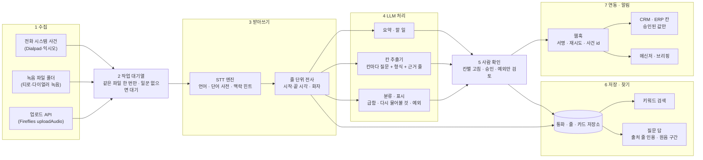
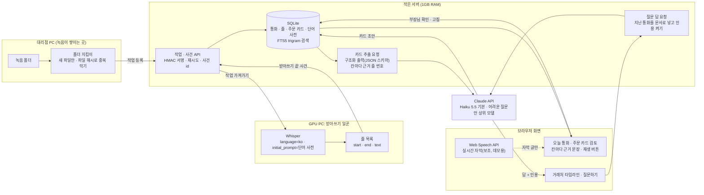

> AI 초안 · 돌린 사람: 배*결 · Claude Code(Opus 5.5) 조사 에이전트 · 2026-11-11 · 검토 전

# 상위 서비스 선정과 참조 아키텍처 (B · C)

앞 조사 세 개에서 모은 서비스 가운데 우리에게 본보기가 될 것을 골랐다. 그리고 그 서비스들이 속에서 어떻게 돌아가는지 공식 문서로 단계별로 뜯어 봤다. 질문은 둘이다.

1. 누구를 본보기로 삼나? (B)
2. 그들은 "녹음 → 받아쓰기 → AI 처리 → 저장·찾기 → 업무 연동 → 화면 → 보안"을 어떻게 짰나? 우리 데모에는 어떻게 옮기나? (C)

## 0. 읽는 법

- **조사 시점**: 2026-11. 기능·값은 이때 본 공식 문서 기준이다. 자주 바뀐다.
- **표시**
  - `[확인]` 회사 공식 문서(개발자 문서·도움말·보안 페이지·가격 페이지·회사 보도자료)에서 봤다.
  - `[추정]` 기사·제3자 글이 근거다. 또는 공식 문서에서 미루어 짐작했다.
  - `[후기]` 리뷰·후기 글이 근거다.
  - `확인 못 함` 이번 조사에서 근거를 못 찾았다. "없다"는 뜻이 아니다.
  - `[앞 조사]` 앞 조사 파일에서 이미 `[확인]`으로 적은 사실을 가져왔다. 링크는 그 원문이다.
- **앞 조사 파일**: [조사-서비스지도-국내.md](조사-서비스지도-국내.md), [조사-서비스지도-해외.md](조사-서비스지도-해외.md), [조사-주문접수-부품플랫폼.md](조사-주문접수-부품플랫폼.md).
- **조사 방법**: 조사 에이전트 1개. 이번 작업에서는 웹 검색(WebSearch)이 첫 호출부터 한도에 막혔다(같은 작업의 다른 에이전트와 한도를 나눠 쓴다). 그래서 검색 대신 공식 문서 주소를 직접 열어(WebFetch 약 45회) 확인했다. Dialpad 도움말(help.dialpad.com)과 Dialpad 본 사이트는 이번에 403 으로 열리지 않았다. Dialpad 의 도움말 내용은 앞 조사 결과를 썼고, 개발자 문서(developers.dialpad.com)는 새로 읽었다.
- **점수는 AI 판단이다.** 기준과 근거는 1절에 다 적었다. 사람이 가중치를 바꾸면 순위가 바뀐다(1-4).
- 대리점·정비소 이름, 실제 통화 내용은 넣지 않았다. 예시 문장은 모두 지어낸 것이다.

## 1. 고르는 기준과 점수표 (B)

### 1-1. 기준 다섯 개와 가중치

| 기준 | 가중치 | 5점 | 3점 | 1점 |
|---|---|---|---|---|
| ① 기능 폭 | 20% | 받아쓰기·요약·칸 추출·검색·질문 답 다섯 가지가 모두 확인됨 | 세 가지 | 한 가지 |
| ② 업무 연동 깊이 | 20% | 정해진 업무 칸(CRM·ERP)에 자동으로 쓰고, API·웹훅도 공개 | 알림·내보내기 일부 | 연동 없음 |
| ③ 평판·사용자 규모 | 10% | 고객 1만 곳 이상 또는 사용자 1,000만 이상 | 고객 수백 곳·사용자 수십만, 또는 회사 주장 숫자만 | 정보 없음 |
| ④ 한국어·전화 통화 적합성 | 25% | 한국어 [확인] + 전화 녹음 경로가 기본 | 둘 중 하나만 강함 | 둘 다 없음 |
| ⑤ 우리 문제(전화 주문)와의 거리 | 25% | 말로 온 주문을 주문서(품목·수량)로 만든다 | 통화에서 정해진 칸을 채우거나, 지난 통화 사실을 찾아 준다 | 관련 적음 |

- ②의 4점은 "CRM·ERP 로 요약·기록을 내보내고 API 나 알림이 있음", 2점은 "앱 안 제안(캘린더 등)이나 API 가 있다고만 함"이다.
- ③의 4점은 "고객 수천 곳 또는 사용자 100만 이상", 2점은 "숫자 확인 못 함, 사례만"이다.
- ④는 일부 기능이 영어만 되면 1점 뺐다. 4점은 "한국어 [확인] + 전화는 연동으로 받음"이다.
- ⑤의 4점은 "자동차 업종이거나 전화 칸 채우기가 주문에 가까움", 2점은 "회의·통화 요약 노트"다.
- **가중치를 이렇게 둔 이유**: 우리 데모의 성패는 한국어 전화 받아쓰기와 주문 카드 채우기에 달렸다. 그래서 ④·⑤에 절반(50%)을 줬다. 평판은 본보기를 고르는 데 덜 중요해서 10%만 줬다.
- 총점 = Σ(가중치 × 점수). 만점 5.00.

### 1-2. 후보 16개 점수표

후보는 앞 조사 세 파일(국내 22개, 해외 31개, 주문 접수·부품 36개)에서 갈래마다 대표를 뽑았다. 국내 6개, 해외 10개다.

| 순위 | 서비스 | 갈래 | ① 기능 | ② 연동 | ③ 평판 | ④ 한국어·전화 | ⑤ 거리 | **총점** | 한 줄 근거 |
|---|---|---|---|---|---|---|---|---|---|
| 1 | Fireflies.ai | 해외 · 회의/통화 노트 | 5 | 5 | 5 | 4 | 3 | **4.25** | 칸별 추출 + 사람 승인 뒤 CRM 전송, 다이얼러 7개, 한국어 지원, 웹훅·API 공개 |
| 2 | Gong | 해외 · 영업 대화 분석 | 5 | 5 | 4 | 3 | 3 | **3.90** | 질문형 추출기 20개 → 기존 CRM 칸. 답에 전사 인용. 한국어 되나 일부 기능 영어만 |
| 2 | 티로(Tiro) | 국내 · 회의/통화 노트 | 4 | 4 | 3 | 5 | 3 | **3.90** | 갤럭시 통화 녹음 파일 자동 변환, 서울 저장, 단어 기억, 출처 단 AI 답, 웹훅 |
| 4 | Canals | 해외 · 산업재 주문 접수 | 2 | 5 | 3 | 3 | 5 | **3.70** | 전화·카운터 대화를 실시간 받아써 품번 없이 카탈로그 매칭 → ERP 주문 |
| 5 | Choco OrderAgent · VoiceAgent | 해외 · 식자재 주문 접수 | 2 | 5 | 2 | 3 | 5 | **3.60** | 음성사서함·전화 주문 → 주문 칸, 거래처 이력과 대조해 예외만 사람 검토 |
| 5 | Dialpad | 해외 · 클라우드 전화 내장 AI | 3 | 5 | 5 | 3 | 3 | **3.60** | 전화 자체에 AI. 통화 단계별 웹훅, 줄마다 화자·시각 붙은 전사 API. 한국어 없음 |
| 5 | 익시오(ixi-O) | 국내 · 통신사 AI 전화 | 4 | 2 | 4 | 5 | 3 | **3.60** | 받아쓰기는 기기 안, 요약만 서버. "AI 대화 검색"으로 지난 통화를 질문으로 찾음 |
| 8 | Aircall | 해외 · 클라우드 전화 | 3 | 4 | 5 | 3 | 3 | 3.40 | 요약·주제·할 일 → HubSpot·Salesforce. 검증 7개 언어에 한국어 없음 |
| 9 | 다글로 | 국내 · 회의 노트 | 4 | 3 | 4 | 4 | 2 | 3.30 | 단어장·보이스매칭·AI 채팅. 통화 녹음 파일은 정황만 |
| 9 | RingCentral AI | 해외 · 클라우드 전화 | 4 | 4 | 2 | 3 | 3 | 3.30 | 실시간 받아쓰기·요약 기본 포함, Salesforce 동기화. 규모 수치 확인 못 함 |
| 11 | 에이닷 전화 · 노트 | 국내 · 통신사 AI 전화 | 3 | 2 | 5 | 5 | 2 | 3.25 | 통화 요약·태그·일정 제안. 외부 연동 거의 없음 |
| 11 | Avoma | 해외 · 회의 노트 + 영업 | 5 | 4 | 2 | 2 | 3 | 3.25 | 단어 사전·양방향 CRM 칸(추가 상품). 한국어 확인 못 함 |
| 13 | LG U+ AI비즈콜 | 국내 · 기업 유선전화 + AI | 2 | 2 | 2 | 5 | 3 | 3.00 | 대표 유선전화 녹음·요약, 전화 올 때 이력 표시. 세부 문서 부족 |
| 14 | 네이버웍스 클로바노트 | 국내 · 회의 노트(기업) | 2 | 2 | 4 | 5 | 2 | 2.95 | 자주 쓰는 단어 2,000개, 안드로이드 통화 미리보기. 검색·질문 답 확인 못 함 |
| 15 | Partly AI Interpreter | 해외 · 자동차 부품 주문 | 1 | 4 | 3 | 1 | 5 | 2.80 | 차대번호로 부품 검증 후 사람 확인 → DMS. 받아쓰기 경로 확인 못 함 |
| 16 | Otter.ai | 해외 · 회의 노트 | 3 | 4 | 5 | 1 | 2 | 2.65 | 단어 사전·AI Chat. 한국어 없음, 회의 중심 |

점수 근거 출처는 앞 조사 파일의 각 서비스 절과 이 문서 2절에 있다.

### 1-3. 상위 7개

| 순위 | 서비스 | 왜 골랐나 (본보기로 삼을 점) |
|---|---|---|
| 1 | **Fireflies.ai** | "칸마다 추출 지시문 → 사람이 검토 → 승인한 칸만 CRM 에 보냄"이 문서로 가장 자세하다. 칸마다 덧붙이기/덮어쓰기를 고른다. 사용자가 고친 문장과 원래 받아쓴 문장을 따로 둔다. |
| 2 | **Gong** | 칸 채우기를 "질문 + 지시문 + 답 형식"으로 정의한다. 발행 전 시험해서 값과 이유를 본다. 질문 답에 전사 위치 인용을 단다. |
| 2 | **티로** | 국내 서비스 가운데 우리 구조와 가장 닮았다. 휴대폰이 이미 녹음한 파일을 읽어 자동 변환한다. 서울 저장·음성 즉시 폐기·학습 금지, 단어 기억 두 층, 출처 번호를 누르면 원문 문단으로 가는 AI 답이 있다. |
| 4 | **Canals** | 전화로 들어온 주문을 실시간 받아써 품번 없이 카탈로그와 맞추고, 재고·가격을 붙인 주문 초안을 만든다. 우리 "주문 카드"의 완성형이다. |
| 5 | **Choco** | 말로 온 주문을 주문 칸으로 바꾸고, 거래처의 지난 주문과 대조해 "진짜 예외"만 사람에게 보낸다. |
| 5 | **Dialpad** | 전화 시스템 쪽 설계의 본보기다. 통화 단계마다 웹훅을 쏘고, 전사를 "줄마다 화자·시각·종류"로 준다. |
| 5 | **익시오** | 국내 통신사 앱이 이미 "지난 통화를 질문으로 찾기"를 판다. 받아쓰기는 기기, 요약만 서버로 나눈 데이터 설계도 참고가 된다. |

- 국내 2개(티로·익시오), 주문 접수형 2개(Canals·Choco)를 넣었다.
- 아깝게 빠진 것: Aircall(3.40)은 Dialpad 와 역할이 겹쳐 뺐다. 다글로(3.30)는 통화 녹음 파일 처리가 공식 기능으로 확인되지 않았다. LG U+ AI비즈콜은 "대표 유선전화 + 전화 올 때 이력"이 우리와 가깝다. 그러나 공개 문서가 짧아 구조를 뜯어볼 수 없었다. 패턴 8에서 따로 쓴다.

### 1-4. 가중치를 바꾸면

점수표 그대로 가중치만 바꿔 다시 셌다.

- **④ 한국어·전화 25% → 10%, ① 기능 20% → 35%**: Fireflies 4.40, Gong 4.20, 티로 3.75, Avoma 3.70, Dialpad 3.60, Canals 3.55. 7위는 익시오·RingCentral·Choco 가 3.45 로 같다. 한국어를 덜 보면 기능 많은 해외 회의 노트(Avoma)가 올라온다.
- **⑤ 거리 25% → 40%, ④ 한국어·전화 25% → 10%**: Fireflies 4.10, Canals 4.00, Gong·Choco 3.90, 티로·Dialpad 3.60. 7위는 Partly·Avoma·Aircall 이 3.40 으로 같고, 익시오는 3.30 으로 빠진다.
- 세 경우 모두 Fireflies·Gong·티로는 5위 안에 남는다. 본보기 셋은 가중치에 크게 흔들리지 않는다. 6~7위는 가중치에 따라 바뀐다.

## 2. 상위 7개 서비스 구조 (C)

각 서비스를 일곱 단계로 나눴다. 칸마다 근거를 달았다. 근거가 없으면 `확인 못 함`이다.

### 2-1. Fireflies.ai — "칸별 지시문 + 승인 뒤 전송"

| 단계 | 어떻게 하나 | 근거 |
|---|---|---|
| 수집 | 회의 봇·크롬 확장, 그리고 다이얼러 7개(Aircall, JustCall, Outreach, Quo, RingCentral, Salesloft, Zoom Phone). 목록 밖 다이얼러는 Zapier 로. 다이얼러 통화는 다이얼러가 녹음한 것을 가져온다. 통화 뒤 가져오는지 실시간인지는 문서에 없다 | [확인](https://guide.fireflies.ai/articles/1735609294-learn-about-fireflies-dialer-integrations) |
| 수집(API) | `uploadAudio` 로 파일을 넣는다. 공개 https 주소여야 하고 내 PC 파일은 못 받는다. mp3·mp4·wav·m4a·ogg. 50KB 미만은 거부. 끝나면 지정한 웹훅으로 알린다. `client_reference_id` 로 내 쪽 번호를 붙인다 | [확인](https://docs.fireflies.ai/graphql-api/mutation/upload-audio.md) |
| 받아쓰기 | 문장(Sentence)마다 `text`(사용자가 고친 글 또는 기본 글), `raw_text`(원래 받아쓴 글), `start_time`, `end_time`, `speaker_id`, `speaker_name` 을 둔다 | [확인](https://docs.fireflies.ai/schema/sentence.md) |
| 받아쓰기 | 한국어 지원(ko, ko-KR). 업로드 때 `custom_language` 로 언어를 지정한다. 사용자 단어 사전은 업로드 입력에 없다. 엔진 이름은 공개하지 않는다 | [앞 조사](https://guide.fireflies.ai/articles/2973706448-learn-about-fireflies-supported-languages) · [확인](https://docs.fireflies.ai/graphql-api/mutation/upload-audio.md) |
| 받아쓰기(실시간) | Realtime API 로 받아쓴 조각을 WebSocket 으로 흘려준다. 베타다 | [확인](https://docs.fireflies.ai/realtime-api/overview.md) |
| LLM 처리 | 요약·할 일(meeting.summarized). Autofill CRM 은 칸마다 "무엇을 뽑을지" 지시문을 쓰고 "어느 칸에 넣을지"를 짝짓는다. 지시문이 구체적일수록 정확하다고 안내한다. 한 번 뽑을 때 AI 크레딧 1개 | [확인](https://guide.fireflies.ai/articles/1729159683-autofill-crm-for-salesforce-automatically-extract-and-sync-meeting-data-to-contacts-accounts-and-opportunities) · [확인](https://docs.fireflies.ai/graphql-api/webhooks-v2.md) |
| 저장·찾기 | AskFred: 한 회의 또는 여러 회의를 필터로 묶어 질문한다. 스레드로 이어 묻는다. 답에 인용을 다는지는 문서에 없다 | [확인](https://docs.fireflies.ai/askfred/overview.md) |
| 업무 연동 | 칸마다 덧붙이기/덮어쓰기를 고른다. 기본은 외부 회의에만 돈다. **"검토하고 승인하기 전에는 Salesforce 로 아무것도 보내지 않는다."** 웹훅 v2: `meeting.transcribed`, `meeting.summarized`. HMAC-SHA256 서명, 5번 재시도, 내용이 바뀌면 `reprocessed_at` 을 달아 다시 보낸다 | [확인](https://guide.fireflies.ai/articles/1729159683-autofill-crm-for-salesforce-automatically-extract-and-sync-meeting-data-to-contacts-accounts-and-opportunities) · [확인](https://docs.fireflies.ai/graphql-api/webhooks-v2.md) |
| 화면 | 회의 노트(Notepad)에 "Autofill" 띠가 뜨고 몇 칸을 뽑았는지 보인다. Review → 칸별 값 고치기·✓로 넣고 빼기 → Save and Next → Autofill 버튼 | [확인](https://guide.fireflies.ai/articles/1729159683-autofill-crm-for-salesforce-automatically-extract-and-sync-meeting-data-to-contacts-accounts-and-opportunities) |
| 보안 | 저장 AES-256, 전송 TLS. 회의 데이터로 AI 학습 안 함, AI 업체도 처리 뒤 보관 안 함. SOC 2 Type II, GDPR. Enterprise 는 원하는 위치에 저장(Private Storage)·맞춤 보관 기간. 기본 저장 지역은 공개 안 함 | [확인](https://fireflies.ai/security) |

**우리에게**: 주문 카드 칸마다 "뽑기 지시문"을 따로 둔다. 부장님이 확인 버튼을 누르기 전에는 카드가 "확정"으로 넘어가지 않는다. 받아쓴 원문과 고친 글을 따로 둔다.

### 2-2. Gong — "질문형 추출기 + 인용 단 질문 답"

| 단계 | 어떻게 하나 | 근거 |
|---|---|---|
| 수집 | 통화·회의·이메일을 모은다. 전화는 Gong Dialer 와 다이얼러 연동 | [앞 조사](https://help.gong.io/docs/ai-data-extractor) |
| 받아쓰기 | 지원 언어에 한국어(대한민국)가 있다. 언어를 자동 감지한다. 잘못 받아쓰면 프로필에 쓰는 언어를 넣고 다시 처리한다. 이메일 분류·위험 알림·추천 할 일·예시 기반 트래커 4개는 영어 통화만 된다. 질문 기반 트래커는 모든 언어 | [확인](https://help.gong.io/docs/what-languages-are-supported-in-gong) |
| 받아쓰기 엔진 | "Gong AI 는 자체 개발"이라고 쓴다. 화자 분리·단어 사전 문서는 확인 못 함 | [확인](https://www.gong.io/trust-center/) |
| LLM 처리 | AI Data Extractor: 추출기마다 질문, 선택 지시문, 대상(딜/계정), 답 형식(예·아니오, 글, 하나 고르기, 여럿 고르기, 숫자, 날짜, 범위). "추출기 하나에 질문 하나"를 권한다. 워크스페이스당 발행 20개 | [확인](https://help.gong.io/docs/ai-data-extractor) |
| LLM 처리 | AI Briefer: "brief type" 템플릿의 각 칸이 하나의 질문에 답한다. 대화·이메일·웹·CRM 을 묶는다 | [확인](https://help.gong.io/v1/docs/understanding-the-ai-briefer) |
| 저장·찾기 | Gong Assistant(2026-03, 통화 페이지): 이번 통화 전사 + 같은 사람과의 다른 통화 + 계정·딜 정보를 본다. **답에 전사의 해당 부분으로 가는 인용을 단다.** 계정·딜·검색 화면은 "앞으로" | [확인](https://help.gong.io/v1/docs/ai-ask-anything-is-evolving-into-gong-assistant) |
| 업무 연동 | 딜 추출기는 CRM 의 기존 칸에만 쓴다. 새 칸·새 레코드를 만들지 않는다. 새 대화가 오면 값을 다시 계산해 덮어쓴다. 최근 한 달 활동한 딜에서 6개월 치 통화를 본다 | [확인](https://help.gong.io/docs/ai-data-extractor) |
| 화면 | 발행 전 "시험" 기능이 값과 "왜 그 값인지" 설명을 보여 준다. 딜 보드의 Briefs·Score 탭, 통화 페이지 요약, 연락처 서랍 | [확인](https://help.gong.io/docs/ai-data-extractor) · [확인](https://help.gong.io/v1/docs/understanding-the-ai-briefer) |
| 보안 | 미국·EU 데이터센터 중 고름(기본 미국). 생성형 모델 학습에 안 씀. AWS, 저장·전송 암호화, 고객 키(BYOK) 선택. 보관 최대 3년 또는 계약 기간 중 짧은 쪽, 계약 끝나고 30일 뒤 삭제. 가림(redaction)·수집 제외 목록. SOC 2 Type 2, ISO 27001·27017·27018·27701·42001 | [확인](https://help.gong.io/docs/faqs-for-security-privacy-and-compliance) · [확인](https://www.gong.io/trust-center/) |

**우리에게**: 주문 카드 칸 하나를 "질문 하나 + 답 형식 하나"로 정의한다(예: "주문한 부품 수량은? 형식: 숫자"). 시험 화면에서 값과 이유를 함께 보여 준다. 질문 답에는 반드시 통화 문장 인용을 단다.

### 2-3. 티로(Tiro) — "휴대폰 녹음 파일 자동 변환 + 출처 단 질문 답"

| 단계 | 어떻게 하나 | 근거 |
|---|---|---|
| 수집 | 실시간 녹음, 오프라인 녹음(나중에 올림), 파일 올리기 | [확인](https://docs.tiro.ooo/llms.txt) |
| 수집(통화) | 티로는 통화를 직접 녹음하지 않는다. 갤럭시 기본 통화 녹음이 만든 파일을 읽어 글로 바꾼다. 안드로이드만 된다(iOS 는 OS 가 막음). "자동 변환"을 켜면 그 뒤에 생긴 녹음만 뒤에서 변환한다. 예전 녹음은 손으로 고른다. **같은 녹음 파일은 기존 노트를 다시 쓰고 중복을 만들지 않는다.** 크레딧이 떨어지면 대기열에 남겨 두었다가 이어서 한다. 노트 제목은 상대 전화번호나 연락처 이름 | [확인](https://docs.tiro.ooo/en/guide/recording/call-recording) |
| 받아쓰기 | 받아쓰기 업체를 여럿 쓴다: Deepgram, AssemblyAI, ElevenLabs, NAVER Cloud Clova, Google Speech-to-Text | [확인](https://tiro.ooo/security) |
| 받아쓰기(화자) | 화자를 A·B 로 나눈다(Pro 이상). 실시간 녹음은 끝난 뒤 전체를 다시 분석해 붙인다. 이름을 붙이면 문서에도 이름으로 나온다. 틀릴 수 있어 사람이 고친다. 파일은 화자 수를 넣으면 더 잘 나눈다 | [확인](https://docs.tiro.ooo/en/guide/recording/diarization.md) |
| 받아쓰기(단어) | "단어 기억": 개인용(내 노트 전부)과 워크스페이스용(팀 전원) 두 층. 쉼표로 여러 개 넣거나, 파일을 올리면 한 파일에서 100개까지 뽑아 고르게 한다. 한국어 화면에는 "분야별 단어 추가" 묶음이 있다. 회의 하나에만 쓰는 힌트는 "맥락(Context)" 칸에 따로 넣는다 | [확인](https://docs.tiro.ooo/en/guide/recording/wordbook.md) · [확인](https://docs.tiro.ooo/en/guide/recording/context.md) |
| LLM 처리 | LLM 업체: Azure OpenAI(주), Anthropic Claude(예비), Google Vertex AI, AWS Bedrock. 템플릿 문서. Tiro Wiki 가 노트에서 사람·주제·결정 페이지를 자동으로 만들고, 문장마다 원래 노트 문단을 출처로 잇는다 | [확인](https://tiro.ooo/security) · [확인](https://docs.tiro.ooo/en/guide/notes/wiki.md) |
| 저장·찾기 | Ask Tiro: 한 노트 또는 전체 노트에 묻는다. `@` 로 노트·폴더를 고른다. **답에 번호 출처가 붙고, 누르면 원래 노트의 그 문단으로 가서 강조한다.** Wiki 를 먼저 찾고 출처를 따라가며, 모르면 모른다고 한다(회사 주장). 전체 노트 질문은 웹·데스크톱만, 모바일은 한 노트만 | [확인](https://docs.tiro.ooo/en/guide/notes/ask-tiro.md) · [확인](https://docs.tiro.ooo/en/guide/notes/wiki.md) |
| 업무 연동 | 녹음이 끝나면 조건(제목·폴더)에 맞는 노트를 Slack 채널에 올린다. 이 링크는 비밀번호 없는 공개 링크다. Notion·HubSpot·Salesforce 로 내보낸다(Salesforce 는 일정 설명 칸). REST API 로 노트·전사·요약을 읽는다. 웹훅은 `note.*`, `note_summary.*`, `voice_file_job.*` 등. 웹훅에는 메타데이터만 싣고 본문은 API 로 따로 받는다. HMAC-SHA256 서명, 6번까지 재시도, 같은 사건은 같은 `id`. MCP 서버도 있다 | [확인](https://docs.tiro.ooo/en/guide/automation/sharing.md) · [확인](https://docs.tiro.ooo/en/developers/getting-started/quickstart.md) · [확인](https://docs.tiro.ooo/en/developers/webhooks/webhooks-overview.md) |
| 화면 | 웹·데스크톱·모바일. "문단 다시 듣기"(베타): 켜면 문단마다 원음을 재생한다. 모바일은 문단의 시각을 누른다. 켠 동안만 음성을 저장하고, 관리자가 정한 기간이 지나면 음성만 지우고 글은 남긴다 | [확인](https://docs.tiro.ooo/en/guide/notes/replay.md) |
| 보안 | AWS 서울(ap-northeast-2) Multi-AZ. 저장 AES-256, 전송 TLS 1.2 이상, 민감한 내용은 사용자별로 한 번 더 암호화. 음성은 받아쓰고 바로 되살릴 수 없게 버린다(다시 듣기를 켜면 예외). 휴지통 보관 0·7·14·30일 선택. 고객 데이터로 학습·미세조정 안 함. LLM·STT 업체와 학습 금지·보관 0 계약. ISO 27001:2022, SOC 2 Type 2, SSO | [확인](https://tiro.ooo/security) · [확인](https://docs.tiro.ooo/en/guide/privacy/overview.md) |

**우리에게**: 수집 방식이 우리와 같다(이미 녹음된 파일을 읽는다). "켠 뒤 새 파일만, 같은 파일 중복 금지, 일꾼이 없으면 대기"를 그대로 쓴다. 단어 기억을 "대리점 공용 + 부장님 개인" 두 층으로 둔다.

### 2-4. Canals — "전화 주문을 받아쓰며 바로 주문 초안"

| 단계 | 어떻게 하나 | 근거 |
|---|---|---|
| 수집 | 이메일, 전화, 음성사서함, 매장 카운터·현장 대화 | [확인](https://www.canals.ai/products/distributor-order-entry) |
| 받아쓰기 | 전화·음성사서함을 실시간으로 받아써 "ERP 에 바로 넣을 주문"으로 바꾼다. 카운터에서는 대화를 녹음하며 그 자리에서 견적을 만든다. 엔진·화자 분리·한국어는 확인 못 함 | [확인](https://www.canals.ai/products/distributor-order-entry) |
| LLM 처리 | 손글씨·물량표·엑셀·PDF·음성을 서식·품번 없이 처리한다. 손님이 원하는 것을 해석해 카탈로그에서 가장 맞는 품목을 찾는다. 담당자 행동과 손님 선호에서 배운다 | [확인](https://www.canals.ai/products/distributor-order-entry) |
| 저장·찾기 | 확인 못 함 | — |
| 업무 연동 | 초안에 지점별 재고·가격·비재고 조달·배송지·배송 지시를 붙인다. 담당자가 검토하고 한 번 클릭으로 ERP 에 낸다. 연동 ERP: Eclipse, Prophet21, Infor CSD·SX.e, SAP S/4HANA, MS Dynamics | [확인](https://www.canals.ai/products/distributor-order-entry) · [앞 조사](https://www.globenewswire.com/news-release/2026/04/01/3266577/0/en/Canals-Introduces-End-to-End-Operating-AI-for-Distributors-Automating-Repetitive-Workflows-for-Customer-Winning-Service.html) |
| 화면 | "마무리에 필요한 모든 것을 한곳에" 모은 주문 초안. "팀이 통제권을 쥔다" | [확인](https://www.canals.ai/products/distributor-order-entry) |
| 보안 | SOC 2 Type II, AES-256, TLS 1.3. 저장 위치·학습 사용은 확인 못 함 | [앞 조사](https://www.canals.ai/products/distributor-order-entry) |

**우리에게**: 주문 카드 부품 칸을 부장님 말 그대로 두지 말고 "대리점 품목표에서 가장 가까운 후보 2~3개"를 옆에 붙인다. 재고·가격 붙이기는 데모 범위 밖이다(대리점 시스템 연동 필요).

### 2-5. Choco OrderAgent · VoiceAgent — "예외만 사람에게"

| 단계 | 어떻게 하나 | 근거 |
|---|---|---|
| 수집 | 음성사서함·WhatsApp·이메일·문자·사진·손글씨. VoiceAgent 는 전화를 실시간으로 받는다 | [확인](https://choco.com/us/orderagent) |
| 받아쓰기 | VoiceAgent 는 OpenAI Realtime API 위에 만들었다. "어떤 언어로든 24시간". 음성사서함 받아쓰기 엔진은 확인 못 함 | [확인](https://choco.com/us/press/choco-and-openai-join-forces-to-launch-the-first-ai-voice-agent-for-the-food-service-industry) |
| LLM 처리 | 엉킨 주문을 "ERP 에 넣을 깨끗한 데이터"로 바꾼다. 뽑은 품목·단위·배송 정보로 스스로 학습한다. VoiceAgent 는 통화 중 재고를 확인하고 대체품을 권한다 | [확인](https://choco.com/us/orderagent) · [확인](https://choco.com/us/press/choco-and-openai-join-forces-to-launch-the-first-ai-voice-agent-for-the-food-service-industry) |
| 저장·찾기 | 해당 없음(주문 처리 도구) | — |
| 업무 연동 | Autopilot: 주문마다 거래처의 지난 주문 이력과 대조하고 **"진짜 예외"만 검토로 보낸다.** 어떤 거래처·주문을 맡길지 사람이 고른다. 초기 도입사는 주문 50% 의 사람 검토를 없앴다(회사 주장). 도입(온보딩) 전체가 빠르면 2주라고 쓴다. ERP 연동 기간만 따로 적지는 않았다(검증 수정 2026-11-11) | [확인](https://choco.com/us/orderagent) |
| 화면 | 검토 화면에서 AI 가 뽑은 품목·단위·배송을 "한 번 훑어" 확인한다. 원문과 나란히 놓는 화면은 회사 사례 글에 있다 | [확인](https://choco.com/us/orderagent) · [앞 조사](https://choco.com/us/stories/suppliers/orderagent-the-ai-order-processing-engine-thats-powering-the-future-of-food-distribution) |
| 보안 | AWS, 승인한 지역 밖으로 안 나간다. SOC 2(보안·가용성·기밀성). Okta·다단계 인증, 최소 권한. 필요한 동안만 보관. 학습 사용·AI 업체는 확인 못 함 | [확인](https://choco.com/us/security) |
| 주의 | 같은 페이지에 정확도 "최대 97%"와 "최대 99% 목표"가 함께 있다. 독립 검증은 없다 | [확인](https://choco.com/us/orderagent) |

**우리에게**: 단골 거래처의 평소 주문과 다른 것(처음 보는 부품, 평소보다 큰 수량, 차종과 안 맞는 부품)만 노란색으로 표시한다. 나머지는 "확인만 누르면 끝"으로 만든다.

### 2-6. Dialpad — "전화 시스템이 내보내는 사건과 전사"

| 단계 | 어떻게 하나 | 근거 |
|---|---|---|
| 수집 | 자체 클라우드 전화. 통화 사건 웹훅: `calling`, `ringing`, `connected`, `hangup`, `missed`, `voicemail` 등. 회사·사무실·사람 단위로 구독한다 | [확인](https://developers.dialpad.com/docs/call-events) |
| 받아쓰기 | 통화가 끝나 전사가 준비되면 `call_transcription` 사건을 보낸다. `GET /api/v2/transcripts/{call_id}` 가 줄(lines) 목록을 준다. 줄마다 말한 사람 이름·사용자 id·연락처 id, 글, **말한 시각**, 종류(transcript, moment, ai_question, custom_moment, real_time_moment) | [확인](https://developers.dialpad.com/docs/call-events) · [확인](https://developers.dialpad.com/reference/transcriptsget) |
| 받아쓰기 엔진 | 자체 개발·조정한 모델. 일본어판 도움말의 AI 언어 목록에 한국어 없음(옛 문서일 수 있음) | [앞 조사](https://help.dialpad.com/docs/data-security-ai-language-models) · [앞 조사](https://help.dialpad.com/hc/ja/articles/360033113772) |
| LLM 처리 | AI Recap: 요약·할 일·하이라이트. 웹훅에 `recap_summary`, `recap_outcome`(결과), `recap_purposes`(통화 목적), `recap_action_items`(할 일)를 따로 싣는다. "moment"(예: 가격 문의)는 전사 줄 사이에 끼운다 | [앞 조사](https://help.dialpad.com/docs/AI-recap) · [확인](https://developers.dialpad.com/docs/call-events) |
| 저장·찾기 | 통화 검색·질문 답은 이번에 확인 못 함 | — |
| 업무 연동 | Recap 과 할 일을 Salesforce 통화 Task 에 자동으로 남긴다(예전 통화는 소급 안 함). 웹훅은 JWT 또는 JSON. **사건 순서가 뒤바뀔 수 있으니 `event_timestamp` 로 정렬하라**고 한다. 연관 통화(돌려 받기 등)는 참조 id 로 묶는다 | [앞 조사](https://help.dialpad.com/docs/dialpad-ai-salesforce) · [확인](https://developers.dialpad.com/docs/call-events) |
| 화면 | Recap 을 사용자가 고친다. 할 일로 캘린더 일정을 만든다 | [앞 조사](https://help.dialpad.com/docs/AI-recap) |
| 보안 | 학습은 선택(미국·캐나다 기본 꺼짐, 영국·EU 기본 켜짐) [검증: 확인 불가 — help.dialpad.com 이 403 으로 열리지 않음]. 외부 LLM 업체에는 학습 금지, 보통 30일 안 삭제를 요구 | [앞 조사](https://help.dialpad.com/docs/ai-training-preferences) · [앞 조사](https://help.dialpad.com/docs/data-security-ai-language-models) |

**우리에게**: 일꾼 → 서버 알림을 "사건" 단위(파일 발견 → 받아쓰기 끝 → 카드 초안 끝 → 확인됨)로 나눈다. 전사는 줄마다 시각을 붙여 저장한다. "다시 물어볼 것"은 Dialpad 의 moment 처럼 전사 줄 사이에 끼운 표시로 다룰 수 있다.

### 2-7. 익시오(ixi-O) — "받아쓰기는 기기, 요약은 서버, 찾기는 질문으로"

| 단계 | 어떻게 하나 | 근거 |
|---|---|---|
| 수집 | 통신사 앱이 전화 앱 노릇을 한다. 자동 녹음(대상 지정 가능)과 수동 녹음. 녹음을 끄면 그 통화에서는 다시 못 켠다 | [확인](https://www.lguplus.com/ixi-O) |
| 받아쓰기 | 녹음 파일은 기기에만 둔다. 글로 바꾸기도 기기에서 한다. 한국어가 아니면 결과가 안 나올 수 있다 | [확인](https://www.lguplus.com/ixi-O) |
| LLM 처리 | 받아쓴 글을 요약용으로 서버에 보내고 요약이 끝나면 바로 버린다. 키워드·해시태그·AI 제안(캘린더 등록, 지도 검색)을 함께 준다. 200자 미만·1시간 이상 통화는 요약 안 함. 업무용(부동산 중개·영업 활동 등) 포함 6가지 양식 | [확인](https://www.lguplus.com/ixi-O) · [추정](https://www.etoday.co.kr/news/view/2531622) |
| 저장·찾기 | AI 대화 검색: "잊어버린 약속이나 지난 대화도 질문 한 번으로 찾는다." 검색 방식·처리 위치·인용 여부는 확인 못 함 | [확인](https://www.lguplus.com/ixi-O) |
| 업무 연동 | 캘린더 등록 제안 정도. 외부 시스템 연동은 확인 못 함 | [확인](https://www.lguplus.com/ixi-O) |
| 화면 | 휴대폰 앱. 요약을 고치고 복사·공유한다 | [추정](https://www.etoday.co.kr/news/view/2531622) |
| 보안 | 6개월 안의 통화 기록·요약은 서버에 저장(다시 깔아도 불러옴). 녹음·받아쓴 글·AI 제안은 앱을 지우면 같이 지워진다. 번호 1개당 계정 1개 | [확인](https://www.lguplus.com/ixi-O) · [앞 조사](https://www.lguplus.com/ixi-O) |
| 값 | AI 대화 검색·스마트 요약 무료 체험 100회(2025-12 행사). 유료 값 확인 못 함 | [추정](https://www.etoday.co.kr/news/view/2531622) |

**우리에게**: "두 개라고 했나?" 같은 질문 찾기는 이미 국내 소비자 앱이 판다. 우리 차별점은 (1) 대리점 대표 전화의 모든 통화를 거래처별로 모으고 (2) 답에 통화 문장과 원음 구간을 붙이는 데 있다. 데이터 쪽은 "음성은 대리점 PC 에, 글만 서버로"라는 익시오식 분리를 따른다.

## 3. 일곱 개를 겹쳐 보면 — 단계별 공통점

| 단계 | 거의 모두 하는 것 | 갈리는 것 | 우리 선택 |
|---|---|---|---|
| 수집 | 이미 있는 녹음을 가져오거나(티로·Fireflies 다이얼러), 전화 시스템이 직접 넘긴다(Dialpad·익시오) | 실시간 응대(Canals·Choco VoiceAgent) vs 통화 뒤 처리 | 통화 뒤 처리(녹음 폴더). 실시간은 브라우저 자막으로 보조만 |
| 받아쓰기 | 문장·줄 단위로 시각과 화자를 붙인다(Fireflies·Dialpad·티로) | 자체 엔진(Gong·Dialpad) vs 외부 업체 여럿(티로) | Whisper(PC GPU). 단어 사전을 프롬프트로 넣는다 |
| LLM 처리 | 요약 + 할 일. 정해진 칸은 "질문/지시문 하나 = 칸 하나"(Gong·Fireflies) | 사람 승인 필수(Fireflies) vs 예외만 사람(Choco Autopilot) vs 자동 덮어쓰기(Gong) | 처음엔 모두 사람 확인. 나중에 단골·평소 주문만 자동으로 |
| 저장·찾기 | 질문 답에 출처를 단다(티로·Gong) | 지식 지도(Tiro Wiki) vs 통화 단위 | 통화 단위 + 거래처 단위. 키워드 검색 먼저, 그다음 LLM 이 답 |
| 업무 연동 | 웹훅 + 서명 + 재시도 + 중복 방지 id(Fireflies·티로·Dialpad) | CRM/ERP 칸에 직접 쓰기 vs 메신저 알림 | 데모는 카드 확정까지. 대리점 시스템 입력은 다음 단계 |
| 화면 | 검토 화면에서 칸별로 고치고 넣고 빼기(Fireflies·Choco·Canals) | 원음 재생 연결(티로) 유무 | 칸마다 근거 문장 + 재생 버튼 |
| 보안 | 학습 안 함, 전송·저장 암호화 | 저장 지역(서울·미국·EU), 음성 보관 여부 | 음성은 대리점 PC 에 두고 서버에는 글만. 외부 AI 에는 필요한 글만 |

## 4. 공통 참조 아키텍처

### 4-1. 글로 쓰면

일곱 서비스의 공통 뼈대는 일곱 칸이다.

1. **수집**: 녹음을 얻는다. 전화 시스템 사건, 폴더 속 녹음 파일, 업로드 API 가운데 하나다.
2. **작업 대기열**: 녹음 하나가 "작업" 하나가 된다. 같은 파일은 한 번만 처리하고, 일꾼이 없으면 기다린다.
3. **받아쓰기**: 언어·단어 사전·맥락 힌트를 넣고 글로 바꾼다. 결과는 "줄(문장) + 시작·끝 시각 + 화자"다.
4. **LLM 처리**: (가) 요약·할 일, (나) 정해진 칸 추출(칸마다 질문과 형식), (다) 분류·표시(급함, 다시 물어볼 것). 칸마다 근거 줄 번호를 같이 받는다.
5. **사람 확인**: 칸별로 고치고 넣고 뺀 뒤 승인한다. 익숙해지면 "예외만" 사람에게 보낸다.
6. **저장·찾기**: 통화·줄·카드를 저장한다. 키워드 검색과 질문 답을 준다. 질문 답에는 출처 줄을 달고 원음 구간으로 잇는다.
7. **업무 연동·알림**: 웹훅(서명·재시도·중복 방지)으로 다른 시스템이나 메신저에 알린다. 정해진 업무 칸에는 승인된 값만 쓴다.

보안은 모든 칸에 걸린다. 음성은 받아쓰고 곧 버리거나 사용자 쪽에 둔다. 외부 AI 업체와는 학습 금지·보관 안 함 조건을 맺는다. 저장 지역을 밝힌다.

### 4-2. 참조 아키텍처 다이어그램 (일반형)

### 4-3. 우리 데모에 대입

데모 구성: 1GB RAM 작은 서버 + Claude API + GPU 가 있는 PC 의 Whisper 받아쓰기 일꾼 + 브라우저 Web Speech API.

| 구성 요소 | 맡는 일 | 본뜬 곳 | 근거·주의 |
|---|---|---|---|
| 폴더 지킴이 | 녹음 폴더에 새 파일이 생기면 작업을 만든다. 켠 뒤 생긴 파일만, 같은 파일은 한 번만 | 티로 통화 녹음 가져오기 | [확인](https://docs.tiro.ooo/en/guide/recording/call-recording) |
| Whisper 일꾼 | 받아쓰기. `initial_prompt` 에 거래처·차종·부품 이름을 넣는다. `carry_initial_prompt` 를 켜면 매 구간에 다시 붙는다. 결과는 구간별 `start`·`end`·`text`. 화자 칸은 없다 | Tiro 단어 기억·맥락 | [확인](https://raw.githubusercontent.com/openai/whisper/main/whisper/transcribe.py). 화자 구분이 필요하면 따로 붙여야 한다. 대리점 녹음이 두 채널로 저장되는지는 확인 못 함 |
| 작업·사건 API | 일꾼과 서버가 "작업 생김 → 받아쓰기 끝 → 카드 초안 끝 → 확인됨"을 주고받는다. 서명·재시도·사건 id 로 중복을 막는다 | Fireflies 웹훅 v2, 티로 웹훅, Dialpad 통화 사건 | [확인](https://docs.fireflies.ai/graphql-api/webhooks-v2.md) · [확인](https://docs.tiro.ooo/en/developers/webhooks/webhooks-overview.md) |
| 저장소 | SQLite 한 파일. 1GB 서버에 벡터 DB 는 무겁다(우리 판단). 한국어는 FTS5 trigram 으로 부분 글자 검색을 한다. 단, 3글자 미만 검색어는 전문 검색으로 안 걸린다. "두 개" 같은 짧은 말은 `LIKE` 로 찾는다 | — | [확인](https://www.sqlite.org/fts5.html) |
| 카드 추출 | Claude 구조화 출력으로 주문 카드 JSON 을 받는다. 칸마다 값 + 근거 줄 번호 + 자신 없음 표시를 받는다 | Gong 추출기, Fireflies Autofill | 구조화 출력은 스키마를 지키게 한다. 단 거절·`max_tokens` 잘림 때는 어긋날 수 있다 [확인](https://platform.claude.com/docs/en/build-with-claude/structured-outputs.md) |
| 질문 답 | 지난 통화 전사를 문서 블록으로 넣고 인용을 켠다. 답의 문장마다 인용 글(`cited_text`)과 글자 위치가 붙는다. `cited_text` 는 출력 토큰으로 세지 않는다 | 티로 Ask Tiro, Gong Assistant | [확인](https://platform.claude.com/docs/en/build-with-claude/citations) |
| **설계 주의** | **인용과 구조화 출력은 한 요청에 같이 못 쓴다(400 오류).** 그래서 카드 추출(구조화 출력)과 질문 답(인용)을 서로 다른 요청으로 나눈다. 카드 쪽 근거는 JSON 안의 줄 번호로 받는다 | — | [확인](https://platform.claude.com/docs/en/build-with-claude/citations) |
| 모델·값 | Claude Haiku 5.5: 입력 100만 토큰당 0.10달러, 출력 0.50달러(프롬프트 10만 토큰 이하). Claude Sonnet 5.5: 2달러·10달러. Batch API 는 입력·출력 50% 할인(급하지 않은 밤 일괄 처리용). 2026-11 기준 | — | [확인](https://platform.claude.com/docs/en/about-claude/pricing) |
| 값 어림 | 3분 통화 전사를 약 1,500 토큰, 지시문 2,000 토큰, 출력 400 토큰으로 잡으면 Haiku 5.5 로 하루 100통화 카드 추출은 하루 약 0.06달러다 | — | [추정] 한국어 토큰 수는 실제 녹음으로 재야 한다 |
| 실시간 자막 | Web Speech API(`lang="ko-KR"`, `continuous`, `interimResults`). Chrome 등 일부 브라우저는 음성을 서버 인식 엔진으로 보낸다. 오프라인으로 안 된다. `processLocally` 로 기기 안 인식을 요구할 수 있으나 지원 범위는 확인 못 함 | 익시오 "보이는 전화" | [확인](https://developer.mozilla.org/en-US/docs/Web/API/SpeechRecognition). 실제 고객 통화에는 쓰지 말고 시연용으로만 |
| 데이터 경계 | 음성 파일은 대리점 PC·일꾼 PC 밖으로 안 나간다. 서버에는 글·카드만. Claude 에는 그 통화(또는 질문에 필요한 통화)의 글만 보낸다 | 익시오(녹음은 기기, 요약만 서버), 티로(음성 즉시 폐기) | [확인](https://www.lguplus.com/ixi-O) · [확인](https://docs.tiro.ooo/en/guide/privacy/overview.md) |

## 5. 우리가 가져올 패턴 12개

| # | 패턴 | 어디서 봤나 | 부품 대리점 전화 주문에 어떻게 쓰나 |
|---|---|---|---|
| 1 | **녹음 폴더 자동 가져오기** — 켠 뒤 생긴 파일만, 같은 파일은 한 번만, 일꾼이 없으면 대기 | 티로 갤럭시 통화 녹음 [확인](https://docs.tiro.ooo/en/guide/recording/call-recording) | 대리점 PC 녹음 폴더를 지킨다. 파일 해시로 중복을 막는다. GPU PC 가 꺼져 있으면 쌓아 두고 켜지면 처리한다 |
| 2 | **칸 하나 = 질문 하나 + 답 형식 하나** | Gong AI Data Extractor [확인](https://help.gong.io/docs/ai-data-extractor), Fireflies 칸별 지시문 [확인](https://guide.fireflies.ai/articles/1729159683-autofill-crm-for-salesforce-automatically-extract-and-sync-meeting-data-to-contacts-accounts-and-opportunities) | 거래처(고르기), 차종(글), 연식(숫자), 차번호(글), 부품(목록), 수량(숫자), 급함(예·아니오), 다시 물어볼 것(목록)마다 질문과 예시를 따로 쓴다. 칸을 하나씩 고쳐도 다른 칸이 안 흔들린다 |
| 3 | **채운 뒤 사람 승인** — 승인 전에는 아무 데도 안 보냄 | Fireflies Autofill [확인](https://guide.fireflies.ai/articles/1729159683-autofill-crm-for-salesforce-automatically-extract-and-sync-meeting-data-to-contacts-accounts-and-opportunities), Canals [확인](https://www.canals.ai/products/distributor-order-entry), Partly [확인](https://www.partly.com/solutions/dealerships) | 카드는 "초안 → 부장님 확인 → 확정" 세 상태다. 확인 화면은 칸별 ✓ 와 고치기만 둔다. 고령 사용자를 생각해 큰 글씨·큰 버튼 하나로 |
| 4 | **근거 문장 연결 + 원음 구간 재생** | 티로 출처 번호 → 문단 강조, 문단 다시 듣기 [확인](https://docs.tiro.ooo/en/guide/notes/ask-tiro.md) · [확인](https://docs.tiro.ooo/en/guide/notes/replay.md), Gong 인용 [확인](https://help.gong.io/v1/docs/ai-ask-anything-is-evolving-into-gong-assistant), Dialpad 줄별 시각 [확인](https://developers.dialpad.com/reference/transcriptsget) | 카드의 "수량 2" 옆에 근거 문장("…그거 두 개만 보내 줘요", 지어낸 예)과 ▶ 버튼. 누르면 그 구간 녹음을 튼다. 부장님이 귀로 확인한다 |
| 5 | **근거 단 질문 답, 근거 없으면 "못 찾음"** | 티로 Ask Tiro [확인](https://docs.tiro.ooo/en/guide/notes/ask-tiro.md), 익시오 AI 대화 검색 [확인](https://www.lguplus.com/ixi-O), Claude 인용 [확인](https://platform.claude.com/docs/en/build-with-claude/citations) | "○○공업사가 지난주에 두 개라고 했나?"에 답 + 해당 통화 날짜·문장 + ▶. 인용이 없으면 답하지 말고 "통화 기록에서 못 찾았다"로 끝낸다. 사실관계 다툼에서 지어낸 답이 가장 위험하다 |
| 6 | **단어 사전 두 층** — 공용 + 개인, 파일에서 뽑아 고르기, 한 통화용 맥락은 따로 | 티로 단어 기억·맥락 [확인](https://docs.tiro.ooo/en/guide/recording/wordbook.md), 네이버웍스 클로바노트 자주 쓰는 단어 2,000개 [앞 조사](https://naver.worksmobile.com/pricing/clovanote/) | 대리점 공용: 거래처 이름, 차종 별칭, 부품 속칭. 부장님 개인: 자주 부르는 호칭. 거래처 목록 엑셀을 올리면 이름을 뽑아 준다. 같은 사전을 Whisper `initial_prompt` 와 Claude 지시문에 함께 쓴다 |
| 7 | **칸마다 쓰기 규칙** — 덧붙이기 / 덮어쓰기 / 빈칸일 때만 | Fireflies 덧붙이기·덮어쓰기 [확인](https://guide.fireflies.ai/articles/1729159683-autofill-crm-for-salesforce-automatically-extract-and-sync-meeting-data-to-contacts-accounts-and-opportunities), Gong 덮어쓰기 [확인](https://help.gong.io/docs/ai-data-extractor), Outreach 빈칸만 [앞 조사](https://support.outreach.io/hc/en-us/articles/39330939992859-Deal-Agent-Overview) | 같은 주문으로 두 번째 전화가 오면 수량은 덮어쓰지 않는다. "2 → 3 (14:20 통화)"처럼 바뀐 이력으로 남긴다. "두 개라고 했다/안 했다"를 가리는 데 이력이 핵심이다 |
| 8 | **거래처별 통화 타임라인 + 전화 올 때 이력** | LG U+ AI비즈콜 수신 시 소통 이력 [앞 조사](https://www.lguplus.com/biz/all/telecom/lines/biz-call/B000000130), Gong 계정·딜 요약 [확인](https://help.gong.io/v1/docs/understanding-the-ai-briefer), Tiro Wiki 사람 페이지 [확인](https://docs.tiro.ooo/en/guide/notes/wiki.md) | 거래처 화면에 통화·카드를 시간순으로 쌓는다. 같은 번호로 전화가 오면 최근 카드 3장과 "아직 안 끝난 것"을 띄운다(데모에서는 번호를 손으로 고르는 것으로 대신) |
| 9 | **예외만 사람에게** — 평소와 다른 것만 표시 | Choco Autopilot [확인](https://choco.com/us/orderagent) | 거래처의 지난 카드와 비교해 처음 보는 부품, 평소의 3배 넘는 수량, 차종과 연식이 안 맞는 조합만 노란색. 데모 1단계는 전부 사람 확인, 2단계에서 "예외 없음 + 단골"만 자동 확정을 시험 |
| 10 | **사건 웹훅** — 서명·재시도·사건 id·순서 정렬 | Fireflies 웹훅 v2 [확인](https://docs.fireflies.ai/graphql-api/webhooks-v2.md), 티로 웹훅 [확인](https://docs.tiro.ooo/en/developers/webhooks/webhooks-overview.md), Dialpad 통화 사건 [확인](https://developers.dialpad.com/docs/call-events) | 일꾼 PC → 서버 알림을 HMAC 서명으로 확인한다. 같은 사건 id 는 한 번만 처리한다. 본문(전사)은 알림에 싣지 않고 따로 가져간다(티로 방식). 서버가 잠깐 죽어도 일꾼이 다시 보낸다 |
| 11 | **원래 받아쓴 글과 고친 글을 따로 저장** | Fireflies `raw_text` / `text` [확인](https://docs.fireflies.ai/schema/sentence.md) | 부장님이 "그랜저"를 "그랜져"에서 고치면 원문도 남긴다. 자주 고치는 말은 단어 사전 후보로 올린다. 나중에 받아쓰기 정확도를 잴 정답 자료도 된다 |
| 12 | **아침 브리핑 · 할 일 자동 생성** | Gong AI Briefer(칸마다 질문) [확인](https://help.gong.io/v1/docs/understanding-the-ai-briefer), Dialpad `recap_action_items` [확인](https://developers.dialpad.com/docs/call-events), 티로 녹음 끝나면 Slack 자동 게시 [확인](https://docs.tiro.ooo/en/guide/automation/sharing.md) | 아침에 "어제 확정 안 된 카드 · 다시 물어볼 것 · 급함 표시 주문"을 한 장으로. 카드의 "다시 물어볼 것"이 곧 할 일이다. 메신저로 보낼 때 공개 링크는 쓰지 않는다(티로가 공개 링크 위험을 스스로 경고한다) |

## 6. 확인 못 한 것 · 사람이 확인할 것

### 6-1. 확인 못 한 것

- Fireflies·Gong 의 사용자 단어 사전, 받아쓰기 엔진 이름.
- Fireflies AskFred 와 익시오 AI 대화 검색이 답에 인용을 다는지.
- Canals·Choco 의 받아쓰기 엔진, 한국어 지원, 저장 지역, 학습 사용 여부.
- Dialpad 의 한국어 지원 최신 상태(도움말이 403 으로 안 열렸다).
- 익시오 AI 대화 검색의 처리 위치(기기 안인지 서버인지)와 유료 값.
- 웹 검색 한도 때문에 Gong Assistant 의 언어 지원, 티로 웹훅 이벤트 세부 이름 같은 칸은 더 파지 못했다.

### 6-2. 사람이 확인할 것

- **가중치**: ④ 한국어·전화와 ⑤ 거리에 50% 를 줬다. 팀이 다르게 본다면 1-4 를 보고 순위를 다시 매긴다.
- **대리점 녹음 파일 형식**: 두 사람 목소리가 한 채널에 섞였는지, 좌우 채널로 나뉘었는지. 나뉘었다면 화자 구분이 쉬워진다. 데모 전에 가짜 녹음이 아닌 실제 형식(파일 이름 규칙·확장자)만 확인한다(내용은 저장소에 넣지 않는다).
- **Web Speech API 를 실제 통화에 쓰지 않기**: Chrome 은 음성을 외부 서버로 보낸다. 시연용 가짜 대화에만 쓴다.
- **Claude 로 보내는 글의 범위**: 통화 글에는 차번호·사람 이름이 들어간다. 데모에서는 가짜 데이터만 쓰고, 실제 도입 전에는 개인정보 처리 방침과 국외 이전 고지를 따로 검토한다.
- **값 어림(4-3)**: 한국어 토큰 수는 가짜 녹음 몇 개로 실제로 재 본다.

## 7. 출처 목록

### Fireflies.ai
- 다이얼러 연동: https://guide.fireflies.ai/articles/1735609294-learn-about-fireflies-dialer-integrations
- Autofill CRM(Salesforce): https://guide.fireflies.ai/articles/1729159683-autofill-crm-for-salesforce-automatically-extract-and-sync-meeting-data-to-contacts-accounts-and-opportunities
- 지원 언어(앞 조사): https://guide.fireflies.ai/articles/2973706448-learn-about-fireflies-supported-languages
- 보안: https://fireflies.ai/security
- API 문서 목록: https://docs.fireflies.ai/llms.txt
- uploadAudio: https://docs.fireflies.ai/graphql-api/mutation/upload-audio.md
- Sentence 스키마: https://docs.fireflies.ai/schema/sentence.md
- 웹훅 v2: https://docs.fireflies.ai/graphql-api/webhooks-v2.md
- AskFred API: https://docs.fireflies.ai/askfred/overview.md
- Realtime API: https://docs.fireflies.ai/realtime-api/overview.md

### Gong
- AI Data Extractor: https://help.gong.io/docs/ai-data-extractor
- 보안·개인정보 FAQ: https://help.gong.io/docs/faqs-for-security-privacy-and-compliance
- Trust Center: https://www.gong.io/trust-center/
- Gong Assistant: https://help.gong.io/v1/docs/ai-ask-anything-is-evolving-into-gong-assistant
- AI Briefer: https://help.gong.io/v1/docs/understanding-the-ai-briefer
- 지원 언어: https://help.gong.io/docs/what-languages-are-supported-in-gong
- 규모(앞 조사): https://www.gong.io/press/gong-growth-accelerates-past-55-yoy-arr-tops-500m

### 티로(Tiro)
- 통화 녹음 가져오기: https://docs.tiro.ooo/en/guide/recording/call-recording
- 보안: https://tiro.ooo/security
- 개인정보·보안 안내: https://docs.tiro.ooo/en/guide/privacy/overview.md
- 문서 목록: https://docs.tiro.ooo/llms.txt
- 단어 기억: https://docs.tiro.ooo/en/guide/recording/wordbook.md
- 맥락(Context): https://docs.tiro.ooo/en/guide/recording/context.md
- 화자 분리: https://docs.tiro.ooo/en/guide/recording/diarization.md
- Ask Tiro: https://docs.tiro.ooo/en/guide/notes/ask-tiro.md
- Tiro Wiki · MCP: https://docs.tiro.ooo/en/guide/notes/wiki.md
- 문단 다시 듣기: https://docs.tiro.ooo/en/guide/notes/replay.md
- 자동 공유(Slack): https://docs.tiro.ooo/en/guide/automation/sharing.md
- 개발자 빠른 시작: https://docs.tiro.ooo/en/developers/getting-started/quickstart.md
- 웹훅: https://docs.tiro.ooo/en/developers/webhooks/webhooks-overview.md

### Canals
- 주문 입력 제품: https://www.canals.ai/products/distributor-order-entry
- 보도자료(앞 조사): https://www.globenewswire.com/news-release/2026/04/01/3266577/0/en/Canals-Introduces-End-to-End-Operating-AI-for-Distributors-Automating-Repetitive-Workflows-for-Customer-Winning-Service.html

### Choco
- OrderAgent: https://choco.com/us/orderagent
- 보안: https://choco.com/us/security
- VoiceAgent 보도자료(2025-12-04): https://choco.com/us/press/choco-and-openai-join-forces-to-launch-the-first-ai-voice-agent-for-the-food-service-industry
- 사례 글(앞 조사): https://choco.com/us/stories/suppliers/orderagent-the-ai-order-processing-engine-thats-powering-the-future-of-food-distribution

### Dialpad
- 통화 사건 웹훅: https://developers.dialpad.com/docs/call-events
- 전사 API: https://developers.dialpad.com/reference/transcriptsget
- AI Recap(앞 조사): https://help.dialpad.com/docs/AI-recap
- Salesforce 연동(앞 조사): https://help.dialpad.com/docs/dialpad-ai-salesforce
- AI 학습 설정(앞 조사): https://help.dialpad.com/docs/ai-training-preferences
- AI 언어 모델 보안(앞 조사): https://help.dialpad.com/docs/data-security-ai-language-models
- 일본어 도움말 AI 언어 목록(앞 조사): https://help.dialpad.com/hc/ja/articles/360033113772

### 익시오(ixi-O)
- 공식 소개: https://www.lguplus.com/ixi-O
- 이투데이 2025-12-02 기사: https://www.etoday.co.kr/news/view/2531622

### 점수표에만 쓴 서비스(앞 조사 원문)
- LG U+ AI비즈콜: https://www.lguplus.com/biz/all/telecom/lines/biz-call/B000000130
- 네이버웍스 클로바노트 가격: https://naver.worksmobile.com/pricing/clovanote/
- Partly: https://www.partly.com/solutions/dealerships
- Avoma 보안: https://www.avoma.com/security
- Outreach Deal Agent: https://support.outreach.io/hc/en-us/articles/39330939992859-Deal-Agent-Overview
- 그 밖의 서비스(Aircall, RingCentral, 다글로, 에이닷, Otter) 출처는 앞 조사 두 파일의 출처 목록에 있다.

### 우리 데모 구성 요소
- Claude 인용(Citations): https://platform.claude.com/docs/en/build-with-claude/citations
- Claude 구조화 출력: https://platform.claude.com/docs/en/build-with-claude/structured-outputs
- Claude 가격: https://platform.claude.com/docs/en/about-claude/pricing
- Whisper transcribe.py: https://raw.githubusercontent.com/openai/whisper/main/whisper/transcribe.py
- MDN SpeechRecognition: https://developer.mozilla.org/en-US/docs/Web/API/SpeechRecognition
- SQLite FTS5: https://www.sqlite.org/fts5.html
