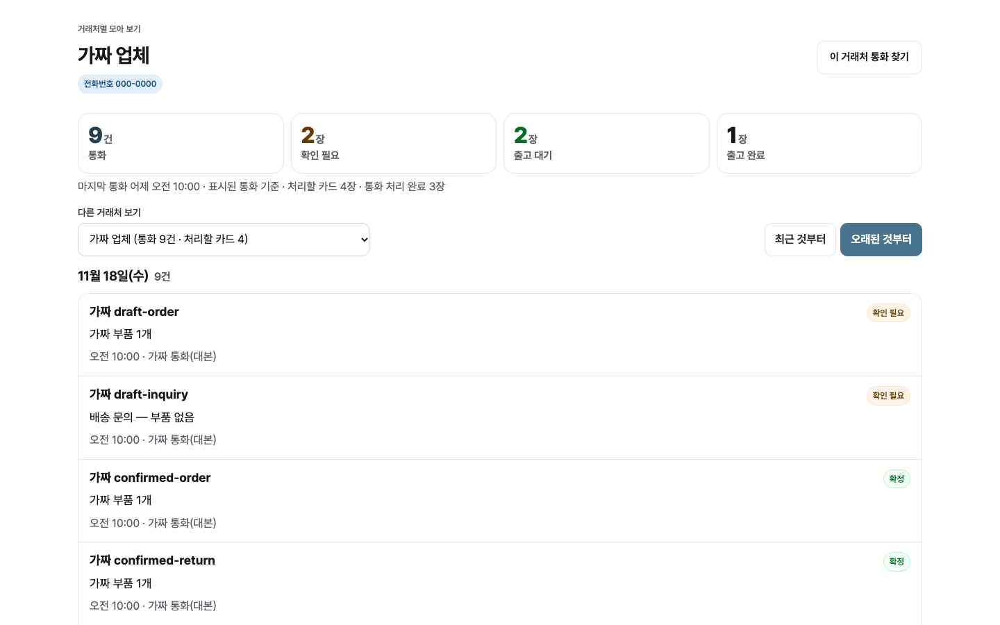
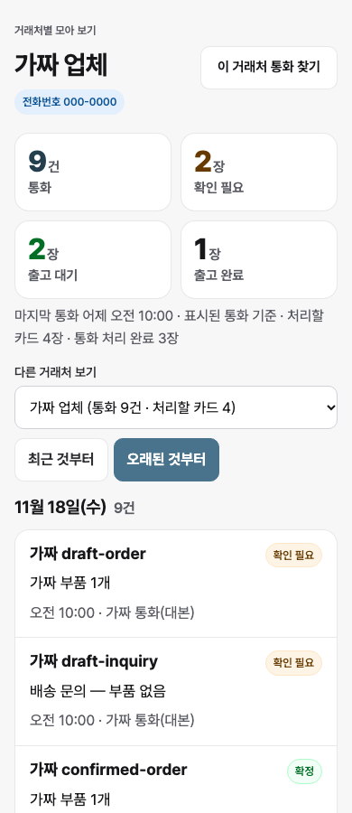

# 거래처 처리 상태 집계 정합성
> AI 초안 · 돌린 사람: 신*림 · 도구: ChatGPT dot · 2026-11-19

## 실제 업무에서 생기는 혼동
확정된 배송 문의는 카드에서 처리 완료이며 출고 대상도 아니다. 그런데 거래처 모아보기는 모든 확정 카드를 「확정·출고 전」과 「열린 카드」에 포함했다. 실제 출고 처리가 잘못된 것이 아니라 완료한 일을 남은 일로 보이게 하는 집계·안내 불일치다.

## 범위
1.6 거래처 관리·통화 이력·상태 분리와 출고 여정에 해당한다. 고객 목록/API/상세의 열린 카드는 초안 또는 확정된 실제 출고 대상만 센다. 확정된 비출고 통화는 처리 완료로 구분한다. 다시 전화 표시는 별도 업무로 남기고 상태만으로 지우지 않는다. 품목·권한·확정 규칙은 바꾸지 않는다.

전체 UI 재설계 완료나 실사용자 연구 결과가 아니다. 가짜 데이터 재현·기존 도메인 기준과의 대조로 검증한다. dev 배포는 보류한다.

## 재현과 검증
- 변경 전: 완료 배송 문의 1건의 실제 UI 모듈은 출고 전1/열린1로 표시했다. 실제 임시 DB HTTP 테스트에서도 openCards=1(기대0) 실패를 확인했다.
- 변경 후: 가짜 UI 4범위(문의단독·혼합상태×PC/mobile) 통과. 정렬·키보드 거래처 선택·기존 링크·콜백 표시 보존, 오류/외부요청0.
- 실제 서버 시험 21조합: 주문·반품·모든 문의·빈품목·콜백·취소·출고 및 JSON 품목 경계. SQL 목록과 공통 isShipTarget 상세의 판정 일치. 전체 Node191 통과.
- UI 캡처는 실제 customer 모듈/CSS에 합성 GET을 제공한 화면이다. 전체 앱 LNB나 실제 계정 권한 검증이 아니다.

## 호환성과 한계
API 필드 openCards의 이름·자료형은 유지하되 의미를 실제 처리 대기 카드로 정정했다. 콜백은 독립 업무이며 이 숫자에 더하지 않는다. 목록 API는 전체 통화, 상세는 기존 최근500건 한도를 유지하므로 상세에 「표시된 통화 기준」을 명시했다. 전체 대규모 자료 성능 시험은 하지 않았다.

[변경 전 재현](../자료/customer-status-20261119/before.json) · [UI 자체 검증](../자료/customer-status-20261119/results.json)

| PC 모듈 가짜 화면 | 모바일 모듈 가짜 화면 |
|---|---|
|  |  |
