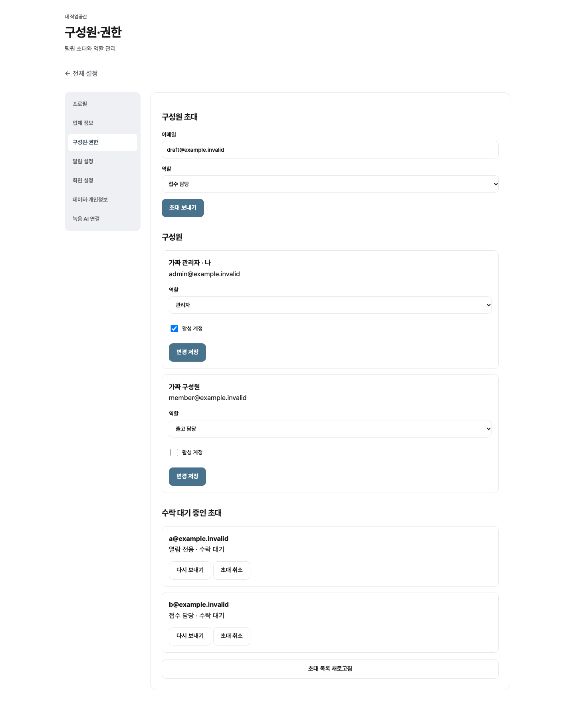
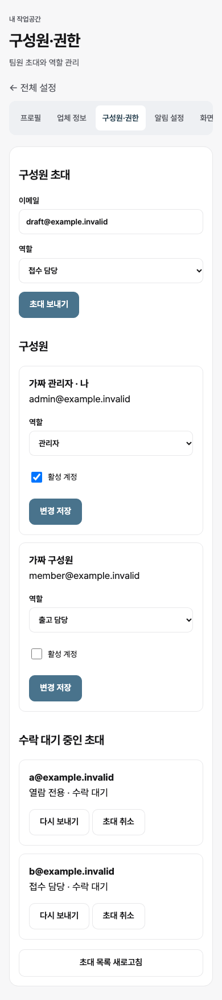

> AI 초안 · 돌린 사람: 신*림 · 도구: ChatGPT dot · 2026-11-19

# 구성원 설정에서 다른 폼의 작성 내용 보존

## 재현
초대 재발송·취소 응답을 기다리며 새 초대 이메일과 다른 구성원 역할을 입력했다. 성공 후 전체 화면이 다시 그려져 이메일은 빈칸, 역할은 기존값으로 돌아갔다. 실제 설정/폼 모듈에 가짜 API를 연결해 두 경로를 재현했다. 실제 메일이나 권한 변경은 없었다.

## 수정
- 초대 처리 후 초대 목록만 갱신한다. 구성원 폼과 새 초대 폼의 DOM·초안·초점은 보존한다.
- 초대 변경은 한 번에 한 건씩 처리하며 별도 fieldset 잠금으로 공통 폼 잠금과 충돌하지 않게 한다. 다른 구성원 편집·저장은 가능하다.
- 새 초대를 성공적으로 제출했을 때만 그 폼을 초기화한다. 실패 시 입력을 유지한다.
- 변경 성공 후 목록 GET이 실패하면 성공 사실과 조회 실패를 구분한다. 초대 작업을 보류하고 목록만 다시 조회하여 중복 재발송을 막는다.
- 초기·후속 조회에서 이미 떠난 화면을 덮지 않는다. 서버 권한과 API 계약은 유지한다.

## 검증
- 신규 가짜 API 19범위 통과: PC1440/모바일390 각각 재발송/취소, 변경·재조회 실패, 신규 초대 성공/실패, 중복 제출 차단, 독립 구성원 저장, 목록 재조회·화면 이탈, 비관리자/데모 UI 제한.
- 기존 설정 7범위·공통 폼5범위·Node188 통과. 오류·외부 요청 0.
- 독립 감사·구현·읽기 리뷰 및 주 검토. 초기 GET 실패 후 이탈 방어는 소스 검토이며, 실제 이탈 회귀는 후속 목록 재조회에 해당한다.
- 실제 CSS를 적용한 아래 가짜 화면의 버튼·입력 가로 잘림을 확인했다. 캡처에는 가짜 이름과 example.invalid 주소만 있다.
- [변경 전](../자료/members-draft-20261119/before-fake.json) · [신규 회귀](../자료/members-draft-20261119/results.json) · [설정 회귀](../자료/members-draft-20261119/settings-regression.json) · [폼 회귀](../자료/members-draft-20261119/form-regression.json)

## 한계
가짜 API 내부 검증이며 실제 메일 발송·서버 권한·실사용자 시험이 아니다. 캡처는 단일 설정 화면의 CSS 검수이며 전체 제품의 접근성과 사용성을 보장하지 않는다. dev 및 운영 배포는 보류한다.
