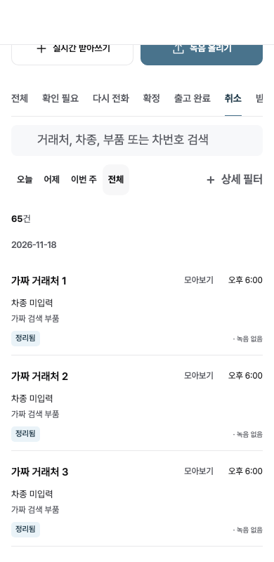
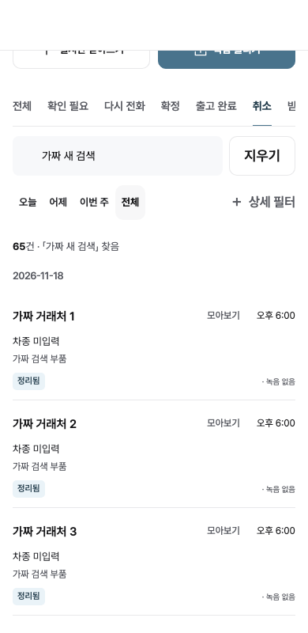

> AI 초안 · 돌린 사람: 신*림 · ChatGPT dot · 2026-11-19

# 검색 입력 직후 상세로 이동해도 마지막 입력 보존

## 문제와 수정
목록 검색은 입력 후 350ms 기다렸다 반영한다. 그 전에 기존 검색 결과를 열면 대기 중 입력을 버리고, 뒤로 돌아왔을 때 이전 검색어로 되돌아갔다.

일반 상세 링크를 누를 때 대기 중 입력을 현재 목록 주소와 돌아갈 주소에 먼저 반영한다. 그 자리에서 검색 API를 새로 호출하지 않는다. 현재 목록 history entry만 교체하므로 상세에서 뒤로 돌아오면 마지막 검색어로 조회한다. 새 검색이면 옛 목록의 펼친 건수를 복원하지 않고 첫 30건부터 시작한다. 공백만 다른 같은 검색어는 원래 펼친 건수를 유지한다. 권한 경계와 modifier 클릭은 유지한다.

## 검증
- 실제 calls/call 모듈·격리 라우터·가짜 65건 API. 수정 전 18실패/2통과, 수정 후 20/20 통과.
- 360/390px × 기본/큰글씨 × 입력/비움 × 브라우저 뒤로가기/상세 목록 링크 16조건.
- 390px 큰글씨 60건 펼침에서 새 검색어/공백만 변경 × 두 복귀 방식 4조건. 새 검색은 30건, 공백만 변경은 60건 유지.
- 각 조건에서 입력·URL·요청 query 일치, 취소 필터 유지, 정상 debounce와 지우기 작동 확인.
- 수정 후 기존 목록 복귀 12조건(계정·공간·세션·삭제 대상·지연 응답 경계), Node 191개, 기존 실제 가짜 앱 브라우저 10흐름 통과.
- 기존 자동갱신 15조건도 점검 통과. 최종 전체 CI에 신규 회귀 포함.
- 독립 읽기 리뷰 blocker 없음. 새 검색을 현재 목록 history에 교체하는 방식이지 검색 기록을 별도로 보관하는 기능은 아니다.

## 전후
실제 UI 모듈을 가짜 API에 연결한 390px 큰글씨 화면이다. 모의 API는 요청 인자를 기록하고 고정 목록을 돌려주므로 실제 검색 엔진 결과 정확성을 검증한 것은 아니다.

## 한계
Chromium viewport와 격리 라우터 기반이다. 실제 휴대폰 가상키보드·스크린리더·네이티브 앱·검색 서버는 신규 테스트 범위 밖이다. 실데이터·유료 API·dev 배포·네이티브 승인 대기는 건드리지 않았다.
