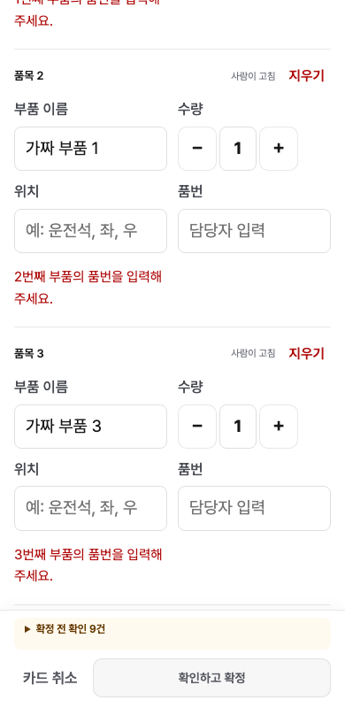
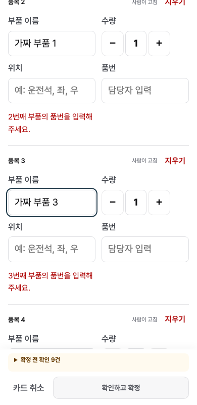

> AI 초안 · 돌린 사람: 신*림 · ChatGPT dot · 2026-11-19

# 모바일 품목 삭제 후 작업 이어가기

## 재현과 수정
주문 카드에서 품목을 지우면 목록이 다시 그려지며 키보드 초점이 body로 사라졌다. 긴 목록에서 다음 품목을 계속 수정하기 어려웠다. 삭제 후 다음 품목의 부품 이름으로, 마지막 품목이면 이전 품목으로 이동한다. 모두 지우면 부품 추가로 이동한다. 편집칸을 화면 중앙에 보여 하단 고정 확인 영역에 가리지 않게 한다. 확인 취소·권한·저장 방식은 그대로다.

## 검증
- 실제 카드 모듈·CSS·HTML 확인창과 가짜 저장 API. 360/390px × 5/10품목 × 기본/큰 글씨 × 중간/마지막/전부/취소/빈 줄 삭제 = 40조건.
- 수정 전 삭제 32조건 초점 소실, 취소 8조건 통과. 수정 후 40조건 통과.
- 편집 초점·다음 Tab의 같은 품목 위치칸·실제 고정 버튼 영역 위 노출·hit test·가짜 저장 결과·draft 상태 유지 확인. 삭제 저장은 최대 5초 조건 대기, 취소는 1100ms 동안 PATCH 0건 확인.
- 실제 가짜 앱 주문↔대화 왕복 10조건 재검증: 5/10품목·360/390px·큰글씨·삭제 후 ID 경계. 모두 통과.
- 실제 가짜 앱 대화 검색 desktop/mobile 2조건: Enter/Shift+Enter·Escape·일치 없음·검색어 보존·큰글씨·쓰기 요청 없음 통과.
- Node 191개와 기존 브라우저 10흐름 통과. 별도 읽기 리뷰 blocker 없음. 신규 회귀 CI 연결.

## 전후 캡처
아래는 실제 카드 모듈을 격리 화면에 올린 가짜 10품목·390px·큰글씨다. 전체 앱 화면이나 실고객 자료가 아니다.

수정 전: 삭제 뒤 초점 소실.

수정 후: 다음 품목 편집칸의 초점과 위치 유지.

## 한계
Chromium 모바일 viewport 검증이다. iOS/Android 실제 가상키보드·visualViewport 축소·스크린리더·네이티브 앱은 미검증이다. 새 40조건은 mock 저장이며 실제 서버 회귀와 구분한다. 실제 자료·유료 API·dev 배포·네이티브 승인 대기를 건드리지 않았다.
