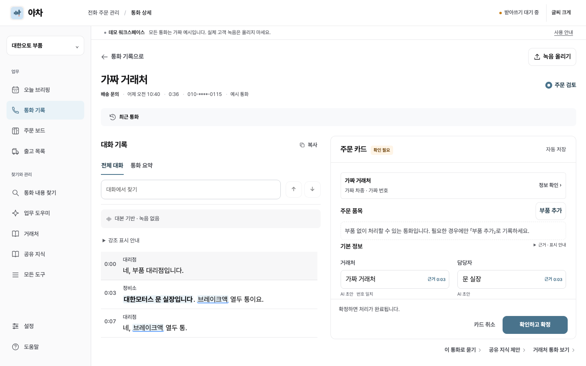
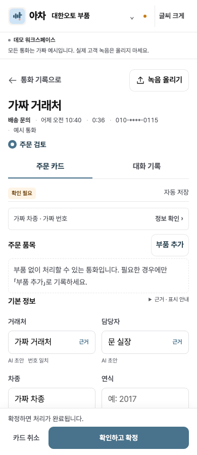

# 문의 카드 빈 상태 안내와 기능 대조
> AI 초안 · 돌린 사람: 신*림 · 도구: ChatGPT dot · 2026-11-19

## 발견한 문제
배송 문의에 품목이 없어도 확정할 수 있는데 화면은 부품 추가를 권했다. 안내의 「부품 줄 추가」도 실제 버튼 「부품 추가」와 달랐다. 주문의 필수 품목 조건을 완화하는 것이 아니라 통화 종류에 맞는 안내로 고친다.

## 시각 개편 후 주요 기능 대조
1.6 요구사항 추적표와 통화 목록·상세·주문 카드 코드를 독립적으로 대조했다. 이 범위에서 시각 개편으로 사라진 주요 기능은 찾지 못했다. 전체 스펙 완료 보장은 아니다.

| 요구와 여정 | 확인한 보존 경계 | 검증 범위 |
|---|---|---|
| 이력 검색→근거→상세 | t/seg 근거 이동, 고객 왕복과 목록 복귀 | 코드 대조, 기존 목록 복귀·원문 회귀 |
| ORD-01/02/03 다품목 수정 | 입력 검증·저장·여러 품목·품번 수동 입력 | 기존 다품목 모듈 mock 회귀와 서버 테스트 |
| AI-04/05/07 및 ORD-07 | 불확실 항목 확인·AI 구분·근거 버튼 | 코드 대조와 기존 가짜 회귀. 실제 모델 정확도·실제 음성 재생 시험 아님 |
| ORD-04/06/09 확정·수정 | 저장 flush 후 revision 기반 확정, 확정 후 읽기 전용, 충돌 처리 | 기존 pending 확정·복구 회귀. 모든 역할 조합을 새로 시험한 것은 아님 |
| AI-09 및 BRD-02 비주문 문의 | 통화 종류에 따른 확정 조건과 출고 대상 분리 | cards.test.mjs의 빈 배송 문의 확정, insights.test.mjs의 출고 목록·CSV 제외 |

## 기존 화면 시험 범위 정정
PR29의 빈 카드 가짜 응답은 `배송문의`라는 비정식 종류 값을 사용했다. 정식 값은 `배송 문의`다. 이 시험은 GET 응답을 바꾼 화면·키보드 검사였으며 실제 문의 저장/확정을 시험한 것으로 볼 수 없다. 이번에 fixture를 정식 값으로 고쳐 재검사한다. 과거 결과 파일은 역사 기록으로 보존한다.

실제 사용자 연구·운영 데이터·유료 AI·dev 배포는 수행하지 않는다.

## 변경과 자체 검증 결과
- 주문은 품목이 필요하다고 안내, 비주문은 필요한 경우에만 추가, 읽기 전용은 등록 없음만 표시한다. 종류 전환·추가/삭제 시 즉시 갱신한다.
- 실제 카드 모듈+mock API 4범위: PC/mobile 각각 주문↔문의 전환·추가삭제·문의 확정·출고 버튼 없음·readonly, 미확인 경고 차단. 오류·외부 요청0.
- 실제 앱+임시 DB+가짜 GET 응답 6뷰, 정식 종류 값과 큰글씨·키보드 회귀 통과. 전체 Node190 통과(서버의 문의 확정·출고 제외 테스트 포함).
- 독립 읽기 검토에서 차단 문제 없음. 새 UI mock 시험과 기존 서버 시험을 조합한 근거이며 하나의 실제 업무 end-to-end 시험은 아니다.

[상호작용 결과](../자료/nonorder-guidance-20261119/interaction-results.json) · [실제 앱 화면 회귀](../자료/nonorder-guidance-20261119/fullapp-results.json)

| PC 가짜 화면 | 모바일 가짜 화면 |
|---|---|
|  |  |
