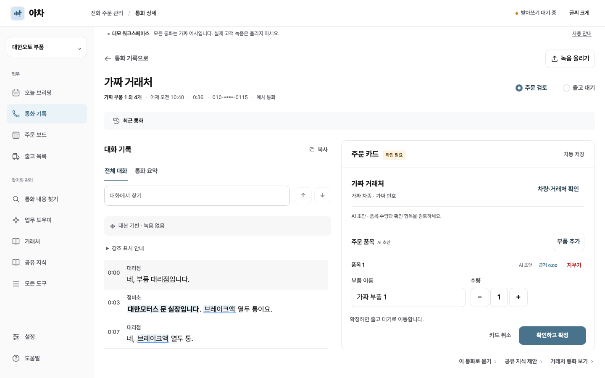
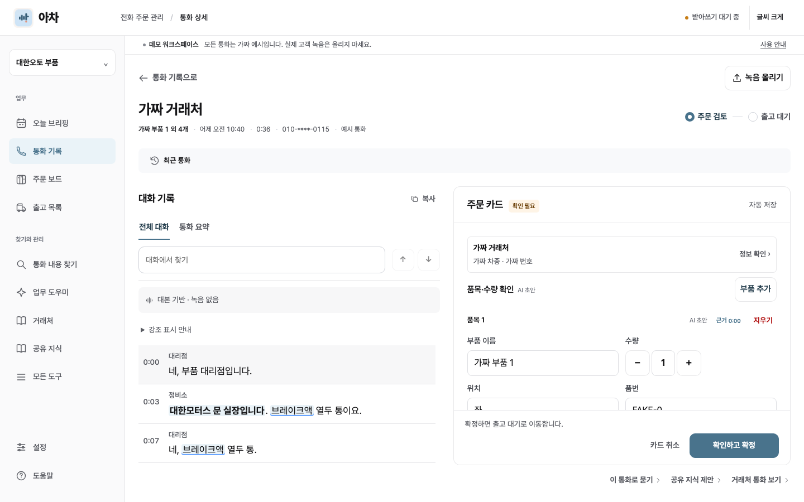
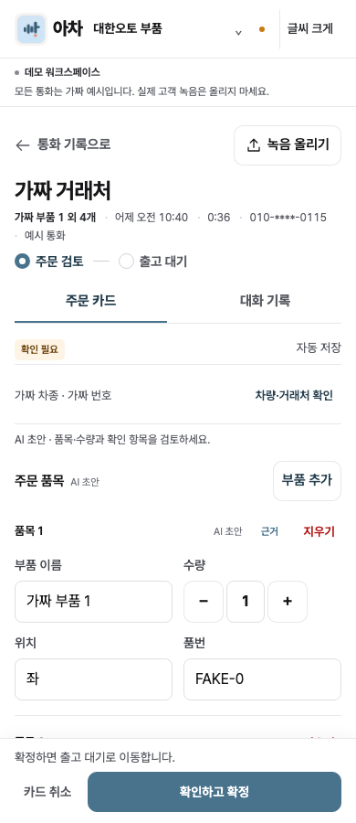
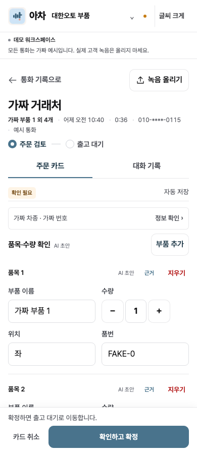

# 주문 카드 첫 품목 노출 개선
> AI 초안 · 돌린 사람: 신*림 · 도구: ChatGPT dot · 2026-11-19

## 무엇을 바꿨나
차량·거래처 요약 전체를 기존 정보 확인 동선으로 묶었다. 접근성 이름에도 고객·차종·번호가 포함된다. 반복되던 검토 안내는 품목·수량 확인 제목과 기존 AI 표시로 통합했다. 빈 카드와 확정 카드는 기존 주문 품목 제목을 유지한다. 차량 정보를 숨기거나 필드를 삭제하지 않았다.

## 실제 가짜 화면 비교
동일 앱·fixture응답·글꼴·스크롤 조건의 5/10품목에서 첫 입력의 화면 Y좌표는 모바일 634.56→594.38px, PC 684.58→627.59px다. 각각 약40/57px 위로 올라왔다. 전체 카드 UX 완성이나 실사용자 효과 측정으로 해석하지 않는다.

| PC 이전 | PC 이후 |
|---|---|
|  |  |

| 모바일 이전 | 모바일 이후 |
|---|---|
|  |  |

## 보존과 검증
실제 앱+고유 임시 DB의 가짜 응답으로 5/10/0품목×PC/mobile 6뷰를 검사했다. 정보 확인 버튼 키보드 동작·44px이상 타깃·큰글씨·수평 넘침을 확인했다. 새 회귀를 CI에 연결한다. 외부/변경 요청과 오류는 0이다. 이 검사는 GET 응답을 합성하며 실제 주문을 바꾸지 않는다.

저장/확정/품목 수정/근거/불확실 검증 로직과 권한은 그대로다. 독립 검토자가 실제 PNG·코드를 읽었다. [새 흐름 결과](../자료/card-first-item-20261119/results.json) · [전후 측정](../자료/card-first-item-20261119/comparison-fake.json).

빈 배송문의의 기존 부품 추가 안내 문구는 이번에 바꾸지 않았다. 실제 사용자 자료·AI·마이크·dev 배포 없음. 기존 vanilla UI를 정돈했으며 공식 Montage React 패키지 도입은 아니다.

추가 재실행: 기존 다품목 13조건·저장 대기 확정 7조건·Node 190개 모두 통과했다. [다품목 결과](../자료/card-first-item-20261119/multiitem-results.json) · [확정 결과](../자료/card-first-item-20261119/confirm-results.json). 이는 가짜 모듈/API 회귀이며 실제 사용자 시험이 아니다.
