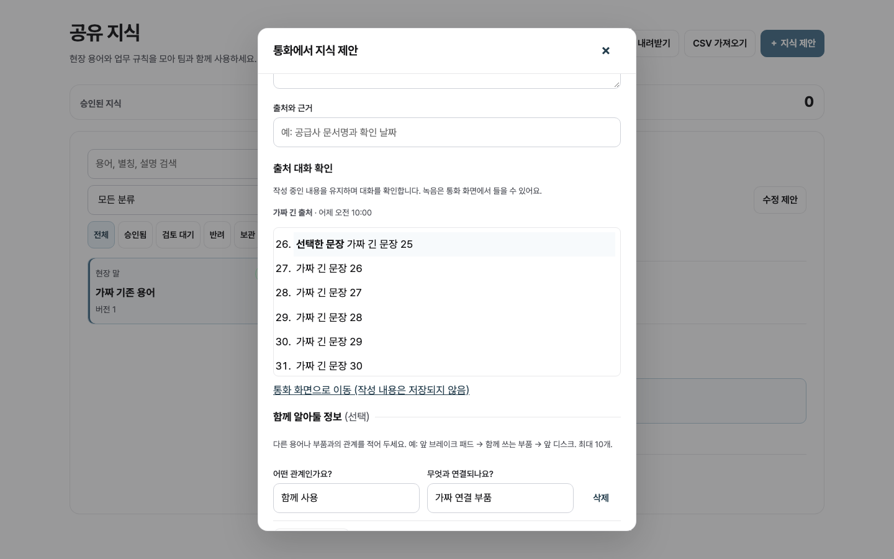
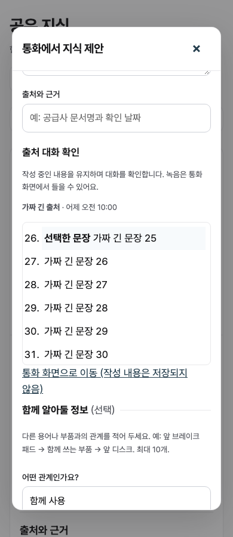

# 지식 제안 출처 확인 중 초안 보존
> AI 초안 · 돌린 사람: 신*림 · 도구: ChatGPT dot · 2026-11-19

## 재현
통화에서 공유 지식 제안으로 들어가 용어·정의를 입력한 뒤 폼의 「출처 통화 열기」를 누르면 같은 탭에서 화면을 떠난다. 돌아오면 입력은 초기값이다. 실제 glossary 모듈과 앱의 hash cleanup/remount를 모사한 가짜 시험에서 작성 용어가 빈 값으로 바뀌었고 POST는 없었다. 실제 사용자 자료는 쓰지 않았다.

## 설계 판단
새 탭만 여는 해법은 채택하지 않았다. Mac 앱 WKWebView의 새 창 처리는 현재 화면에서 탐색하므로 웹 브라우저에서만 초안이 보존되는 해결책이기 때문이다. 폼 안에서 읽기 전용 원문을 확인하고, 전체 통화 화면으로 이동하려면 작성 내용 유실을 알려 명시적으로 선택하게 한다.

전체 사이트 이탈·앱 종료·새로고침의 초안 복구 기능은 아니다. 서버에 자동 초안을 저장하거나 별도 브라우저 저장소를 추가하지 않는다. 기획의 출처 연계·근거 확인 기능을 유지하면서 정상 확인 동선의 유실을 줄이는 범위다. dev 배포 없음.

## 변경 범위
- 제안·수정 폼 안에서 출처 대화를 펼쳐 읽는다. 출처 제목·날짜를 유지하고 선택 문장은 미리보기 안에서 찾아 준다.
- 글은 HTML로 실행하지 않고 안전한 텍스트로 표시한다. 녹음은 기존 통화 화면에서 듣는다.
- 원문 조회 오류는 입력을 그대로 둔 채 재시도한다. 모달을 닫거나 다른 제안을 연 뒤 도착한 응답은 버린다.
- 전체 통화로 이동할 때만 작성 내용이 저장되지 않는다는 확인을 받는다. 저장 중에는 해당 이탈을 막는다. 일반 지식 상세의 출처 링크는 기존 동작이다.

## 자체 검증 결과
신규12범위: 신규/수정 폼×PC/mobile4, 긴 선택문장 내부스크롤2, 조회실패재시도·이탈확인2, 닫힌폼 구응답2, 저장중 이탈차단2. 원문 HTML escape·입력/관계/제출값·포커스·제목/날짜 위치를 확인했다. 오류·외부요청0.

기존 지식 회귀9범위와 Node191도 통과했다. 실제 모듈/CSS와 가짜 API/최소 hash라우터 시험이며 실제 native 앱·녹음·인증·서버 저장 시험은 아니다. 코드는 독립 읽기 검토를 받았다.

[유실 재현](../자료/knowledge-evidence-20261119/before.json) · [신규 회귀](../자료/knowledge-evidence-20261119/results.json) · [기존 지식 회귀](../자료/knowledge-evidence-20261119/existing-knowledge-results.json)

| PC 가짜 모듈 | 모바일 가짜 모듈 |
|---|---|
|  |  |
