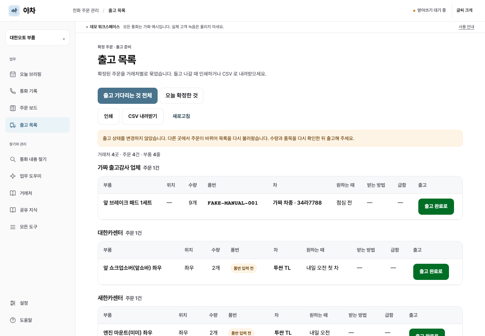
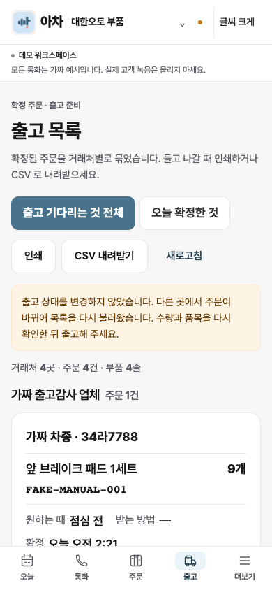

> AI 초안 · 돌린 사람: 신*림 · ChatGPT dot · 2026-11-19

# 오래 열린 출고 목록의 잘못된 출고 방지

## 재현
임시 실제 fixture 서버와 독립 브라우저 두 세션을 사용했다. A 목록에는 수량1·revision3이 보였고, B가 수량9로 수정·재확정해 revision6이 됐다. A의 오래된 버튼은 변경 버전 없이 요청해 최신 수량9를 출고 처리했다. 실제 고객 자료는 사용하지 않았다.

## 수정
- 출고 목록이 표시한 revision을 요청에 보낸다. 다른 곳에서 바뀌면 409로 차단한다.
- 충돌 시 자동 출고 재시도를 하지 않는다. 목록을 다시 불러온 뒤 수량·품목 재검토를 안내한다.
- 다시 불러오지 못하면 완료형 안내를 하지 않고 출고 버튼을 보류한다. 수동 새로고침 성공 후 다시 확인하고 누르게 한다.
- revision이 없는 구형·불완전 응답에서는 변경 요청을 보내지 않는다.

## 검증
- 실제 임시 fixture 서버 두 세션의 5범위: stale409, 최신 수량 안내, 명시적 재시도, 재조회 실패·복구, revision 누락 요청0. PC에서 충돌, 모바일에서 안내 가시성과 명시적 재시도를 확인했다.
- 수정본의 Node188·기존 E2E10을 검증했고, PR19를 포함한 최신 통합에서는 신규5범위·Node188을 다시 통과했다. 통합 전체 E2E는 PR CI로 재확인한다. 독립 읽기 리뷰에서 추가 blocking 없음.
- 시험 서버의 정확한 주소와 임시 자료 경로가 시작 로그에 확인되기 전에는 요청하지 않는다. 포트 충돌 canary 검사에서 다른 서버 요청0회로 실패 종료했다.

## 한계
실사용자 시험이 아니다. 보호 범위는 출고 목록 UI이며 전역 API에 revision을 필수화한 것이 아니다. 같은 scope의 겹친 목록 조회는 오래된 응답이 뒤늦게 표시될 수 있으나 값과 revision이 함께 표시되므로 해당 UI의 stale 출고는 서버가 거절한다. 조회 응답 순서 개선은 후속 항목이다. 기존 이미 출고된 카드의 멱등 응답도 유지한다. dev 배포는 하지 않는다.

[이전 재현](../자료/shipping-revision-20261119/before.json) · [수정 후](../자료/shipping-revision-20261119/results.json) · [포트 안전](../자료/shipping-revision-20261119/port-safety.json)
