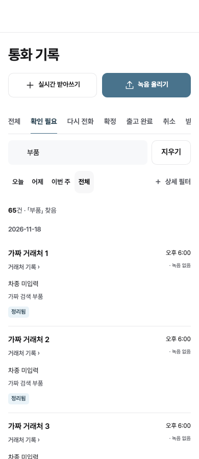
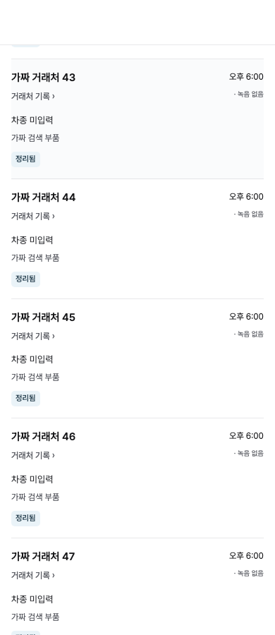
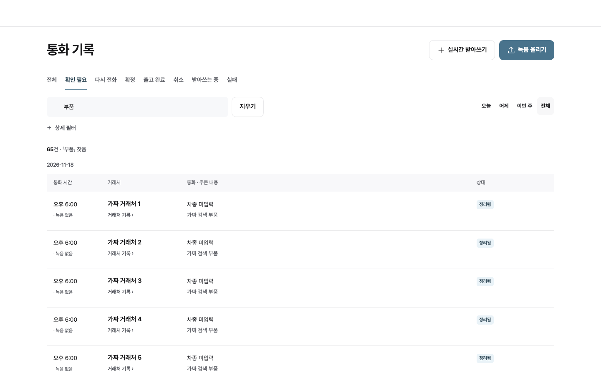
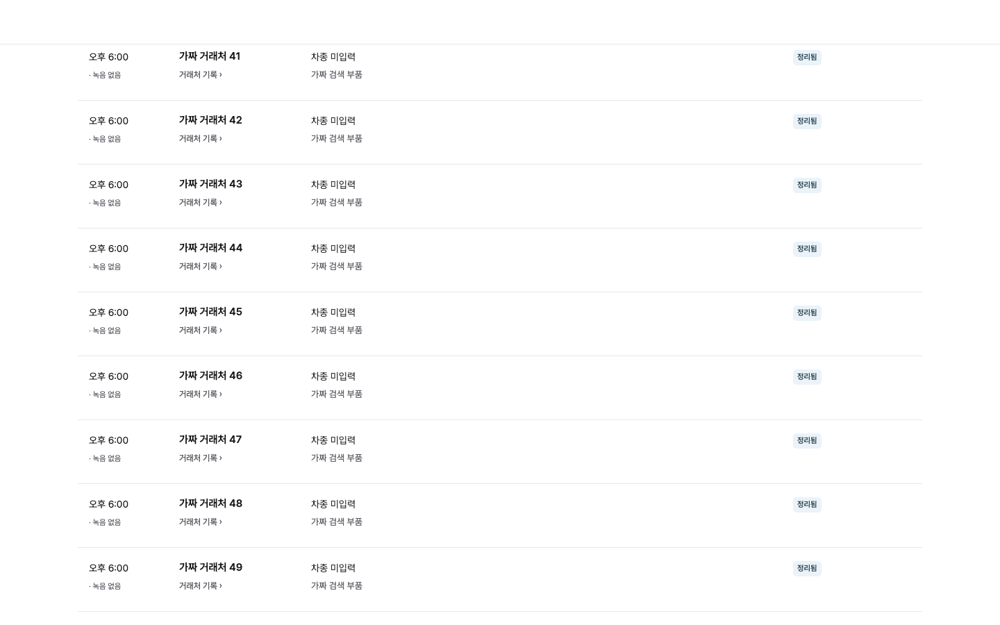

> AI 초안 · 돌린 사람: 신*림 · ChatGPT dot · 2026-11-19

# 통화 상세에서 목록으로 돌아오기

## 문제와 수정
- 가짜 65건 중 60건을 펼친 뒤 45번째 상세를 열고 돌아오면 목록이 30건으로 초기화됐다. PC와 모바일에서 재현했다.
- 직전 목록의 조회 범위·필터 주소·링크를 탭 메모리에만 보관한다. 복귀하면 서버에서 다시 읽고 해당 행에 초점과 위치를 돌려준다. 통화 내용이나 새 저장소를 추가하지 않는다.
- 계정·작업공간·세션이 바뀌거나 다른 필터를 사용하면 복원하지 않는다. 대상 행이 없어졌으면 검색 입력으로 돌아간다.
- 복원 중 화면 이탈·Tab·휠·터치·입력을 하면 늦은 응답이 초점과 위치를 빼앗지 않는다.

## 검증과 한계
- 실제 목록/상세 모듈과 가짜 API·라우팅 하네스 12조건, Node 188개 통과. 내부 검증이며 실사용자 시험이나 전체 앱 통합 검증이 아니다.
- 기존 API·권한·검색 로직은 유지한다. 기존 100건 초과 자동갱신 제한은 별도 후속 항목이다. 처리 중 통화가 있는 100건 초과 목록은 다음 자동갱신에서 다시 줄어들 수 있다.
- 배포 없는 통합 브랜치의 CI로 기존 전체 앱 회귀를 추가 확인한다.

## 가짜 데이터 화면
| 크기 | 이전: 처음 30건으로 초기화 | 이후: 45번째 행으로 복귀 |
|---|---|---|
| 모바일 |  |  |
| PC |  |  |

[가짜 검증 결과](../자료/calls-return-20261119/results.json)
