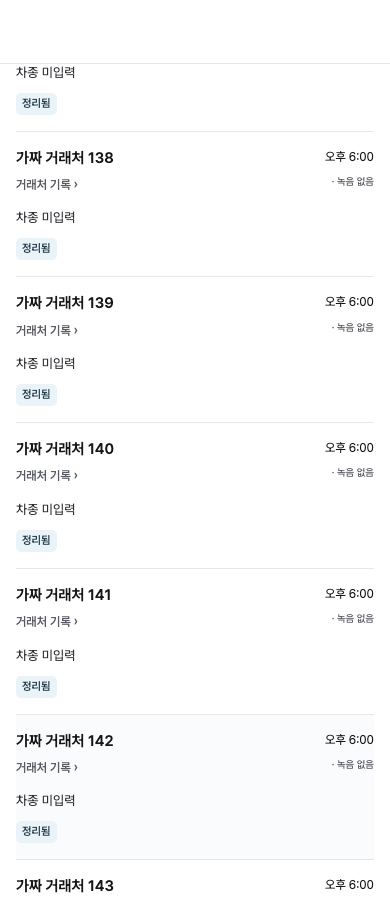
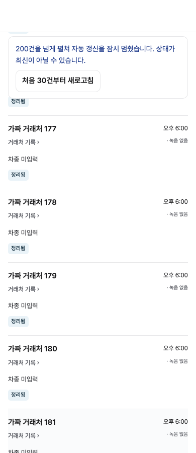

> AI 초안 · 돌린 사람: 신*림 · ChatGPT dot · 2026-11-19

# 목록을 읽는 동안 자동 갱신하기

- 기존에는 150건을 펼쳐도 자동 갱신에서 최대 100건만 다시 읽어 목록이 줄었다. DOM 전체 교체는 링크의 키보드 초점도 없앴다.
- 서버가 지원하는 한 번의 응답 범위인 최대 200건까지 펼친 범위를 다시 읽는다. 응답 적용 직전 사용자가 보고 있는 행·초점을 기준으로 위치를 유지한다. 요청을 시작할 때의 오래된 위치로 돌려보내지 않는다.
- 보고 있는 행이나 초점의 거래처·검색 근거 링크가 사라지면 자동 적용을 멈춘다. 기존 화면과 초점을 보존하고 최신 상태가 아닐 수 있음을 안내한다.
- 200건을 넘게 펼쳤으면 자동 갱신을 보류한다. 현재 위치에서 발견할 수 있는 안내와 ‘처음 30건부터 새로고침’ 버튼을 제공한다. 스피너나 ‘10초마다 새로 봅니다’ 표시를 계속 보여주지 않는다.
- 여러 offset 요청을 이어 붙이는 방식은 사용하지 않는다. 페이지 사이 신규 삽입·삭제가 일어날 때 전체 목록의 일관성이나 누락 없음을 보장하지 않는다. 사용자가 누르는 기존 ‘더 보기’의 서버 페이징 계약도 변경하지 않았다.

## 검증
- 실제 목록 모듈과 가짜 API·시험용 시계로 15조건 통과: PC/모바일150건,200건단일응답,처리완료와갱신중단,신규삽입,응답중사용자이동,검색초점,행/링크소실,210건보류,실패,세션/공간경계.
- Node 188개와 기존 목록 복귀 12조건 통과. 독립 읽기 리뷰 blocking 없음.
- 실사용자 시험, 실제 서버 동시 변경의 전체 일관성 검증, 전체 접근성 인증이 아니다. API·권한과 실데이터는 변경하지 않았다.

## 가짜 화면

[가짜 검증 결과](../자료/calls-refresh-20261119/results.json)
