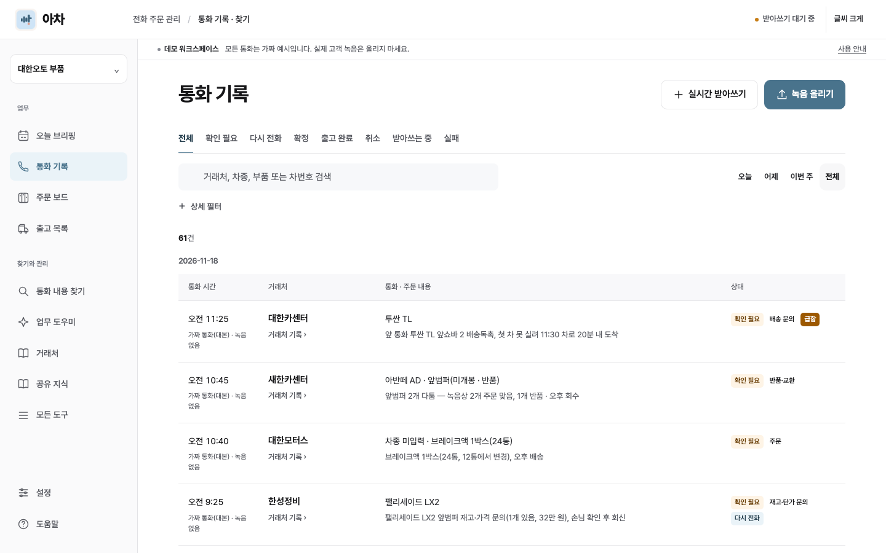
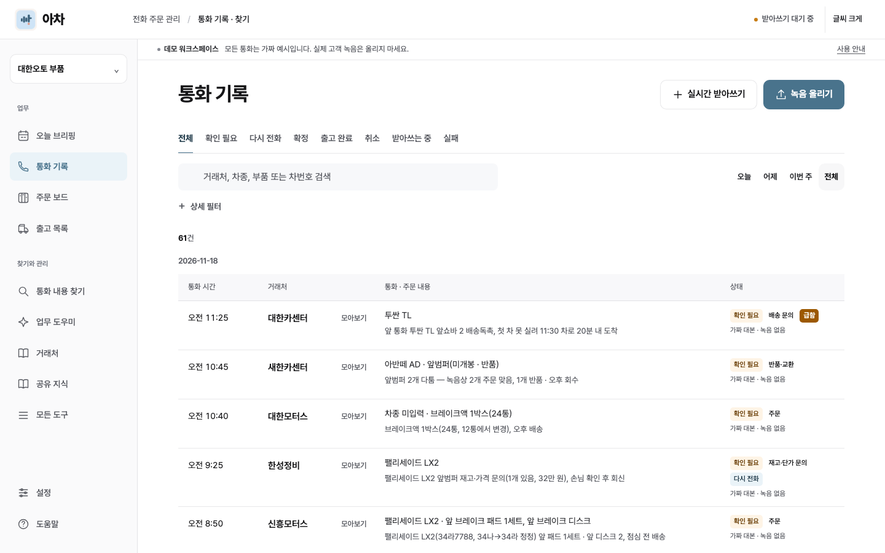
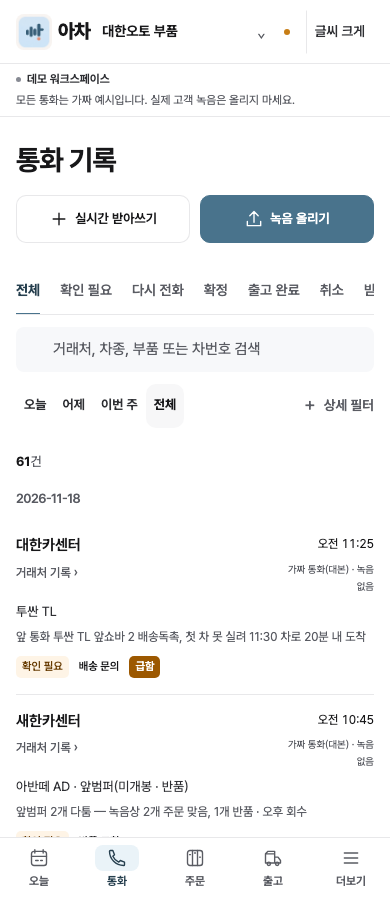
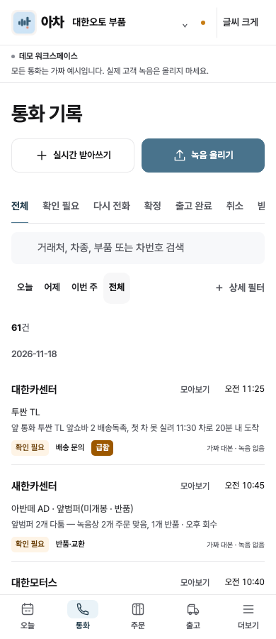

# 통화 목록의 탐색 위계와 밀도 개선
> AI 초안 · 돌린 사람: 신*림 · 도구: ChatGPT dot · 2026-11-19

## 개선
거래처의 다른 통화 링크와 출처 설명이 매 행의 높이를 늘렸다. 거래처·시간을 먼저, 차종·품목을 다음으로 읽도록 정돈했다. 모아보기는 같은 행의 60×44px 보조 링크로 유지했다. 출처·녹음 없음은 상태 영역으로 옮겼다. 요약은 PC 두 줄·모바일 한 줄 미리보기이며 통화 상세의 통화 요약에서 전체를 볼 수 있다. 검색된 근거 문장·오류 설명은 줄이지 않는다.

## 실제 가짜 화면 비교
동일 fixture, 글꼴 준비, scrollY=0, 900px 높이에서 측정했다. 첫 행은 PC 99.4→80px, 모바일 175.2→136px이다. 하단 64px을 보수적으로 제외한 완전 노출 행은 PC 3→4, 모바일 1→2이다. 실제 업무 속도 향상을 측정한 실사용자 연구는 아니다.

| PC 이전 | PC 이후 |
|---|---|
|  |  |

| 모바일 이전 | 모바일 이후 |
|---|---|
|  |  |

## 기준과 보존
[Montage Table](https://montage.wanted.co.kr/docs/components/contents/table/design)의 넓은 화면 비교 구조와 [List cell](https://montage.wanted.co.kr/docs/components/contents/list-cell/design)의 주/부정보 구분 및 조절 가능한 여백을 참고했다. 공식 React 패키지를 설치한 것이 아니라 기존 vanilla UI를 개선했다.

거래처 모아보기·통화 열기·검색 근거·상태/실패·갱신/목록복귀·작업공간 권한은 유지했다. 키보드 이동, 전체 요약 접근, 긴 가짜 거래처·큰 글씨의 수평 넘침을 확인했다. [가짜 측정과 흐름 기록](../자료/calls-density-20261119/results.json).

LNB와 주문 카드 디자인은 이번 변경 대상이 아니다. 모바일 카드의 첫 품목 노출은 후속으로 검토한다. 실제 사용자 자료·외부 AI·dev 배포는 사용하지 않는다.

주 담당이 기존 목록 자동갱신 15범위·상세 왕복 12범위와 Node 190개를 재실행해 통과했다. 독립 검토자는 PC/모바일 PNG와 소스·결과를 확인했고 차단 문제를 발견하지 않았다.

신규 `test:calls-density-e2e`를 CI에 연결했다. 주 담당이 별도 포트의 고유 임시 DB로 두 화면 회귀를 재실행했다. 자신의 서버 시작·DATA_DIR 확인 후에만 접속하고 외부 요청/변경 요청을 차단·단언한다. 결과 오류·외부 요청·변경 요청 0건이다.
