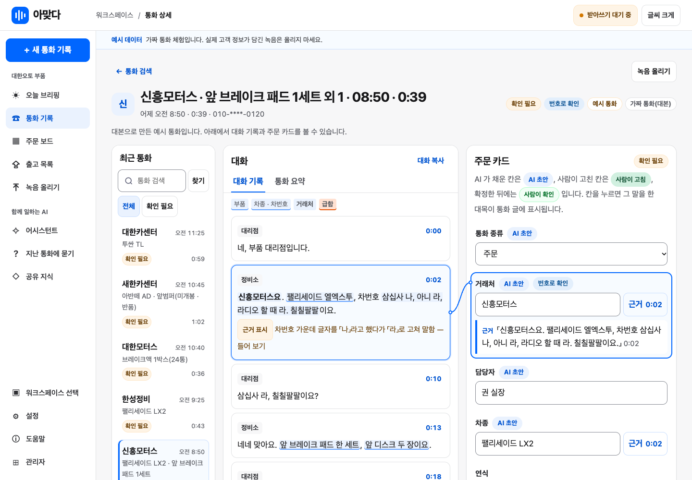
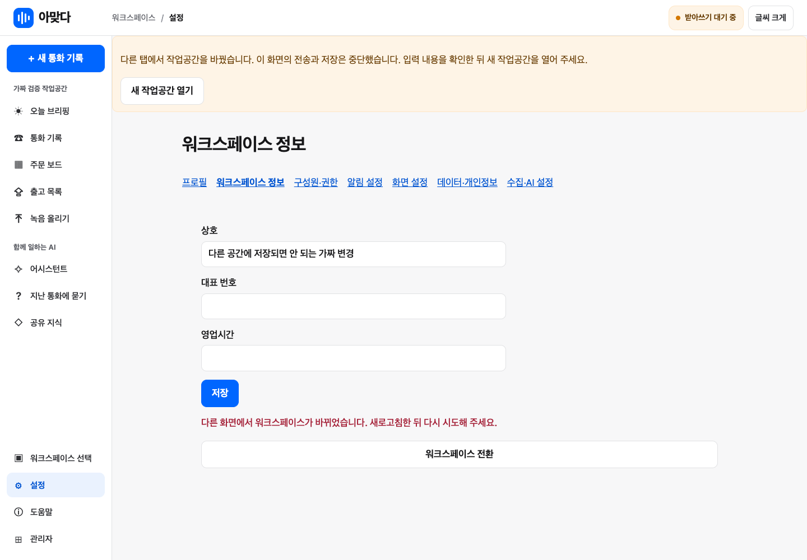

> AI 초안 · 돌린 사람: 신*림 · 도구: Codex(Astra 계획, GPT-6.1 Sol high 병렬 구현·검토) · 2026-11-18

> 후속 변경 안내: 아래 통합·브라우저 검증은 `b86b498` 기준이다. 새 화면 재구성과 Mac/로컬 모델 변경의 최신 검증·차단 상태는 [후속 보고서](v1.6-화면재구성과-Mac로컬앱.md)를 따른다.

# 아맞다 v1.6 구현·검증 보고서

기존 제품 코드에 주문 검토·확정·출고, 계정과 작업공간, 승인형 공유 지식과 어시스턴트를 통합하고 Wanted Montage 토큰을 적용했다. **로컬 회귀 139개, PC 프로그램 시험 17개, 브라우저 E2E 8개 흐름을 통과했다.** 모든 개발 시험은 가짜 통화와 고정 응답·가짜 클라이언트를 사용했다.

전체 기획서 110개 요구사항을 모두 운영 검증한 결과는 아니다. Docker는 설정 검증까지 통과했고 이미지 빌드·기동은 권한 제약으로 검증하지 못했다. 실제 GPU 인식 품질, 실제 메일 배달, 유료 AI, 전화 시스템 연동과 결제 등은 별도 미완료로 남긴다. [110개 요구사항 추적표](v1.6-요구사항-추적표.md)에서 부분·미구현을 구분한다.

## 변경과 근거

| 영역 | 구현한 내용 | 확인 근거 |
|---|---|---|
| 주문 | 필수 필드·품번·수량·재확인 검증, 전 필드 자동 저장, 확정 잠금, 출고 확인·되돌리기, 재연락 독립 상태, 감사 이력, 수정 충돌 | cards/calls 회귀, 브라우저 저장→확정→출고→새로고침→되돌리기 |
| 데이터 분리 | 이메일 증명·암호 설정, 로그인·초대·역할, 작업공간별 SQLite와 음성 경로 | auth 회귀, 비공개 가입과 다른 공간 통화 접근 404 |
| 지식·어시스턴트 | 승인본 유지와 수정안 분리, 반려·보관·복원·CSV, 출처 문장, 서버 대화 저장, 한정된 행동 제안 | glossary/assistant 회귀, 지식 제안·승인과 fixture 응답 표시 |
| UI | Montage 색상·타이포그래피 토큰, 아맞다 이름·아이콘, 3열 통화 화면, 근거 연결선, 줄별 실시간 샘플·일시 정지, 모바일 메뉴 | 실제 브라우저 캡처와 연결선 경로·문장 강조 검사 |
| AI 비용 | 기본 off, 명시적인 fixture, 유료 호출 이중 허용, 자동 브리핑 생성 제거, 고정 응답 표시 | AI 시험, 외부 요청을 막는 오프라인 API 시험 |
| 자체 설치 | Dockerfile·Compose·환경 예제, 백업/복원·업그레이드 절차, 업종 프로필 버전과 개념·별칭·관계 | Compose 설정 검사, 소스와 설치 문서 대조 |

공식 Montage의 React 컴포넌트 패키지를 사용한 것은 아니다. 기존 vanilla JS 제품에 토큰과 사용 패턴을 적용했다. 출처와 차이는 [디자인 문서](../../../src/app/docs/montage.md)에 기록했다.

## 실행 결과

검증 호스트는 macOS arm64, Node.js 24.19.0, Chromium 157.0.8103.79, Python 3.10.22, NumPy 2.2.6이다. 브라우저 실행은 Playwright 1.64.1을 사용했다.

| 검증 | 명령·방법 | 실제 결과 |
|---|---|---|
| Node 전체 회귀 | `cd src/app && npm test`와 같은 `node --import ./tools/no-paid-ai.mjs --test` | 139 passed / 0 failed / 0 skipped |
| PC 프로그램 | `python3 -m unittest discover -s src/pc-agent/tests -v` | 17 passed. Whisper 모델 대신 가짜 전사기·가짜 서버 사용 |
| 브라우저 | `npm run test:e2e` | 8개 흐름 통과, pageerror 0. 1440×1000·360×800 |
| 오프라인 API | Node 회귀에 포함된 `ai-offline.test.mjs` | 가짜 WAV 업로드→모의 워커→카드·브리핑·근거 질의, 실시간 수량 정정, 알 수 없는 입력의 수동 작성 경로 |
| Compose | `docker compose --env-file src/app/.env.example config --format json` | 비공개·fixture·유료 허용 꺼짐·키 없음·127.0.0.1·영속 볼륨 6조건 통과 |
| Docker 이미지·기동 | daemon 접근 | 소켓 permission denied. 별도 실행 도구 호출도 완료되지 않아 빌드·기동·볼륨 복원 미검증 |
| 정적 검사 | 수정 JS/MJS 구문 검사, `git diff --check` | 통과 |

수정·추가한 JS/MJS 63개를 구문 검사했다. 초기 운영 화면 열람 당시에는 자동 브리핑 코드가 있었으므로 그 열람의 과금 여부는 서버 로그 없이 확정하지 못한다. 이후 개발·회귀·브라우저 검증은 로컬 fixture로 한정했고, 이 보고서의 통과 결과는 그 로컬 실행에 해당한다.

시험 로그와 [브라우저 결과 JSON](../자료/e2e-v16/results.json), [Compose 검사 JSON](../자료/e2e-v16/compose-config.json)은 증거 폴더에 둔다. [재실행 방법](../자료/e2e-v16/README.md)과 무과금 CI를 함께 제공한다. CI가 실제 통과했는지는 GitHub 실행 결과를 별도로 확인해야 한다.

### 브라우저로 확인한 8개 흐름

1. 통화 상세의 실제 서버 데이터, 근거 클릭, 원문 강조, SVG 연결선.
2. 품번·메모 자동 저장, 재확인 처리, 확정 잠금, 재연락 상태 유지, 출고 확인, 새로고침 유지, 잠긴 카드 수정 409, 출고 되돌리기.
3. 360px 화면에서 통화 상세 사용과 가로 넘침 없음.
4. 어시스턴트 질문과 근거 응답, ‘테스트 응답’ 표시.
5. 지식 초안 저장 후 별도 승인.
6. 실시간 샘플의 일시 정지, 중도 종료와 저장.
7. 비공개 가입·인증·로그인·작업공간 생성·설정, 다른 공간의 데모 통화 접근 거절, 업로드 동의 안내.
8. 다른 탭에서 작업공간을 바꾼 뒤 이전 탭의 설정 저장과 데이터 내보내기 409.

## 최종 검토에서 발견해 고친 문제

| 문제 | 수정 | 회귀 근거 |
|---|---|---|
| 삭제한 통화가 대화 이력·출처·요약에 남거나 생성 중인 응답이 다시 저장됨 | 제공한 통화 문맥을 기록해 관련 대화를 삭제하고 지식의 통화 출처를 분리한다. 삭제 세대가 달라지면 진행 중인 어시스턴트·브리핑 결과 저장을 거부한다. | assistant 및 insights의 삭제 경합 시험 |
| 다른 탭에서 바뀐 세션 작업공간으로 저장됨 | 열린 화면의 작업공간 ID를 고정하고 API 헤더·음성/내보내기 URL에 전달한다. 서버가 일치 여부를 검사한다. | auth 회귀, 브라우저 8번째 흐름 |
| 녹음 파일의 브라우저 캐시가 권한 변경 후 남음 | 전체·부분 응답을 `no-store`로 변경하고 가짜 녹음 파일명만 별도로 표시한다. | calls의 200·206 응답 검사 |
| 제3자의 미인증 선가입으로 실제 메일함 소유자가 가입하지 못함 | 유효한 인증 링크로 메일함 소유권을 증명한 사람이 최종 비밀번호를 설정한다. 이전 암호는 로그인할 수 없다. | auth의 선가입·인증·암호 교체 시험 |
| 실제 미구현된 마스킹 전송을 설정 UI·설치 문서에서 가능하다고 표시 | `masked`는 외부 전송 차단 상태임을 표시한다. `configured`의 원문 전송 가능성을 명시한다. | UI·설치 문서·제공자 조건 대조 |
| 비공개 PC 상태 확인이 익명 요청으로 실패 | PC check에서 워커 토큰을 보내고 서버는 해당 작업공간에 한정해 응답한다. | auth의 워커 범위 시험, PC 프로그램 회귀 |
| 계정 DB 장애에도 서버가 정상으로 표시 | 시작 단계와 health 검사에 계정 DB를 포함한다. | router/health 및 auth 회귀 |
| 기획의 입력 길이와 구현 길이가 다름 | 공통 프로필에 고객 50·담당자 30·차종 30·부품 50·메모 500자와 네 자리 연식 규칙을 둔다. 기존 긴 값은 무관한 수정 시 보존한다. | cards의 경계값·기존 데이터 보존 시험 |

## 미완료와 도입 조건

- **실제 인식·모델 품질**: 실제 통화 녹음, 집 GPU의 Whisper, 유료 Claude는 호출하지 않았다. 합성 61건의 시드 카드와 고정 응답을 정확도 평가로 사용하지 않는다. 화면에 표시된 가짜 데이터는 운영 성능의 증거가 아니다.
- **메일·약관**: 계정 메일은 서버 outbox 전달 방식이다. 실제 메일 발송 연동은 없으며 설치 운영자의 중계가 필요하다. 이용·개인정보 안내는 설치용 초안이고 법률 검토 완료 문서가 아니다.
- **설치**: Docker 이미지·실행·백업 복원은 미검증이다. HTTPS, 볼륨 암호화, 자동 백업 스케줄은 운영 환경에서 구성해야 한다.
- **여러 작업공간의 전사**: 계정·데이터는 분리하지만 한 인스턴스의 워커는 `WORKER_WORKSPACE_ID` 하나만 처리한다. 다른 공간은 일감이 대기한다. 다중 워커 토큰별 라우팅은 확장 대상이다.
- **업종 설정**: 기본 제공은 `automotive@1` 하나다. 개념·관계·검증·필드 라벨을 소스의 프로필로 확장할 수 있지만 임의 업종 스키마를 UI에서 자유롭게 만드는 기능은 아니다. [확장 안내](../../../src/app/docs/업종-프로필.md)
- **남은 기능**: 생성 토큰 스트리밍, 외부 간편 로그인, 교환기 연동, 요금제·결제, 전체 운영 콘솔 등은 추적표의 미완료 항목이다. 카드 충돌 UI·오프라인 재시도, 전체 브라우저 2개 버전·접근성 전수 감사도 이번 브라우저 증거에 포함되지 않는다.
- **기존 데이터 이전**: 기존 단일 DB는 지정한 `LEGACY_WORKSPACE_OWNER_EMAIL` 소유자가 인증한 뒤 인계한다. 공개 데모와 실제 데이터 볼륨을 분리하고 병합·배포 전에 전체 볼륨을 백업해야 한다. 이 PR에서 운영 서버 배포나 데이터 이전을 실행하지 않는다.

## 진행 기록과 Goal 기능

기획서 검토 기록 초안은 참고만 했으며 구현·시험 결과와 분리해 갱신했다. 작업 중 도구 호출이 장시간 완료되지 않아 중단된 구간이 있었고, 파일과 기존 E2E 결과를 보존한 뒤 이어서 검증했다. 밤새 끊김 없이 실행됐다고 기록하지 않는다.

현재 제공된 도구에는 Goal 등록·조회 기능이 노출되지 않는다. 따라서 `/goal`이 실제 Goal로 등록됐는지 확인하거나 새로 등록할 수 없었다. 이는 등록 API를 호출해 받은 오류가 아니라 기능 미노출이다. 자동화 기능을 Goal로 대체 등록하지 않았다.

기획의 모순과 제안은 [검토와 구현계획](v1.6-검토와-구현계획.md)에 별도로 정리했다. GitHub 제출은 `taejs` 계정의 작업 브랜치에서 PR로 진행하며 `main`·`dev`에 직접 반영하지 않는다.
